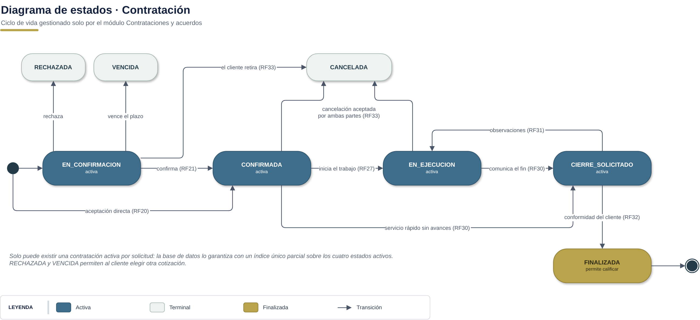
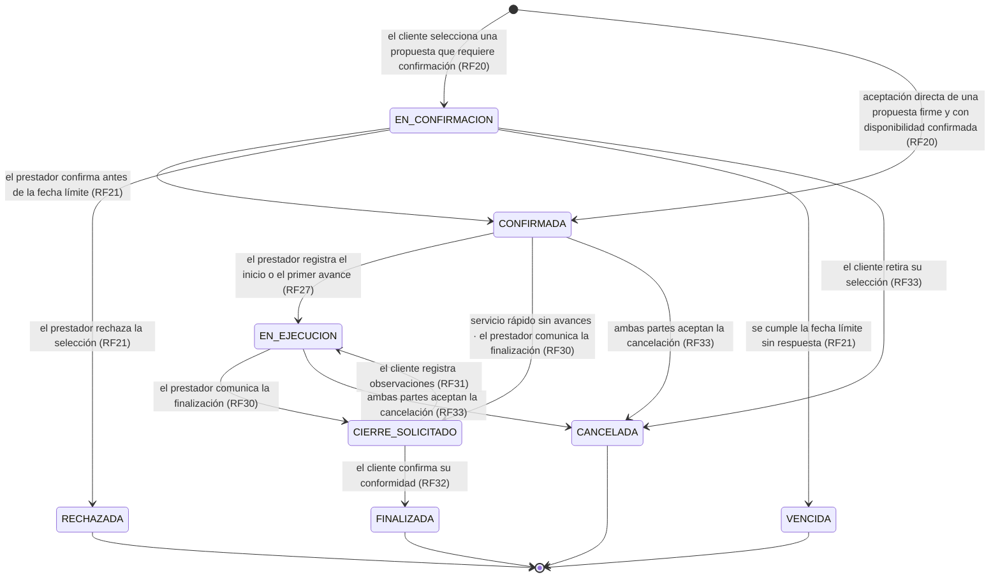
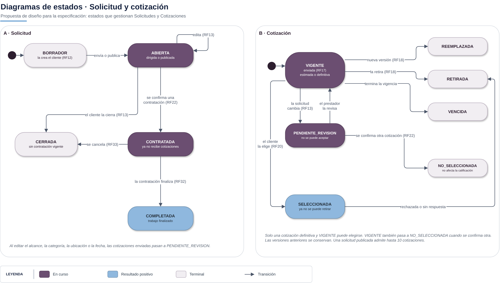

# Requisitos funcionales

Los requisitos funcionales indican qué debe hacer la plataforma para atender las necesidades de clientes, prestadores y administrador.

Cada requisito tiene un identificador y un criterio de aceptación. Este criterio señala qué debemos comprobar para confirmar que la función trabaja correctamente.

Las funciones se desarrollarán por entregas, manteniendo el alcance completo del proyecto. La columna **Prioridad** indica la entrega de cada requisito según el método MoSCoW, explicado en el apartado 4.

## 1. Requisitos funcionales

### 1.1. Registro, acceso y perfiles

| ID | Requisito funcional | Criterio de aceptación | Prioridad |
|---|---|---|---|
| RF01 | El sistema debe permitir crear cuentas de clientes y prestadores. | La cuenta se registra con los datos obligatorios válidos y sin repetir el identificador de acceso. Una cuenta puede tener ambos perfiles. | Debe (MVP) |
| RF02 | El sistema debe permitir iniciar y cerrar sesión. | Las credenciales válidas permiten acceder. Después de cerrar sesión, las operaciones privadas requieren una nueva autenticación. Después de varios intentos fallidos consecutivos se aplica una espera antes de permitir otro intento. | Debe (MVP) |
| RF03 | El sistema debe permitir recuperar el acceso a una cuenta. | El usuario puede cambiar su contraseña después de completar la verificación. Una solicitud vencida o ya utilizada no permite cambiarla nuevamente. | Debe (MVP) |
| RF04 | El sistema debe controlar el acceso según los permisos y la participación del usuario en cada operación. | Los usuarios no pueden modificar operaciones ajenas ni acceder a funciones administrativas sin autorización. | Debe (MVP) |
| RF05 | El sistema debe permitir consultar y actualizar los datos autorizados del perfil. | Los cambios válidos quedan guardados y la información privada no aparece en el perfil público. | Debe (MVP) |
| RF06 | El sistema debe permitir al prestador registrar su tipo, especialidades, experiencia, zonas de atención, disponibilidad y trabajos anteriores. | El perfil muestra los datos registrados y presenta la disponibilidad como información declarada por el prestador, sin garantizar una reserva de horario. | Debe (MVP) |
| RF07 | El sistema debe permitir presentar documentos para la verificación del prestador y consultar su revisión. | El prestador puede conocer si la revisión está pendiente, aprobada o requiere correcciones. Los documentos privados no se publican. | Debería |

### 1.2. Publicación y búsqueda de servicios

| ID | Requisito funcional | Criterio de aceptación | Prioridad |
|---|---|---|---|
| RF08 | El sistema debe permitir al prestador publicar, editar, pausar y retirar sus servicios. | Solo el propietario puede administrar sus publicaciones. Los servicios pausados o retirados no admiten nuevas solicitudes, pero conservan sus contrataciones anteriores. | Debe (MVP) |
| RF09 | El sistema debe permitir buscar servicios y prestadores por especialidad, zona, disponibilidad declarada y calificación. | Los resultados corresponden a los filtros seleccionados. Se informa cuando no existen coincidencias y se identifica a los prestadores que todavía no tienen valoraciones. | Debe (MVP) |
| RF10 | El sistema debe permitir consultar el detalle del servicio y el perfil público del prestador. | Se muestran servicios, experiencia, trabajos anteriores, valoraciones y verificaciones disponibles, distinguiendo los datos declarados de los revisados. | Debe (MVP) |
| RF11 | El sistema debe permitir describir una necesidad con palabras cotidianas y recibir ayuda de inteligencia artificial para orientar la búsqueda. | El cliente puede revisar y corregir la interpretación. Los resultados provienen de los registros de la plataforma y los filtros siguen disponibles si la asistencia falla. | Debería |

### 1.3. Solicitudes, contacto y visitas

| ID | Requisito funcional | Criterio de aceptación | Prioridad |
|---|---|---|---|
| RF12 | El sistema debe permitir crear solicitudes dirigidas a un prestador o publicadas para recibir propuestas. | La solicitud registra descripción, categoría, zona y fecha o periodo deseado, con fotografías y medidas cuando correspondan. Puede guardarse como borrador antes de enviarse o publicarse. | Debe (MVP) |
| RF13 | El sistema debe permitir editar y cerrar solicitudes antes de confirmar una contratación. | Los cambios quedan registrados. Si cambian el alcance, categoría, ubicación o fecha, se avisa a los prestadores interesados y sus cotizaciones quedan pendientes de revisión antes de poder aceptarse. Si existe una selección pendiente, esta se retira. | Debe (MVP) |
| RF14 | El sistema debe permitir al prestador consultar solicitudes publicadas compatibles con sus servicios y solicitudes dirigidas a su perfil. | El prestador puede revisar las solicitudes disponibles para él, sin acceder a solicitudes privadas dirigidas a otros. | Debe (MVP) |
| RF15 | El sistema debe facilitar el contacto mediante llamada o WhatsApp utilizando datos autorizados. | El usuario puede iniciar el contacto. Abrir el enlace no confirma una contratación ni permite a la plataforma leer la conversación externa. | Debería |
| RF16 | El sistema debe permitir proponer y confirmar visitas técnicas. | La visita registra fecha, horario y costo, incluido cero si es gratuita. Ambas partes aceptan las condiciones y se indica si el costo se descontará de un trabajo posterior. | Debería |

### 1.4. Cotizaciones y selección

| ID | Requisito funcional | Criterio de aceptación | Prioridad |
|---|---|---|---|
| RF17 | El sistema debe permitir elaborar y enviar cotizaciones vinculadas a la versión vigente de una solicitud. | La propuesta indica alcance, exclusiones, materiales, mano de obra, precio o forma de calcularlo, plazo, vigencia y condiciones de pago. Se distingue si es estimada o definitiva. | Debe (MVP) |
| RF18 | El sistema debe permitir solicitar aclaraciones, actualizar y retirar cotizaciones todavía no contratadas. | Las aclaraciones y versiones anteriores se conservan. Una propuesta reemplazada o retirada no puede aceptarse. Para modificar una contratación confirmada se utiliza una propuesta de cambio. | Debe (MVP) |
| RF19 | El sistema debe permitir comparar cotizaciones de una misma solicitud. | Se muestran precios, trabajos incluidos, materiales, plazos y condiciones. Los datos faltantes y los importes estimados se identifican, sin presentarlos como condiciones definitivas. | Debe (MVP) |
| RF20 | El sistema debe permitir al cliente seleccionar o aceptar una cotización definitiva y vigente. | Si requiere confirmación, queda pendiente del prestador. Si tiene condiciones y disponibilidad confirmadas para aceptación directa, se registra la contratación. Una estimación debe convertirse en propuesta definitiva antes de contratar. No se aceptan propuestas vencidas, retiradas o pendientes de revisión. | Debe (MVP) |
| RF21 | El sistema debe permitir al prestador confirmar o rechazar una selección pendiente dentro de un plazo visible para ambas partes. | La selección registra una fecha límite calculada según el plazo configurado, sin superar la vigencia de la cotización. Si se rechaza o vence, el cliente puede seleccionar otra propuesta. Se impide mantener dos selecciones pendientes o generar dos contrataciones activas para la misma solicitud. | Debe (MVP) |
| RF22 | El sistema debe actualizar y comunicar el resultado de las propuestas. | Al confirmar una contratación, la solicitud deja de recibir propuestas y las restantes propuestas pendientes quedan como no seleccionadas. Se avisa a sus autores sin afectar su calificación. | Debe (MVP) |

### 1.5. Acuerdos y documentos

| ID | Requisito funcional | Criterio de aceptación | Prioridad |
|---|---|---|---|
| RF23 | El sistema debe conservar y permitir descargar el resumen de una contratación confirmada. | Ambas partes consultan la misma versión del acuerdo, con participantes, trabajo, precio, materiales, plazos y condiciones de pago. Se conservan las confirmaciones y sus fechas. | Debería |
| RF24 | El sistema debe permitir preparar y conservar un documento de contratación detallado cuando se necesite. | El documento puede revisarse y descargarse. Su aceptación registra a ambas partes, la versión y las fechas. Se distingue entre borrador, versión aceptada y copia firmada adjunta; adjuntar una copia no verifica automáticamente las firmas. | Debería |
| RF25 | El sistema debe permitir proponer, aceptar o rechazar cambios de alcance, precio o plazo de una contratación. | Cada propuesta muestra las modificaciones y sus efectos sobre el acuerdo. Solo se incorpora cuando ambas partes la aceptan. Se conservan las condiciones y versiones anteriores. | Podría |

### 1.6. Seguimiento, pagos directos y finalización

| ID | Requisito funcional | Criterio de aceptación | Prioridad |
|---|---|---|---|
| RF26 | El sistema debe mostrar el estado de la contratación y controlar sus cambios. | Solo los participantes autorizados pueden realizar las transiciones permitidas, dejando registro del responsable y la fecha. | Debe (MVP) |
| RF27 | El sistema debe permitir registrar y consultar avances, fotografías y entregas. | El prestador registra avances y el cliente los consulta. Los trabajos grandes pueden organizarse por etapas, sin exigirlas para los servicios rápidos. | Debería |
| RF28 | El sistema debe permitir al cliente registrar pagos realizados directamente al prestador. | El registro incluye monto, fecha y medio de pago, con comprobante opcional, y queda pendiente de confirmación. La plataforma no procesa ni retiene el dinero. | Debería |
| RF29 | El sistema debe permitir al prestador confirmar la recepción de un pago o comunicar una diferencia. | La respuesta y su fecha quedan registradas. Un comprobante adjunto no confirma automáticamente el pago. Si existe una diferencia, se conserva la declaración original y la observación. | Debería |
| RF30 | El sistema debe permitir al prestador comunicar la finalización y solicitar la revisión del cliente. | La contratación queda pendiente de conformidad y el cliente recibe un aviso. Esta acción no finaliza automáticamente el trabajo. | Debe (MVP) |
| RF31 | El sistema debe permitir registrar y atender observaciones del trabajo. | El cliente registra observaciones y el prestador responde e informa su atención. El cliente puede confirmar su resolución o mantenerlas pendientes. | Debe (MVP) |
| RF32 | El sistema debe permitir al cliente confirmar su conformidad y finalizar la contratación. | La confirmación queda registrada cuando no existen observaciones abiertas. La falta de respuesta no cierra el trabajo y la finalización no confirma automáticamente pagos pendientes. | Debe (MVP) |
| RF33 | El sistema debe permitir solicitar y registrar cancelaciones. | Antes de contratar, el cliente puede retirar su selección o cerrar la solicitud. Después de contratar, una parte propone la cancelación con motivo y condiciones, y la otra acepta o rechaza. Solo la aceptación la registra como cancelada; ante rechazo o falta de acuerdo, se puede abrir una incidencia. El historial y los pagos registrados se conservan. | Debería |
| RF34 | El sistema debe permitir calificar y comentar contrataciones finalizadas y confirmadas. | Solo el cliente participante puede registrar una valoración por contratación, con una puntuación de 1 a 5 y comentario opcional. No se permite calificar simples contactos ni propuestas no seleccionadas. | Debería |

### 1.7. Avisos, historial e incidencias

| ID | Requisito funcional | Criterio de aceptación | Prioridad |
|---|---|---|---|
| RF35 | El sistema debe generar avisos sobre solicitudes, propuestas, visitas, contrataciones y cambios relevantes. | Los avisos se muestran a sus destinatarios y pueden enviarse por los canales externos habilitados. Una falla de envío no anula la operación registrada. | Debe (MVP) |
| RF36 | El sistema debe permitir consultar el historial de operaciones propias. | El usuario puede revisar solicitudes, propuestas, acuerdos, contrataciones y pagos, con filtros por fecha o estado, sin acceder al historial privado de otras personas. | Debería |
| RF37 | El sistema debe permitir reportar problemas relacionados con usuarios, publicaciones o contrataciones. | El reporte registra motivo, descripción, referencia y evidencias opcionales, y recibe un identificador de seguimiento. Reportar un problema no cancela automáticamente una contratación. | Podría |
| RF38 | El sistema debe permitir consultar el estado de un reporte y aportar información durante su revisión. | El usuario puede conocer el estado y las respuestas que le corresponden, además de atender solicitudes de información. Las notas administrativas privadas no aparecen en su consulta. | Podría |

### 1.8. Administración

| ID | Requisito funcional | Criterio de aceptación | Prioridad |
|---|---|---|---|
| RF39 | El sistema debe permitir gestionar categorías y subcategorías. | El administrador puede crearlas, actualizarlas, activarlas y desactivarlas sin modificar el código. Desactivarlas impide nuevas publicaciones, pero no elimina registros anteriores. | Debe (MVP) |
| RF40 | El sistema debe permitir gestionar cuentas y permisos autorizados. | Las restricciones, suspensiones y cambios de permisos registran motivo y responsable, sin borrar automáticamente el historial de trabajos. | Podría |
| RF41 | El sistema debe permitir revisar la información presentada para verificar prestadores. | El administrador puede aprobar, rechazar o solicitar correcciones, indicando qué se revisó y el motivo del resultado. La verificación de identidad no se presenta como garantía de calidad técnica. | Debería |
| RF42 | El sistema debe permitir moderar publicaciones y valoraciones. | Las restricciones o retiros quedan justificados y registrados. Se conserva el contenido original para revisión autorizada y no se permite inventar ni reescribir opiniones para favorecer a un usuario. | Podría |
| RF43 | El sistema debe permitir atender incidencias y registrar su resultado. | El administrador puede solicitar información, registrar acciones y comunicar una respuesta. Cerrar una incidencia no modifica automáticamente precios, pagos ni condiciones aceptadas por las partes. | Podría |
| RF44 | El sistema debe permitir consultar reportes de actividad. | El administrador autorizado puede consultar cantidades de usuarios, servicios, solicitudes, propuestas y contrataciones por periodo y filtros disponibles. | Podría |
| RF45 | El sistema debe registrar las acciones administrativas. | Se puede identificar quién realizó cada acción, cuándo, sobre qué registro y el motivo cuando corresponda. | Podría |

## 2. Relación entre historias de usuario y requisitos funcionales

| Historia de usuario | Requisitos funcionales relacionados |
|---|---|
| HU01 Registro y acceso | RF01, RF02, RF03, RF04 |
| HU02 Actualización del perfil | RF05 |
| HU03 Presentación del prestador | RF06, RF07 |
| HU04 Publicación de servicios | RF08 |
| HU05 Búsqueda y consulta de prestadores | RF09, RF10 |
| HU06 Búsqueda con lenguaje cotidiano | RF11 |
| HU07 Registro y publicación de solicitudes | RF12, RF13 |
| HU08 Consulta de oportunidades de trabajo | RF14 |
| HU09 Comunicación y visitas | RF15, RF16 |
| HU10 Elaboración de cotizaciones | RF17, RF18 |
| HU11 Comparación y aclaración de propuestas | RF18, RF19 |
| HU12 Selección y confirmación de contratación | RF20, RF21 |
| HU13 Resultado de las propuestas | RF22 |
| HU14 Consulta y conservación de acuerdos | RF23, RF24 |
| HU15 Cambios en las condiciones | RF25 |
| HU16 Seguimiento y avances | RF26, RF27 |
| HU17 Registro y confirmación de pagos directos | RF28, RF29 |
| HU18 Comunicación de finalización y atención de observaciones | RF30, RF31 |
| HU19 Revisión y conformidad del cliente | RF31, RF32 |
| HU20 Cancelación | RF33 |
| HU21 Calificación del servicio | RF34 |
| HU22 Avisos | RF35 |
| HU23 Consulta del historial | RF36 |
| HU24 Reporte y seguimiento de problemas | RF37, RF38 |
| HU25 Gestión de categorías | RF39 |
| HU26 Revisión de cuentas, prestadores y publicaciones | RF40, RF41, RF42, RF45 |
| HU27 Atención de incidencias | RF43, RF45 |
| HU28 Reportes de actividad | RF44 |

## 3. Ciclo de vida de una contratación

Los requisitos RF20, RF21 y RF26 a RF33 describen cómo avanza una contratación. El diagrama reúne esos estados en un solo modelo. El módulo **Contrataciones y acuerdos** es el único responsable de cambiar el estado; los demás módulos registran su información y le solicitan la transición.

[Archivo editable en Draw.io](../../img/fuentes-svg/estados-contratacion.drawio) · [Versión SVG](../../img/fuentes-svg/estados-contratacion.svg)

El mismo modelo se conserva en formato Mermaid para que pueda leerse como texto y versionarse junto con los requisitos:

| Estado | Significado | ¿Cuenta como contratación activa? |
|---|---|---|
| EN_CONFIRMACION | Selección pendiente: el prestador debe confirmar antes de la fecha límite. | Sí |
| CONFIRMADA | Acuerdo registrado; el trabajo todavía no empieza. | Sí |
| EN_EJECUCION | El trabajo está en curso; se registran avances y pagos directos. | Sí |
| CIERRE_SOLICITADO | Pendiente de conformidad: el prestador comunicó la finalización. | Sí |
| FINALIZADA | El cliente confirmó su conformidad. Permite calificar (RF34). | No |
| RECHAZADA | El prestador rechazó la selección. El cliente puede elegir otra propuesta. | No |
| VENCIDA | Venció la fecha límite sin respuesta. El cliente puede elegir otra propuesta. | No |
| CANCELADA | La selección se retiró o ambas partes aceptaron la cancelación. | No |

**Reglas del ciclo de vida:**

- Una solicitud solo puede tener **una contratación activa** a la vez. Esta regla impide tanto dos selecciones pendientes como dos contrataciones confirmadas (RF21).
- La fecha límite de confirmación se calcula con un plazo que define la plataforma como parámetro de configuración y nunca supera la vigencia de la cotización.
- Una propuesta de cancelación o de cambio de condiciones no cambia el estado por sí sola: queda pendiente hasta que la otra parte la acepta.
- Un servicio rápido puede pasar de CONFIRMADA a CIERRE_SOLICITADO sin registrar avances; los trabajos grandes pasan por EN_EJECUCION.
- La falta de respuesta del cliente no lleva a FINALIZADA (RF32). Cada transición registra al responsable y la fecha (RF26).

### Estados de la solicitud y de la cotización

La contratación depende de los estados de la solicitud y de la cotización, que gestionan los módulos Solicitudes y visitas y Cotizaciones. Este modelo es la propuesta que tomará la especificación del sistema.

[Archivo editable en Draw.io](../../img/fuentes-svg/estados-solicitud-cotizacion.drawio) · [Versión SVG](../../img/fuentes-svg/estados-solicitud-cotizacion.svg)

| Entidad | Estado | Significado |
|---|---|---|
| Solicitud | BORRADOR | Guardada por el cliente; todavía no es visible para los prestadores (RF12). |
| Solicitud | ABIERTA | Dirigida a un prestador o publicada; recibe cotizaciones y puede editarse (RF13). |
| Solicitud | CONTRATADA | Tiene una contratación confirmada; deja de recibir cotizaciones (RF22). |
| Solicitud | COMPLETADA | La contratación finalizó (RF32). |
| Solicitud | CERRADA | El cliente la cerró o la contratación se canceló, sin otra contratación vigente. |
| Cotización | VIGENTE | Enviada para la versión actual de la solicitud; puede ser estimada o definitiva (RF17). |
| Cotización | PENDIENTE_REVISION | La solicitud cambió después de enviarla; no puede aceptarse hasta que el prestador la revise (RF13). |
| Cotización | SELECCIONADA | El cliente la eligió; ya no puede retirarse (RF20). |
| Cotización | REEMPLAZADA · RETIRADA · VENCIDA | Ya no puede aceptarse: hay una versión nueva, el prestador la retiró o terminó su vigencia (RF18). |
| Cotización | NO_SELECCIONADA | Se confirmó otra cotización para la misma solicitud; no afecta la calificación (RF22). |

## 4. Priorización de los requisitos

La prioridad de cada requisito proviene de la historia de usuario que atiende. Hay tres ajustes: RF26 entra en el MVP porque la contratación y el cierre necesitan controlar estados, y RF07 y RF41 se entregan juntos en la segunda entrega porque la verificación de prestadores necesita las dos partes.

| Prioridad | Requisitos | Total |
|---|---|---|
| Debe (MVP) | RF01–RF06, RF08–RF10, RF12–RF14, RF17–RF22, RF26, RF30–RF32, RF35, RF39 | 24 |
| Debería | RF07, RF11, RF15, RF16, RF23, RF24, RF27–RF29, RF33, RF34, RF36, RF41 | 13 |
| Podría | RF25, RF37, RF38, RF40, RF42–RF45 | 8 |

