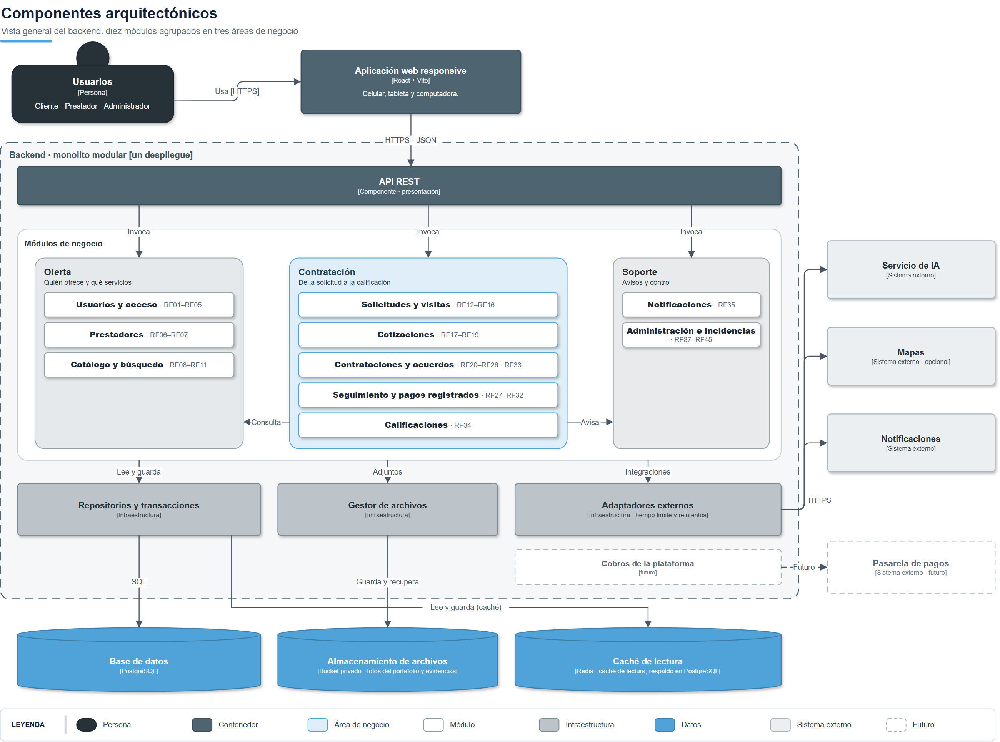

# Componentes arquitectónicos

[Archivo editable en Draw.io](../../img/fuentes-svg/componentes-arquitectonicos.drawio) · [Versión SVG](../../img/fuentes-svg/componentes-arquitectonicos.svg)

La plataforma incluye una aplicación web responsive y un backend con API REST, diez módulos de negocio, repositorios y adaptadores. La base de datos relacional y los archivos son recursos utilizados por el backend; no son módulos de negocio.

Los diez módulos se agrupan en tres áreas de negocio: **Oferta** (Usuarios y acceso, Prestadores, Catálogo y búsqueda), **Contratación** (Solicitudes y visitas, Cotizaciones, Contrataciones y acuerdos, Seguimiento y pagos registrados, Calificaciones) y **Soporte** (Notificaciones, Administración e incidencias). Las áreas ordenan la lectura; cada módulo sigue siendo independiente.

**Integración aprobada de la 002.** Los módulos Usuarios y acceso, Prestadores, Catálogo y búsqueda y Administración e incidencias ya se ejecutan juntos en el monolito (40 operaciones: 17 de la 001 y 23 de la 002). Prestadores conserva el perfil profesional, el portafolio y las fotografías; Catálogo y búsqueda, las clasificaciones, los servicios, la proyección pública de búsqueda y la revisión durable de la oferta; Administración e incidencias, el permiso de gestión de categorías, las aprobaciones y la **auditoría**. PostgreSQL es la fuente de verdad; **Redis** acelera las lecturas públicas con respaldo en PostgreSQL ([estrategia de caché](estrategia-de-cache.md)); las fotografías saneadas se guardan en un **bucket privado** del almacenamiento de objetos. Los diez módulos y su independencia no cambian.

Los módulos se comunican mediante operaciones públicas. Las flechas de esta vista representan llamadas durante la ejecución. La pasarela de pagos se muestra como ampliación futura para cobrar planes o servicios de la plataforma; los trabajos se pagan directamente al prestador.

El módulo Contrataciones y acuerdos es el único que cambia el estado de una contratación. Seguimiento y pagos registrados guarda avances y pagos y solicita esas transiciones mediante la API pública de Contrataciones. Calificaciones consulta a Contrataciones si el trabajo está finalizado. Cotizaciones registra si cada propuesta quedó seleccionada o no seleccionada cuando Contrataciones se lo indica.
