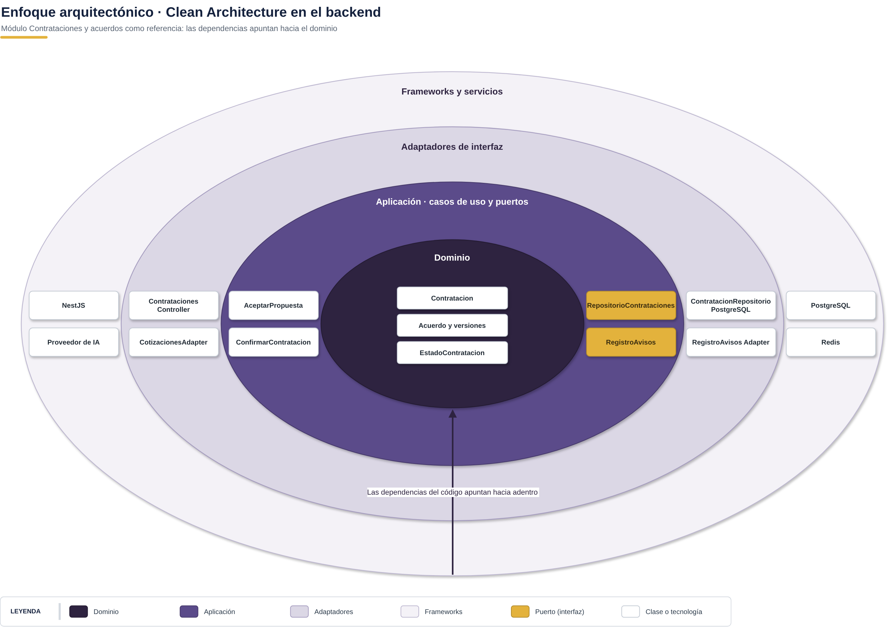
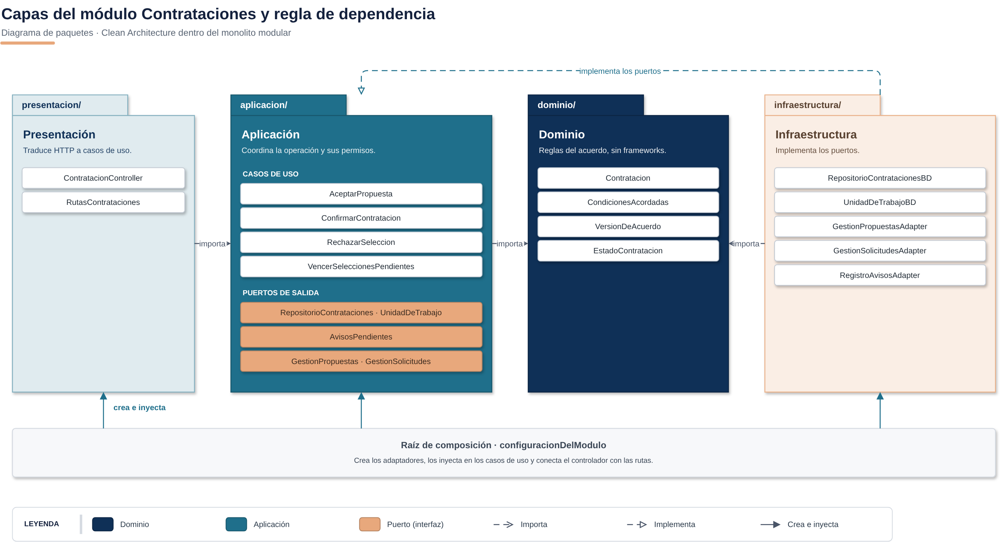

# Enfoque arquitectónico

Se utiliza **Clean Architecture** para separar las reglas y los contratos internos de los detalles de interfaz, persistencia e integración.

| Elemento | Descripción aplicada a la plataforma |
|---|---|
| Enfoque arquitectónico | Clean Architecture. |
| Objetivo | Mantener el dominio independiente de frameworks, clientes HTTP, bases de datos y proveedores externos. |
| Problema que resuelve | Evita que un cambio de interfaz o de proveedor obligue a reescribir las reglas de búsqueda y contratación. |
| Capas definidas | Presentación, Aplicación, Dominio e Infraestructura. La raíz de composición crea y conecta las implementaciones. |
| Aplicación en el proyecto | La interfaz web organiza pantallas, casos de uso, modelos y adaptadores HTTP. El backend mantiene sus propios casos de uso, reglas, contratos e implementaciones. |
| Beneficios | Facilita las pruebas, concentra las responsabilidades y permite sustituir detalles técnicos respetando los contratos. |

[Archivo editable en Draw.io](../../img/fuentes-svg/enfoque-clean-architecture.drawio) · [Versión SVG](../../img/fuentes-svg/enfoque-clean-architecture.svg)

La imagen muestra los anillos de Clean Architecture con piezas reales del módulo Contrataciones y acuerdos. En el centro está el **dominio** (Contratacion y sus valores); alrededor, la **aplicación** con los casos de uso y los puertos; después, los **adaptadores** que implementan esos puertos y el controlador HTTP; y en el anillo exterior, los **frameworks y servicios** (NestJS, PostgreSQL, Redis y el proveedor de IA).

La flecha indica la regla de dependencia: el código de un anillo solo conoce a los anillos interiores. Durante la ejecución un caso de uso invoca una implementación concreta, pero su código depende únicamente de la interfaz del puerto.

## Clean Architecture en el backend

En el backend, Clean Architecture se aplica dentro de cada módulo de negocio. El módulo Contrataciones y acuerdos sirve de referencia:

[Archivo editable en Draw.io](../../img/fuentes-svg/capas-modulo-contrataciones.drawio) · [Versión SVG](../../img/fuentes-svg/capas-modulo-contrataciones.svg)

| Capa del backend | Contenido en Contrataciones y acuerdos |
|---|---|
| Dominio | Entidad Contratacion, valores del acuerdo y estados con sus reglas. |
| Aplicación | Casos de uso (AceptarPropuesta, ConfirmarContratacion, RechazarSeleccion) y puertos de salida. |
| Infraestructura | Repositorio en base de datos, unidad de trabajo y adaptadores hacia Cotizaciones, Solicitudes y Notificaciones. |
| Presentación | Controlador y rutas HTTP. |

En el frontend, los contratos se ubican junto a los modelos de la interfaz porque solo describen cómo consultar la API. En el backend se ubican en Aplicación, porque los casos de uso son quienes los necesitan. En ambos casos el dominio no depende de frameworks ni de proveedores. El detalle completo está en el [diseño interno de módulos](../03-diseno-de-software/diseno-interno/diseno-interno-de-modulos.md).

## Alternativas evaluadas

| Enfoque | Motivo por el que no se eligió |
|---|---|
| Arquitectura en capas tradicional | Las reglas del negocio dependerían directamente de la base de datos y de los proveedores, lo que dificulta sustituir la IA (DA06) y probar las reglas. |
| Reglas en los controladores del framework (MVC) | La lógica de contratación quedaría repartida entre controladores y pantallas, y un cambio de framework afectaría las reglas. |

El costo de Clean Architecture es definir más contratos e interfaces. Por eso se aplica solo en los módulos con reglas de negocio, sin crear capas innecesarias. La decisión se registra en [ADR-002](../01-analisis-de-sistema/07-decisiones-arquitectonicas.md).
