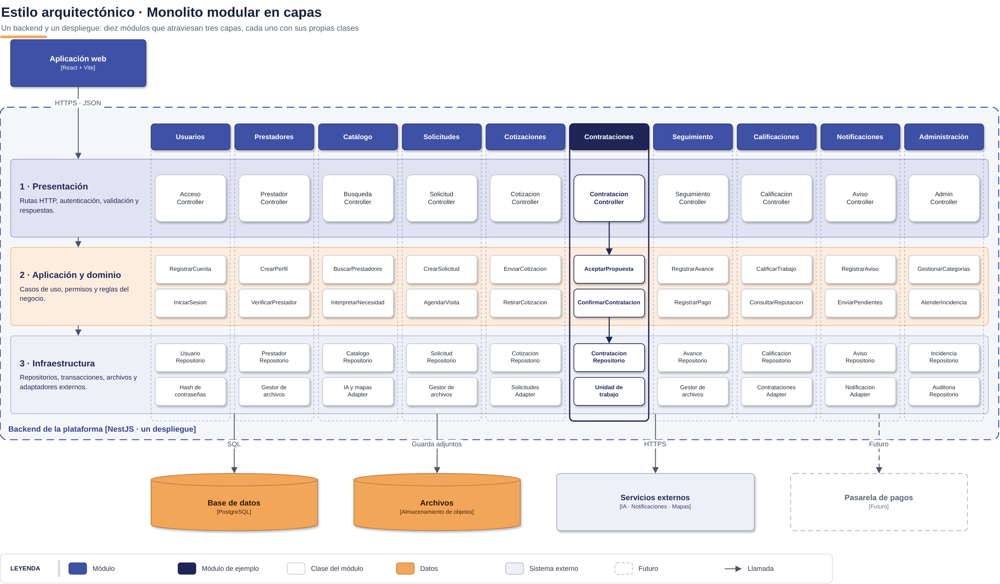

# Estilo arquitectónico

Se utiliza un **monolito modular organizado en capas**. El backend comienza como una aplicación de servidor y un despliegue, con diez módulos de responsabilidades separadas.

[Archivo editable en Draw.io](../../img/fuentes-svg/estilo-monolito-modular.drawio) · [Versión SVG](../../img/fuentes-svg/estilo-monolito-modular.svg)

| Capa | Responsabilidad |
|---|---|
| Presentación | Recibir peticiones HTTP, identificar al usuario, validar la entrada y convertir resultados a respuestas. |
| Aplicación y dominio | Coordinar casos de uso, comprobar permisos de la operación y aplicar las reglas del negocio. |
| Infraestructura y datos | Implementar los contratos de persistencia, transacciones, archivos y servicios externos. |

Cada módulo conserva la propiedad de sus datos y utiliza operaciones públicas de los otros módulos. Compartir una base de datos y herramientas de acceso no permite modificar libremente tablas ajenas.

Las flechas verticales muestran llamadas en ejecución. Los casos de uso dependen de interfaces internas y reciben sus implementaciones desde la composición; por ello el estilo en capas es compatible con Clean Architecture.

Los avisos se registran con la operación principal y se envían después del commit. La pasarela de pagos se mantiene como ampliación futura y no participa en el pago directo del trabajo al prestador.

## Alternativas evaluadas

| Estilo | Ventaja | Motivo por el que no se eligió |
|---|---|---|
| Monolito tradicional sin módulos | Es el más simple de construir. | Las responsabilidades se mezclan y un cambio puede afectar a todo el sistema (DA08). |
| **Monolito modular (elegido)** | Un solo despliegue, transacciones locales y módulos con límites claros. | — |
| Microservicios | Cada servicio escala y se despliega por separado. | Aceptar una cotización coordinaría varios servicios con transacciones distribuidas o sagas, lo que complica DA04. Además exige más infraestructura y monitoreo de los que justifica el proyecto. |

El monolito modular conserva una vía de evolución: como cada módulo solo se comunica por operaciones públicas, uno que crezca puede separarse después como servicio. La decisión se registra en [ADR-001](../01-analisis-de-sistema/07-decisiones-arquitectonicas.md).

## Propiedad del estado de la contratación

El estado de una contratación pertenece al módulo **Contrataciones y acuerdos**. Seguimiento y pagos registrados guarda avances, pagos y observaciones, y solicita a Contrataciones los cambios de estado (iniciar la ejecución, solicitar el cierre, finalizar o cancelar). Calificaciones consulta a Contrataciones si el trabajo está finalizado. Así el ciclo de vida completo vive en un solo módulo.
