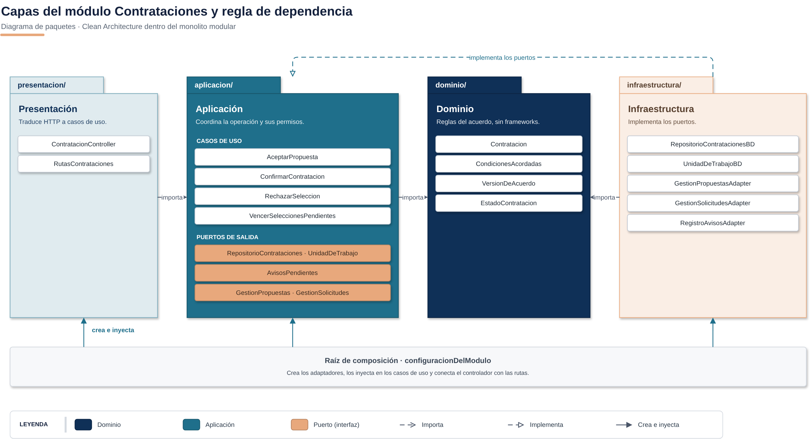
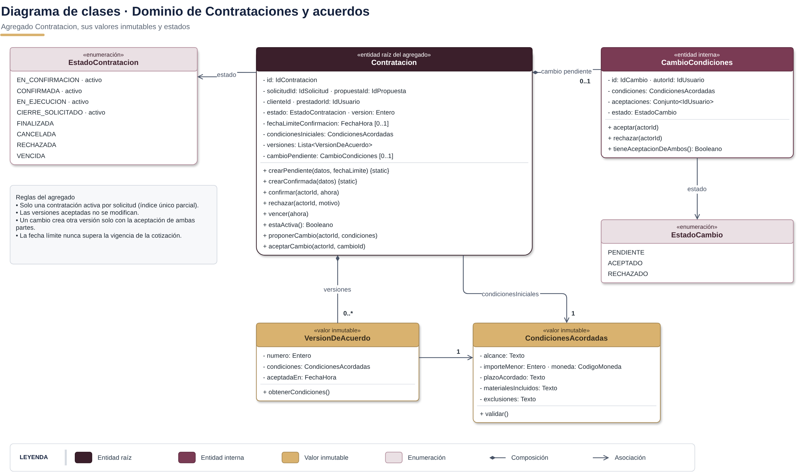
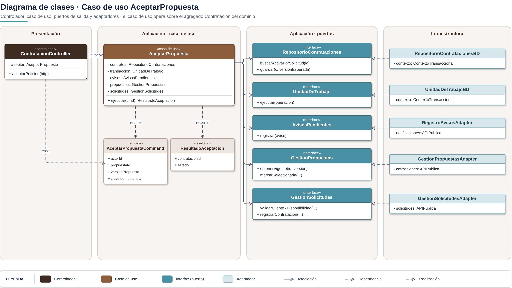
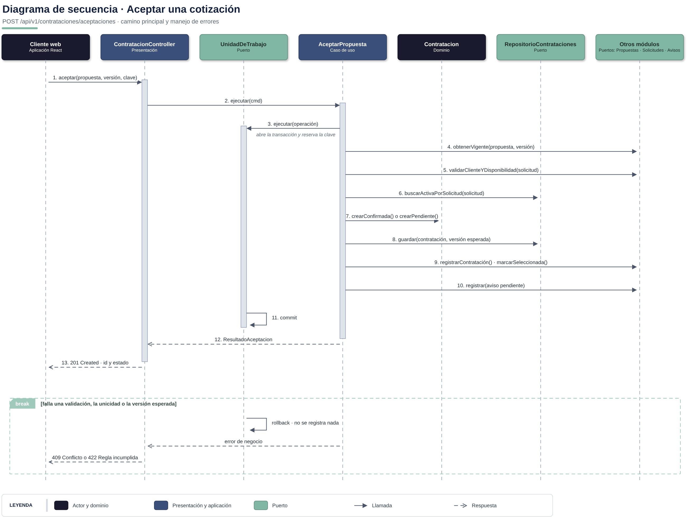

# Diseño interno de módulos

> **Proyecto:** Plataforma web para la búsqueda y contratación de servicios de construcción civil en Ayacucho.  
> **Módulo de referencia:** Contrataciones y acuerdos.  
> **Enfoque interno:** Clean Architecture dentro de un monolito modular organizado en capas.  
> **Estado:** diseño propuesto; se implementará con NestJS y PostgreSQL (ADR-013).

## 1. Propósito

Este documento define cómo se organiza el código dentro del módulo de referencia. Busca que todos los módulos sigan responsabilidades claras, que las reglas del negocio permanezcan separadas de la tecnología y que el equipo identifique dónde corresponde cada pieza y de qué puede depender.

Se desarrolla AceptarPropuesta como caso de uso principal. El módulo también contempla la confirmación o el rechazo del prestador, el vencimiento de las selecciones pendientes y los cambios de condiciones acordados entre las partes.

En este documento, **propuesta** y **cotización** designan el mismo registro, como se define en el [glosario](../../01-analisis-de-sistema/09-glosario.md).

El módulo Contrataciones y acuerdos es el **único propietario del estado de la contratación**. Seguimiento y pagos registrados guarda avances, pagos y observaciones, y solicita a Contrataciones cada cambio de estado mediante su API pública. Los estados y transiciones se describen en el [ciclo de vida de la contratación](../../01-analisis-de-sistema/03-requisitos-funcionales.md#3-ciclo-de-vida-de-una-contratación).

## 2. Estructura de carpetas

La siguiente es la **estructura lógica propuesta para el backend**, no una afirmación de que estos archivos ya estén implementados. Las extensiones se definirán al elegir el lenguaje. La carpeta `tecnologia/` del repositorio contiene, por ahora, una estructura reservada para el ejemplo tecnológico.

| Ruta dentro de `src/modules/contrataciones/` | Pieza de referencia | Responsabilidad | Depende de |
|---|---|---|---|
| `dominio/contratacion` | Contratacion | Mantener participantes, estado, fecha límite de confirmación, versiones y reglas de aceptación. | Tipos del dominio. |
| `dominio/condiciones-acordadas` | CondicionesAcordadas | Representar alcance, importe, moneda, plazo, materiales y exclusiones. | Tipos del dominio. |
| `dominio/version-de-acuerdo` | VersionDeAcuerdo | Conservar una versión inmutable aceptada. | CondicionesAcordadas. |
| `dominio/cambio-condiciones` | CambioCondiciones | Registrar un cambio y las aceptaciones de sus participantes. | Tipos del dominio. |
| `dominio/estado-contratacion` | EstadoContratacion | Definir los estados válidos del acuerdo y cuáles cuentan como activos. | Ninguna capa externa. |
| `dominio/estado-cambio` | EstadoCambio | Definir PENDIENTE, ACEPTADO y RECHAZADO. | Ninguna capa externa. |
| `aplicacion/aceptar-propuesta` | AceptarPropuesta | Coordinar la aceptación y su guardado. | Dominio y puertos de aplicación. |
| `aplicacion/confirmar-contratacion` | ConfirmarContratacion | Registrar la confirmación pendiente del prestador antes de la fecha límite. | Dominio y puertos de aplicación. |
| `aplicacion/rechazar-seleccion` | RechazarSeleccion | Registrar el rechazo del prestador y permitir que el cliente elija otra propuesta. | Dominio y puertos de aplicación. |
| `aplicacion/vencer-selecciones-pendientes` | VencerSeleccionesPendientes | Marcar como VENCIDA cada selección cuya fecha límite pasó; lo ejecuta un proceso programado. | Dominio y puertos de aplicación. |
| `aplicacion/proponer-cambio` | ProponerCambioDeCondiciones | Coordinar una propuesta de cambio de condiciones. | Dominio y puertos de aplicación. |
| `aplicacion/entradas-y-resultados/` | Comandos y resultados | Transportar los datos de cada operación sin depender de HTTP. | Tipos internos. |
| `aplicacion/puertos/repositorio-contrataciones` | RepositorioContrataciones | Declarar la búsqueda y el guardado de contrataciones. | Contratacion. |
| `aplicacion/puertos/unidad-de-trabajo` | UnidadDeTrabajo | Coordinar la operación transaccional. | Contratos internos. |
| `aplicacion/puertos/avisos-pendientes` | AvisosPendientes | Declarar el registro del aviso que se enviará después. | AvisoContratacion. |
| `aplicacion/puertos/gestion-propuestas` | GestionPropuestas | Declarar la consulta de una propuesta vigente y el registro de su resultado: seleccionada o no seleccionada. | Tipos internos. |
| `aplicacion/puertos/gestion-solicitudes` | GestionSolicitudes | Declarar la validación de la solicitud y el registro de su contratación. | Tipos internos. |
| `infraestructura/repositorio-contrataciones-bd` | RepositorioContratacionesBD | Implementar la persistencia y sus controles de concurrencia. | Puertos, dominio y herramientas de datos. |
| `infraestructura/unidad-de-trabajo-bd` | UnidadDeTrabajoBD | Confirmar o revertir los cambios coordinados. | Puertos y contexto transaccional. |
| `infraestructura/registro-avisos-adapter` | RegistroAvisosAdapter | Registrar avisos pendientes mediante la API pública de Notificaciones, en la misma transacción. | AvisosPendientes y API pública de Notificaciones. |
| `infraestructura/gestion-propuestas-adapter` | GestionPropuestasAdapter | Utilizar la API pública de Cotizaciones. | Puerto y API pública del módulo. |
| `infraestructura/gestion-solicitudes-adapter` | GestionSolicitudesAdapter | Utilizar la API pública de Solicitudes. | Puerto y API pública del módulo. |
| `presentacion/contratacion-controller` | ContratacionController | Traducir HTTP a llamadas del caso de uso y devolver respuestas. | Aplicación y herramientas HTTP. |
| `presentacion/contrataciones-routes` | RutasContrataciones | Registrar las rutas del módulo. | Presentación. |
| `configuracion-del-modulo` | Raíz de composición | Crear e inyectar las implementaciones. | Las piezas que necesita conectar. |
| `api-publica` | Operaciones públicas del módulo | Exponer lo que otros módulos pueden utilizar. | Aplicación; sin exponer repositorios privados. |

## 3. Capas del módulo y regla de dependencia



[Archivo editable en Draw.io](../../../img/fuentes-svg/capas-modulo-contrataciones.drawio) · [Versión SVG](../../../img/fuentes-svg/capas-modulo-contrataciones.svg)

**Regla de dependencia:** el dominio no importa código de las capas externas. La aplicación utiliza el dominio y sus propios contratos; la infraestructura implementa esos contratos. La presentación invoca los casos de uso.

| Capa | Contiene | Responsabilidad | Puede depender de | No puede depender de |
|---|---|---|---|---|
| Dominio | Entidades, valores y estados. | Aplicar las reglas del acuerdo. | Tipos propios del negocio. | Aplicación, presentación, infraestructura, HTTP, ORM y SDK. |
| Aplicación | Casos de uso, entradas, resultados y puertos. | Coordinar las operaciones y sus permisos. | Dominio y contratos internos. | Controladores, repositorios concretos y drivers. |
| Infraestructura | Repositorios y adaptadores concretos. | Implementar persistencia e integraciones. | Puertos de aplicación, dominio y herramientas externas. | Presentación e implementaciones privadas de otros módulos. |
| Presentación | Controladores y rutas. | Traducir peticiones y respuestas. | Aplicación y herramientas HTTP. | Acceso directo a datos e implementaciones de repositorio. |
| Composición | Configuración del módulo. | Elegir y conectar las implementaciones. | Las capas que ensambla. | No contiene reglas del negocio. |

Los puertos de salida del backend se ubican en Aplicación. GestionPropuestasAdapter, GestionSolicitudesAdapter y RegistroAvisosAdapter llaman a operaciones públicas de los módulos propietarios (Cotizaciones, Solicitudes y Notificaciones), sin modificar directamente sus tablas. La tabla de avisos pendientes pertenece al módulo Notificaciones.

Para comprobar la regla, se revisan los imports: Dominio no debe conocer el framework ni el motor, y Aplicación no debe importar las implementaciones de Infraestructura.

## 4. Diagrama de clases



[Archivo editable en Draw.io](../../../img/fuentes-svg/clases-contrataciones.drawio) · [Versión SVG](../../../img/fuentes-svg/clases-contrataciones.svg)



[Archivo editable en Draw.io](../../../img/fuentes-svg/clases-aceptar-propuesta.drawio) · [Versión SVG](../../../img/fuentes-svg/clases-aceptar-propuesta.svg)

El diagrama de clases se presenta en dos vistas. La primera muestra el dominio; la segunda, el caso de uso AceptarPropuesta con sus cinco puertos, cada uno alineado con su adaptador. Contratacion conserva las condiciones iniciales, la fecha límite de confirmación, el historial de versiones y un cambio pendiente como máximo.

Una propuesta firme, vigente y con disponibilidad confirmada previamente puede generar una contratación CONFIRMADA. Si falta esa confirmación, queda EN_CONFIRMACION con una fecha límite que no supera la vigencia de la propuesta. Antes de esa fecha, el prestador confirma o rechaza; si no responde, la selección pasa a VENCIDA. Al confirmar se genera la primera versión aceptada; los cambios posteriores solo crean una nueva versión cuando ambas partes los aceptan.

Los estados EN_CONFIRMACION, CONFIRMADA, EN_EJECUCION y CIERRE_SOLICITADO cuentan como **activos**. La base de datos protege la regla con una restricción de unicidad sobre la solicitud, limitada a esos estados. Así se impiden dos selecciones pendientes y dos contrataciones confirmadas para la misma solicitud. RECHAZADA, VENCIDA, CANCELADA y FINALIZADA no son activas, por lo que el cliente puede elegir otra propuesta tras un rechazo o un vencimiento.

### 4.1. Notación UML utilizada

| Símbolo | Significado | Ejemplo en el diagrama |
|---|---|---|
| Línea continua con punta abierta | Asociación: el objeto conserva una referencia. | AceptarPropuesta → RepositorioContrataciones. |
| Línea discontinua con punta abierta | Dependencia: utiliza un tipo o crea una instancia. | ContratacionController → AceptarPropuestaCommand. |
| Línea discontinua con triángulo vacío | Realización: implementa una interfaz. | RepositorioContratacionesBD → RepositorioContrataciones. |
| Rombo relleno junto al todo | Composición: las partes pertenecen al agregado. | Contratacion → VersionDeAcuerdo. |
| «interface» | Contrato sin implementación concreta. | AvisosPendientes. |
| `-` / `+` | Miembro privado / público. | `- estado` / `+ confirmar()`. |
| `1`, `0..1`, `0..*` | Una instancia, opcional, o cero y muchas partes. | Historial de versiones `0..*` antes de la confirmación. |
| `{static}` | Método de creación llamado sobre la clase. | `crearConfirmada(datos)`. |

Los valores monetarios se representan en unidades menores enteras. Las condiciones y versiones aceptadas son inmutables. Los participantes y sus permisos se validan en el servidor; el navegador no determina los importes ni los estados definitivos.

## 5. Flujo de ejecución: aceptar una propuesta



[Archivo editable en Draw.io](../../../img/fuentes-svg/flujo-aceptar-propuesta.drawio) · [Versión SVG](../../../img/fuentes-svg/flujo-aceptar-propuesta.svg)

| Paso | Origen → destino | Acción | Capa |
|---|---|---|---|
| 1 | Cliente web → ContratacionController | Solicitar la aceptación con propuestaId, versión y clave de idempotencia. La identidad procede de la sesión. | Presentación. |
| 2 | ContratacionController → AceptarPropuesta | Ejecutar el caso de uso con la entrada validada. | Presentación → Aplicación. |
| 3 | AceptarPropuesta → UnidadDeTrabajo | Abrir la transacción y reservar la clave de idempotencia; los pasos 4 a 10 usan ese mismo contexto. | Aplicación → puerto. |
| 4 | AceptarPropuesta → GestionPropuestas | Obtener la cotización vigente y sus condiciones registradas. | Aplicación → puerto. |
| 5 | AceptarPropuesta → GestionSolicitudes | Validar al cliente y la disponibilidad de la solicitud. | Aplicación → puerto. |
| 6 | AceptarPropuesta → RepositorioContrataciones | Comprobar que no existe otra contratación activa para la solicitud. | Aplicación → puerto. |
| 7 | AceptarPropuesta → Contratacion | Crear CONFIRMADA, o EN_CONFIRMACION con su fecha límite, según las condiciones verificadas. | Aplicación → Dominio. |
| 8 | AceptarPropuesta → RepositorioContrataciones | Guardar con controles de versión esperada y unicidad. | Aplicación → puerto. |
| 9 | AceptarPropuesta → GestionSolicitudes y GestionPropuestas | Registrar la contratación en la solicitud y marcar la cotización como seleccionada. Si queda CONFIRMADA, las demás pasan a no seleccionadas (RF22). | Aplicación → puertos. |
| 10 | AceptarPropuesta → AvisosPendientes | Registrar el aviso en Notificaciones, sin enviarlo todavía (Outbox). | Aplicación → puerto. |
| 11 | UnidadDeTrabajo | Guardar el resultado idempotente y confirmar todos los cambios (commit). | Infraestructura. |
| 12–13 | AceptarPropuesta → ContratacionController → Cliente web | Devolver ResultadoAceptacion y responder 201 con el identificador y el estado, después del commit. | Aplicación → Presentación. |
| break | Falla una validación, la unicidad o la versión esperada | Revertir los cambios (rollback) y responder 409 o 422. | Infraestructura → Presentación. |

**Condiciones del flujo:**

- La primera validación fallida interrumpe las llamadas restantes. Los bloques break agrupan el manejo de errores de cada fase.
- Una sola contratación activa por solicitud se protege con validación y una restricción de persistencia; la consulta previa no evita por sí sola una carrera concurrente.
- Una clave ya confirmada devuelve el resultado anterior. Reutilizarla con datos distintos genera un conflicto.
- El aviso se envía después del commit; una falla del proveedor no deshace la contratación.
- 201 significa que se creó el registro. Si está EN_CONFIRMACION, el prestador responde en otra petición mediante ConfirmarContratacion o RechazarSeleccion. Al confirmar, las demás propuestas pasan a no seleccionadas. Si nadie responde, VencerSeleccionesPendientes la marca como VENCIDA al pasar la fecha límite.
- Si una desconexión deja incierto el resultado del commit, no se asume un rollback: se resuelve el reintento mediante la misma clave.

Los errores se traducen a respuestas controladas: 401 o 400 antes del caso de uso; 403 sin permiso; 404 si no existe la propuesta; 409 por versión, vigencia o contratación activa; 422 por reglas de validación; y 500 por un fallo técnico inesperado.

## 6. Código de referencia

Los fragmentos siguientes son **pseudocódigo de diseño**, no archivos ejecutables. Conservan las responsabilidades y los nombres de los diagramas. Las consultas, errores, controles de acceso y tipos concretos se implementarán con NestJS y PostgreSQL.

### 6.1. Dominio · entidad y valores

```text
enumeración EstadoContratacion
    EN_CONFIRMACION, CONFIRMADA, EN_EJECUCION, CIERRE_SOLICITADO,
    FINALIZADA, RECHAZADA, VENCIDA, CANCELADA

    esActivo(estado)
        devolver estado en {EN_CONFIRMACION, CONFIRMADA,
                            EN_EJECUCION, CIERRE_SOLICITADO}

clase Contratacion
    privado estado
    privado condicionesIniciales
    privado fechaLimiteConfirmacion
    privado versiones
    privado cambioPendiente

    estático crearPendiente(datos, fechaLimite)
        validar participantes y condiciones de datos
        exigir que fechaLimite no supere la vigencia de la propuesta
        crear contratación en EN_CONFIRMACION con fechaLimite
        conservar condicionesIniciales
        iniciar historial sin versiones aceptadas
        devolver contratación

    estático crearConfirmada(datos)
        exigir confirmación previa válida en los datos verificados
        crear contratación en CONFIRMADA
        crear primera VersionDeAcuerdo con las condiciones aceptadas
        devolver contratación

    confirmar(actorId, ahora)
        exigir estado EN_CONFIRMACION y que actorId sea el prestador
        exigir que ahora no supere fechaLimiteConfirmacion
        pasar a CONFIRMADA y crear la primera VersionDeAcuerdo

    rechazar(actorId, motivo)
        exigir estado EN_CONFIRMACION y que actorId sea el prestador
        pasar a RECHAZADA y conservar el motivo

    vencer(ahora)
        exigir estado EN_CONFIRMACION y que ahora supere fechaLimiteConfirmacion
        pasar a VENCIDA

    estaActiva()
        devolver EstadoContratacion.esActivo(estado)

    aceptarCambio(actorId, cambioId)
        exigir que actorId sea participante de la contratación
        exigir que cambioId sea el cambio pendiente
        registrar aceptación de esa misma propuesta de cambio
        si ambos participantes aceptaron
            añadir nueva VersionDeAcuerdo
            conservar las versiones anteriores
            dejar de tener un cambio pendiente
```

Cada transición registra al responsable y la fecha, y rechaza los cambios que no parten del estado permitido. Las transiciones de ejecución, cierre y cancelación (`iniciarEjecucion`, `solicitarCierre`, `registrarObservaciones`, `finalizar` y `cancelar`) siguen la misma forma. Seguimiento y pagos registrados las solicita mediante la API pública de Contrataciones.

### 6.2. Aplicación · contratos y caso de uso

```text
interfaz RepositorioContrataciones
    buscarPorId(id)
    buscarActivaPorSolicitud(solicitudId)
    guardar(contratacion, versionEsperada)

interfaz UnidadDeTrabajo
    ejecutar(operacion)

interfaz AvisosPendientes
    registrar(aviso)

interfaz GestionPropuestas
    obtenerVigente(propuestaId, versionPropuesta)
    marcarSeleccionada(propuestaId, contratacionId)
    marcarNoSeleccionadas(solicitudId, propuestaSeleccionadaId)

interfaz GestionSolicitudes
    validarClienteYDisponibilidad(solicitudId, actorId)
    registrarContratacion(solicitudId, contratacionId, estado)

clase AceptarPropuesta
    recibir por constructor los cinco puertos anteriores y un reloj

    ejecutar(cmd)
        preparar contexto de idempotencia con actor, operación,
        clave y huella de la entrada

        devolver unidadDeTrabajo.ejecutar(operación)
            propuesta = propuestas.obtenerVigente(
                cmd.propuestaId, cmd.versionPropuesta)
            solicitudes.validarClienteYDisponibilidad(
                propuesta.solicitudId, cmd.actorId)

            si contratos.buscarActivaPorSolicitud(propuesta.solicitudId) existe
                rechazar con conflicto

            datos = tomar participantes y condiciones de la propuesta registrada
            si propuesta es firme y tiene confirmación previa vigente
                contratacion = Contratacion.crearConfirmada(datos)
            en otro caso
                fechaLimite = mínimo(reloj.ahora + plazoConfirmacion,
                                     propuesta.vigenteHasta)
                contratacion = Contratacion.crearPendiente(datos, fechaLimite)

            contratos.guardar(contratacion, marcaDeEntidadNueva)
            solicitudes.registrarContratacion(
                propuesta.solicitudId, contratacion.id, contratacion.estado)
            propuestas.marcarSeleccionada(propuesta.id, contratacion.id)
            si contratacion.estado es CONFIRMADA
                propuestas.marcarNoSeleccionadas(
                    propuesta.solicitudId, propuesta.id)
            avisos.registrar(aviso de la aceptación y su estado)
            devolver ResultadoAceptacion(contratacion.id, contratacion.estado)

clase ConfirmarContratacion
    ejecutar(cmd)
        devolver unidadDeTrabajo.ejecutar(operación)
            contratacion = contratos.buscarPorId(cmd.contratacionId)
            contratacion.confirmar(cmd.actorId, reloj.ahora)
            contratos.guardar(contratacion, cmd.versionEsperada)
            solicitudes.registrarContratacion(
                contratacion.solicitudId, contratacion.id, CONFIRMADA)
            propuestas.marcarNoSeleccionadas(
                contratacion.solicitudId, contratacion.propuestaId)
            avisos.registrar(aviso de confirmación)
```

UnidadDeTrabajo reserva la clave antes de ejecutar la operación, conserva su resultado y confirma la transacción. Si existe un resultado previo compatible, lo devuelve sin crear otra contratación.

Repositorio, avisos y las operaciones públicas que actualizan solicitudes y propuestas participan en el mismo contexto transaccional. La composición configura ese contexto; no se comparte una transacción mutable entre peticiones diferentes.

La idempotencia se mantiene dentro de la unidad de trabajo a propósito. La reserva de la clave, su resultado y la contratación deben confirmarse en la misma transacción: si se guardaran por separado, un fallo entre ambos pasos dejaría una clave reservada sin resultado. Su única responsabilidad es **ejecutar una operación de forma atómica e idempotente**. Si otros módulos necesitan el mismo control, puede extraerse a un puerto propio que comparta el contexto transaccional.

RechazarSeleccion sigue la misma forma que ConfirmarContratacion con `contratacion.rechazar()`. VencerSeleccionesPendientes recorre las contrataciones EN_CONFIRMACION con la fecha límite vencida y aplica `vencer()` a cada una en su propia transacción. Ninguno de los dos marca las demás propuestas como no seleccionadas: el cliente puede elegir otra.

### 6.3. Infraestructura · repositorio y adaptadores

```text
clase RepositorioContratacionesBD implementa RepositorioContrataciones
    recibir contextoTransaccional

    guardar(contratacion, versionEsperada)
        traducir la entidad a datos de persistencia
        insertar o actualizar con el control de versión correspondiente
        respetar la restricción única de contratación activa por solicitud
        convertir conflictos conocidos a errores internos definidos
        no confirmar una transacción por cuenta propia

clase RegistroAvisosAdapter implementa AvisosPendientes
    recibir la API pública de Notificaciones y el mismo contextoTransaccional

    registrar(aviso)
        pedir a Notificaciones que guarde el aviso pendiente en ese contexto
        no llamar al proveedor de notificaciones dentro de la transacción
```

GestionPropuestasAdapter y GestionSolicitudesAdapter traducen sus operaciones a las APIs públicas de Cotizaciones y Solicitudes. El proceso de avisos pendientes pertenece a Notificaciones: utiliza el proveedor externo después del commit y debe controlar reintentos y posibles duplicados de entrega.

### 6.4. Presentación · controlador

```text
clase ContratacionController
    recibir aceptarPropuesta

    aceptarPeticion(http)
        exigir una sesión autenticada
        validar el formato de propuestaId, versionPropuesta y claveIdempotencia
        cmd.actorId = identidad obtenida de la sesión
        completar cmd con los campos de entrada permitidos
        resultado = aceptarPropuesta.ejecutar(cmd)
        devolver 201 con resultado.contratacionId y resultado.estado

        si ocurre un error
            traducirlo a la respuesta HTTP correspondiente
            no exponer detalles internos ni credenciales
```

### 6.5. Raíz de composición

```text
configurarModuloContrataciones()
    definir el contexto transaccional por operación
    crear RepositorioContratacionesBD
    crear UnidadDeTrabajoBD
    crear RegistroAvisosAdapter con la API pública de Notificaciones
    crear GestionPropuestasAdapter con la API pública de Cotizaciones
    crear GestionSolicitudesAdapter con la API pública de Solicitudes
    inyectar las implementaciones en AceptarPropuesta,
        ConfirmarContratacion, RechazarSeleccion y VencerSeleccionesPendientes
    programar VencerSeleccionesPendientes como tarea periódica
    conectar ContratacionController con las rutas del módulo
```

El guardado de las condiciones, la vinculación de la solicitud, el resultado de las propuestas y el aviso deben probarse como una sola operación. La pasarela de pagos no interviene en este caso de uso: los trabajos se pagan directamente al prestador; el cobro de servicios de la plataforma se implementará después.
