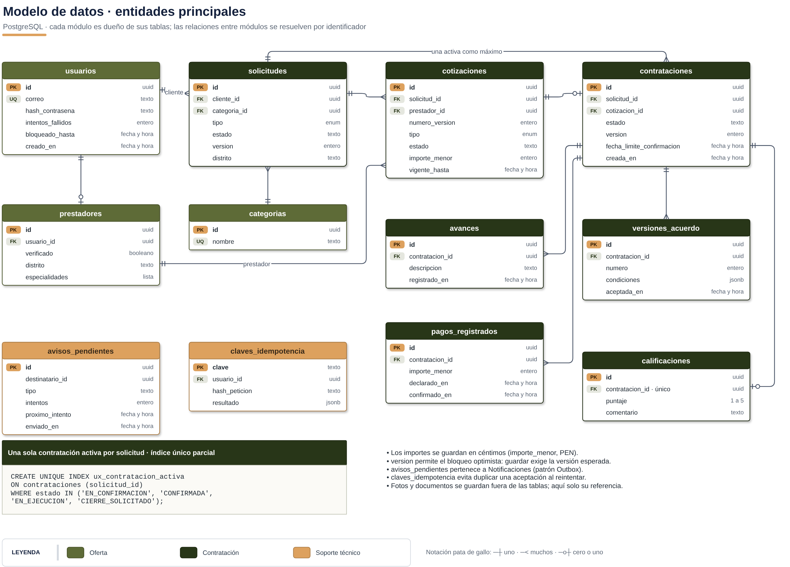

# Modelo de datos

> **Proyecto:** Plataforma web para la búsqueda y contratación de servicios de construcción civil en Ayacucho.  
> **Motor:** PostgreSQL (ADR-005 y ADR-013).  
> **Estado:** diseño propuesto; los nombres y tipos se ajustarán en la implementación.

## 1. Objetivo

Mostrar las tablas principales, sus relaciones y las restricciones que protegen las reglas críticas del negocio, en especial la regla de **una sola contratación activa por solicitud** (DA04).

## 2. Diagrama



[Archivo editable en Draw.io](../../img/fuentes-svg/modelo-datos.drawio) · [Versión SVG](../../img/fuentes-svg/modelo-datos.svg)

El diagrama usa la notación pata de gallo: una línea doble indica «uno», el tridente indica «muchos» y el círculo indica que la relación es opcional.

## 3. Tablas y módulo propietario

| Tabla | Módulo propietario | Contenido |
|---|---|---|
| usuarios | Usuarios y acceso | Cuenta, contraseña cifrada con hash e intentos fallidos de acceso (AC04). |
| prestadores | Prestadores | Perfil profesional, verificación, distrito y especialidades. |
| categorias | Catálogo y búsqueda | Categorías de servicios de construcción civil. |
| solicitudes | Solicitudes y visitas | Necesidad del cliente, tipo (dirigida o publicada), estado y versión. |
| cotizaciones | Cotizaciones | Oferta del prestador para una versión de la solicitud, con importe y vigencia. |
| contrataciones | Contrataciones y acuerdos | Estado de la contratación, versión y fecha límite de confirmación. |
| versiones_acuerdo | Contrataciones y acuerdos | Condiciones aceptadas por ambas partes; nunca se sobrescriben. |
| avances y pagos_registrados | Seguimiento y pagos registrados | Avances del trabajo y pagos directos declarados y confirmados. |
| calificaciones | Calificaciones | Una calificación por contratación finalizada. |
| avisos_pendientes | Notificaciones | Avisos guardados en la misma transacción y enviados después (Outbox). |
| claves_idempotencia | Infraestructura compartida | Resultado de cada petición crítica para responder igual a un reintento. |

Cada módulo modifica solo sus tablas. Cuando necesita datos de otro módulo, usa su operación pública; las claves foráneas entre módulos aseguran la integridad sin autorizar escrituras cruzadas.

## 4. Restricciones que protegen el negocio

| Regla | Restricción en la base de datos |
|---|---|
| Una sola contratación activa por solicitud (RF21) | Índice único parcial sobre `contrataciones (solicitud_id)` limitado a los estados EN_CONFIRMACION, CONFIRMADA, EN_EJECUCION y CIERRE_SOLICITADO. |
| Evitar sobrescrituras concurrentes | Columna `version`: guardar exige la versión esperada (bloqueo optimista). |
| Evitar duplicados al reintentar | Clave primaria en `claves_idempotencia`. |
| Una calificación por trabajo (RF34) | Restricción única sobre `calificaciones (contratacion_id)`. |
| Importes exactos | Importes en céntimos (`importe_menor`, entero) y moneda PEN. |

```sql
CREATE UNIQUE INDEX ux_contratacion_activa
  ON contrataciones (solicitud_id)
  WHERE estado IN ('EN_CONFIRMACION', 'CONFIRMADA', 'EN_EJECUCION', 'CIERRE_SOLICITADO');
```

Si dos clientes o dos pestañas intentan aceptar a la vez, la base de datos rechaza la segunda inserción aunque ambas hayan pasado la validación previa. El caso de uso traduce ese rechazo a una respuesta 409.

Las fotos y los documentos no se guardan en las tablas: el almacenamiento de objetos conserva el archivo y la base de datos solo su referencia y permisos (ADR-011).

### Persistencia de Usuarios y acceso

Las migraciones de 001 crean cuentas, perfiles habilitados, sesiones, desafíos
de recuperación y cambio de correo, referencias de fotografías, consentimientos,
claves idempotentes y avisos pendientes. El índice de correo vigente impone
unicidad y las versiones distinguen conflictos de perfil y credenciales.
Una foto conserva su titular y la referencia al objeto privado. Una restauración
de la base debe comprobar la correspondencia entre referencias y objetos.
El Outbox persiste el aviso en la transacción que lo origina y un worker del
backend lo entrega después. [Modelo y reglas de 001](../../specs/001-usuarios-y-acceso/data-model.md)

---

[Índice del proyecto](../../README.md)
