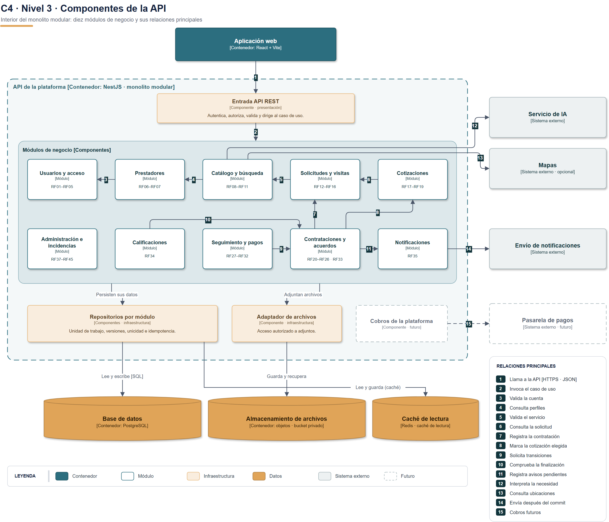

# Nivel 3 · Diagrama de componentes

> **Proyecto:** Plataforma web para la búsqueda y contratación de servicios de construcción civil en Ayacucho.  
> **Contenedor detallado:** API de la plataforma.  
> **Modelo:** C4 · Nivel 3 · Monolito modular.

## 1. Objetivo

Mostrar los componentes internos de la API: los diez módulos de negocio, la entrada HTTP, los adaptadores de persistencia y sus relaciones principales.

| Aspecto | Descripción |
|---|---|
| Pregunta que responde | ¿Cómo se divide el backend por dentro y qué hace cada parte? |
| Audiencia | Equipo de arquitectura y desarrollo. |
| Componente | Grupo de funcionalidades con responsabilidad definida e interfaces de acceso. En esta vista, cada módulo de negocio constituye un componente. |
| Alcance del detalle | API del nivel 2. La aplicación web y los almacenes quedan fuera de este contenedor, pero pertenecen a la plataforma. |
| Siguiente nivel | Clases e interacciones de Contrataciones y acuerdos. |

## 2. Diagrama

[Editar en Draw.io](../../img/fuentes-svg/nivel3-componentes.drawio) · [Versión SVG](../../img/fuentes-svg/nivel3-componentes.svg)

Las flechas muestran relaciones principales de ejecución. No son una secuencia ni enumeran todas las llamadas. Los colores y rótulos distinguen módulos, entrada HTTP, infraestructura, almacenes y proveedores.

## 3. Componentes

| Componente | Responsabilidad | Funcionalidades y requisitos | Ubicación lógica propuesta |
|---|---|---|---|
| Entrada API REST | Recibir y dirigir peticiones. | Autenticación, autorización, validación y traducción de errores. | Presentación y rutas del backend. |
| Usuarios y acceso | Mantener cuentas y permisos. | Registro, sesiones, recuperación y perfil; RF01–RF05. Aporta la identidad a la 002 por su API pública. | `tecnologia/backend/src/modulos/usuarios-acceso/` |
| Prestadores | Mantener información de quienes ofrecen servicios. | 002: perfil profesional, especialidades y zonas, disponibilidad declarada, trabajos anteriores y fotografías saneadas del portafolio con su respaldo coordinado; RF06 y consulta pública RF10. La verificación (RF07) es de la 012. | `tecnologia/backend/src/modulos/prestadores/` |
| Catálogo y búsqueda | Organizar servicios y localizar prestadores registrados. | 002: clasificaciones de dos niveles, servicios y su ciclo, proyección pública de búsqueda, revisión durable de la oferta, elegibilidad y caché Redis con respaldo en PostgreSQL; RF08–RF10 y la ejecución de RF39. La interpretación asistida (RF11) es posterior. | `tecnologia/backend/src/modulos/catalogo/` |
| Solicitudes y visitas | Gestionar necesidades y su evaluación. | Publicación, destinatarios, ubicación y visitas; RF12–RF16. | `src/modules/solicitudes/` |
| Cotizaciones | Mantener propuestas y condiciones. | Elaboración, versiones, vigencia y comparación; RF17–RF19. | `src/modules/cotizaciones/` |
| Contrataciones y acuerdos | Formalizar lo acordado y controlar su estado. | Aceptación, confirmación, documentos, cambios, estados y cancelaciones; RF20–RF26 y RF33. | `src/modules/contrataciones/` |
| Seguimiento y pagos registrados | Registrar la ejecución y solicitar el cierre. | Avances, observaciones, conformidad y pagos directos declarados y confirmados; RF27–RF32. Los cambios de estado los aplica Contrataciones. | `src/modules/seguimiento/` |
| Calificaciones | Gestionar valoraciones de trabajos finalizados. | Calificación vinculada a la contratación; RF34. | `src/modules/calificaciones/` |
| Notificaciones | Gestionar avisos internos y entregas externas. | Avisos pendientes, envío y reintentos; RF35. | `src/modules/notificaciones/` |
| Administración e incidencias | Atender moderación, control y reportes. | 002: permiso persistente de RF39, alta inicial por procedimiento protegido, coordinación de la gestión de categorías y **auditoría** de concesiones, revocaciones y cambios. El resto (usuarios, publicaciones, incidencias, reportes; RF37–RF45) es posterior. | `tecnologia/backend/src/modulos/administracion/` |
| Persistencia por módulo | Implementar el acceso a los datos de cada propietario. | Repositorios, versiones, unicidad y unidad de trabajo. | Infraestructura de cada módulo y configuración transaccional. |
| Adaptador de archivos | Conectar con el almacén de evidencias y documentos. | Carga y recuperación con permisos. En la 002, bucket privado de portafolio con credenciales exclusivas, imágenes saneadas y purga idempotente. | Infraestructura de los módulos que utilizan archivos. |
| Caché de lectura | Acelerar consultas públicas repetidas. | Redis activo con revisión durable y respaldo en PostgreSQL (002). | Infraestructura de Catálogo y búsqueda. |
| Cobros de la plataforma | Cobrar planes o servicios propios. | Ampliación futura; no forma parte de los diez módulos actuales. | Módulo y adaptador por implementar. |

Las rutas de los módulos de la 001 y la 002 son las reales del repositorio; las de los demás módulos siguen siendo una propuesta lógica, no archivos existentes. RF36 corresponde al historial conservado por cada módulo. La agrupación de persistencia facilita la lectura: no propone un único repositorio de negocio que mezcle todos los módulos.

## 4. Relaciones entre componentes

Los números coinciden con las etiquetas de las flechas del diagrama.

| N.º | Origen | Destino | Descripción | Comunicación |
|---|---|---|---|---|
| 1 | Aplicación web | Entrada API REST | Enviar la petición del usuario. | HTTPS con JSON. |
| 2 | Entrada API REST | Módulo correspondiente | Invocar el caso de uso de la petición autorizada. | Llamada en memoria. |
| 3 | Prestadores | Usuarios y acceso | Validar la cuenta asociada al perfil. | Operación pública del módulo. |
| 4 | Catálogo y búsqueda | Prestadores | Consultar perfiles y especialidades para los resultados. | Operación pública del módulo. |
| 5 | Solicitudes y visitas | Catálogo y búsqueda | Validar el servicio seleccionado. | Operación pública del módulo. |
| 6 | Cotizaciones | Solicitudes y visitas | Consultar la solicitud para preparar o validar la cotización. | Operación pública del módulo. |
| 7 | Contrataciones y acuerdos | Solicitudes y visitas | Validar cliente y disponibilidad y registrar la contratación. | Puerto de aplicación y operación pública transaccional. |
| 8 | Contrataciones y acuerdos | Cotizaciones | Obtener la cotización vigente y registrar si quedó seleccionada o no seleccionada. | Puerto de aplicación y operación pública transaccional. |
| 9 | Seguimiento y pagos registrados | Contrataciones y acuerdos | Consultar el acuerdo y solicitar las transiciones de estado. | Operaciones públicas del módulo propietario. |
| 10 | Calificaciones | Contrataciones y acuerdos | Comprobar que la contratación está finalizada y que el cliente participó. | Operación pública de consulta. |
| 11 | Contrataciones y acuerdos | Notificaciones | Registrar avisos pendientes en la misma transacción. | Puerto de aplicación y operación pública. |
| 16 | Prestadores · Catálogo y búsqueda · Administración e incidencias | Usuarios y acceso | Obtener la identidad y los perfiles habilitados de la sesión (002). | API pública `UsuariosAcceso`. |
| 17 | Prestadores | Catálogo y búsqueda | Validar clasificaciones efectivamente activas, publicar la proyección de búsqueda y comprobar la revisión de la oferta (002). | Contratos de la API pública de Catálogo, con unidad de trabajo común. |
| 18 | Catálogo y búsqueda | Prestadores | Comprobar la titularidad del perfil al publicar o gestionar servicios (002). | API pública `PrestadoresApi`. |
| 19 | Administración e incidencias | Catálogo y búsqueda | Ejecutar altas, ediciones, activaciones y desactivaciones de clasificaciones, con permiso, auditoría y mutación en una sola transacción (002). | API pública `GestionClasificaciones`. |

Contrataciones es el único módulo que cambia el estado de una contratación. Seguimiento guarda avances, pagos y observaciones y solicita cada transición mediante la API pública de Contrataciones; no accede a sus tablas. Otros módulos también pueden generar avisos: se muestra Contrataciones como caso representativo. Administración utiliza las operaciones públicas de los módulos afectados, aunque esas conexiones secundarias no se dibujen.

## 5. Relaciones con contenedores y sistemas externos

| N.º | Componente | Destino | Finalidad | Comunicación | Diseño aplicado |
|---|---|---|---|---|---|
| — | Cada módulo, mediante sus repositorios | Base de datos PostgreSQL | Consultar y persistir sus propios registros. | SQL. | Repository y unidad de trabajo. |
| — | Adaptador de archivos | Almacenamiento de archivos | Guardar y recuperar fotos, documentos y evidencias; en la 002, el bucket privado del portafolio. | API del almacenamiento de objetos (S3). | Adapter y control de acceso. |
| — | Catálogo y búsqueda | Redis | Leer y guardar categorías y búsquedas públicas; la revisión durable de PostgreSQL decide si un acierto es válido (002). | Cliente Redis con tiempo de espera acotado. | Decorator de lectura con caché y respaldo en PostgreSQL. |
| 12 | Catálogo y búsqueda | Servicio de IA | Proponer criterios editables. | HTTPS; tiempo límite de 8 s. | Adapter; filtros como alternativa. |
| 13 | Catálogo y búsqueda | Mapas | Consultar referencias geográficas. | HTTPS. | Adapter opcional; zona manual. |
| 14 | Notificaciones | Envío de notificaciones | Entregar avisos después del commit. | HTTPS. | Outbox transaccional, reintentos y deduplicación. |
| 15 | Cobros de la plataforma, futuro | Pasarela de pagos, futura | Procesar cobros por planes o servicios propios. | HTTPS, pendiente. | Adapter previsto. |

La pasarela no procesa los pagos actuales de construcción ni representa una comisión por trabajo. La base de datos y los archivos son contenedores de la plataforma del C2; los proveedores externos pertenecen a terceros.

## 6. Reglas del monolito modular

| Regla | Aplicación y motivo |
|---|---|
| Un backend inicial | Los módulos de negocio se ejecutan y despliegan juntos en la misma aplicación de servidor. |
| Comunicación por operaciones públicas | Un módulo no importa implementaciones privadas de otro. En la 002 los módulos solo comparten los tipos de sus `api-publica` y la composición inyecta las implementaciones; las pruebas de arquitectura comprueban la dirección de las dependencias. |
| Propiedad de los datos | Cada módulo consulta y modifica sus tablas; las operaciones sobre datos ajenos se solicitan al propietario. |
| Transacción coherente | Los adaptadores que participan en una actualización coordinada comparten el contexto transaccional. |
| Concurrencia controlada | La unicidad, versión esperada e idempotencia protegen la contratación activa y los reintentos. |
| Avisos después del commit | La transacción conserva el aviso pendiente; el envío externo ocurre después y admite reintentos. |
| Clean Architecture | Dominio independiente; puertos en Aplicación; adaptadores en Infraestructura; controladores en Presentación. |
| Ampliación gradual | El cobro por servicios de la plataforma permanece futuro, sin introducirlo en la aceptación actual. |

El [diseño interno](../03-diseno-de-software/diseno-interno/diseno-interno-de-modulos.md) explica las capas y el contrato transaccional con mayor detalle.

---

[Índice del proyecto](../../README.md) · [Nivel anterior](02-nivel2-contenedores.md) · [Siguiente nivel](04-nivel4-codigo.md)
