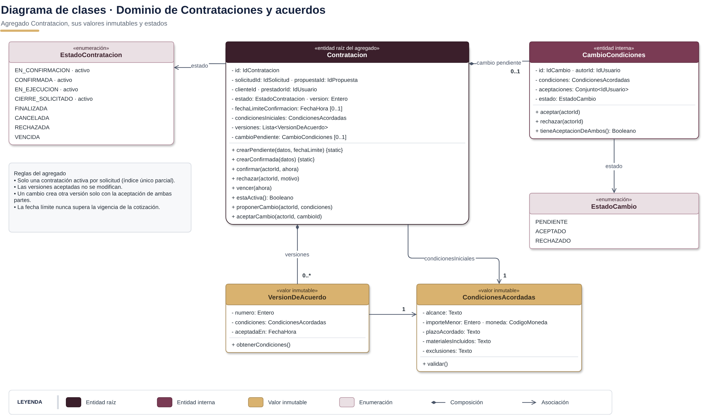
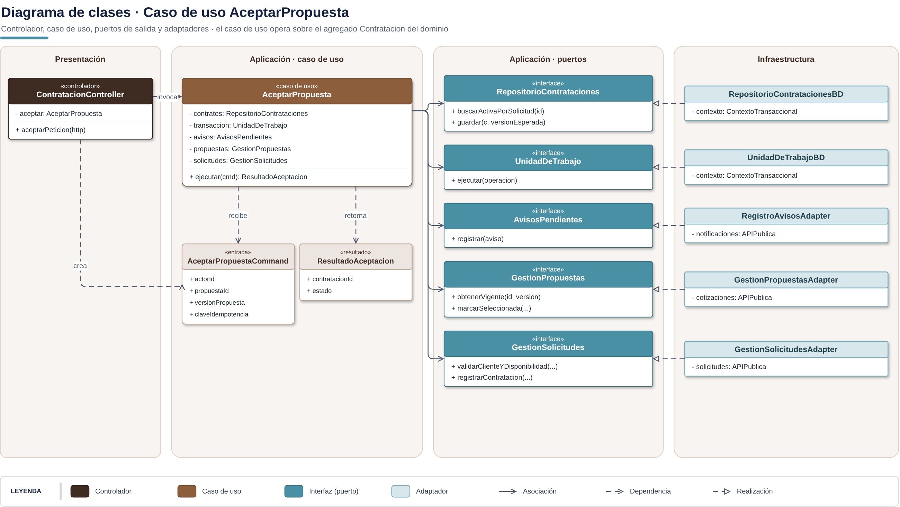
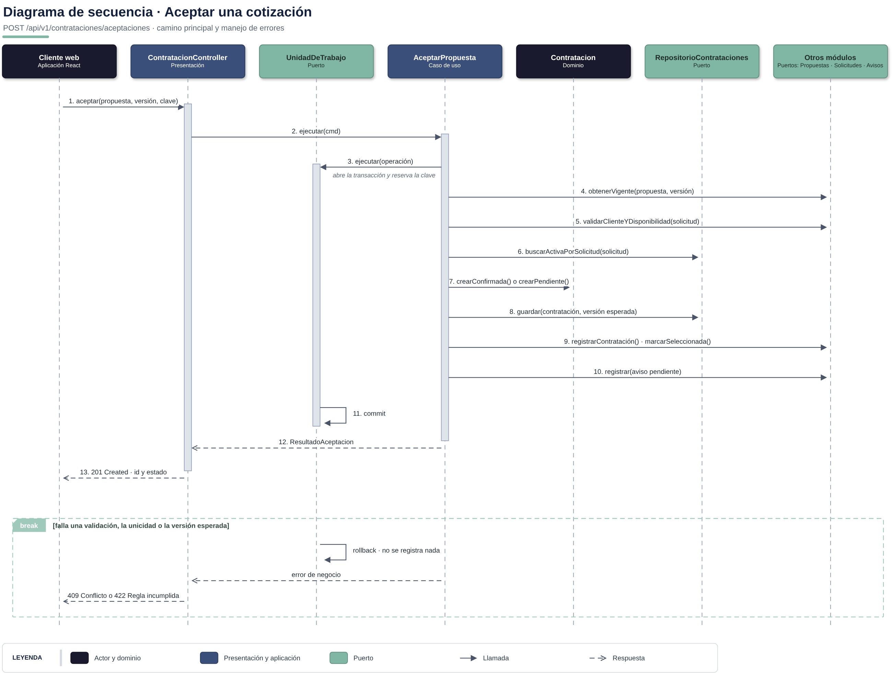

# Nivel 4 · Diagrama de código

> **Proyecto:** Plataforma web para la búsqueda y contratación de servicios de construcción civil en Ayacucho.  
> **Componente detallado:** Contrataciones y acuerdos.  
> **Modelo:** C4 · Nivel 4 · Notación UML.  
> **Caso de uso:** AceptarPropuesta.

## 1. Objetivo

Detallar las clases e interfaces del componente Contrataciones y acuerdos y explicar cómo colaboran para aceptar una propuesta. Se utilizan los mismos diagramas aprobados en diseño interno, conservando una única imagen y un único archivo editable por diagrama.

| Aspecto | Descripción |
|---|---|
| Pregunta que responde | ¿Qué clases participan y cómo colaboran en una operación del módulo? |
| Audiencia | Equipo de desarrollo. |
| Notación | UML: clases para la estructura y secuencia como complemento dinámico del caso de uso. |
| Motivo del módulo elegido | Concentra aceptación, confirmación, versiones de acuerdos, concurrencia y coordinación entre módulos. |
| Alcance | Clases representativas de AceptarPropuesta; no se expanden todos los casos de uso de la plataforma. |
| Estado | Diseño propuesto con tipos lógicos. Se implementará con NestJS y PostgreSQL (ADR-013). |

Este nivel profundiza el componente mostrado en C3. El diseño interno explica la organización de carpetas y el pseudocódigo; aquí se presenta su relación con el modelo arquitectónico.

## 2. Diagrama de clases

[Editar en Draw.io](../../img/fuentes-svg/clases-contrataciones.drawio) · [Versión SVG](../../img/fuentes-svg/clases-contrataciones.svg)

Para facilitar la lectura, el diagrama de clases se divide en dos vistas: la anterior muestra el **dominio** (el agregado Contratacion con sus valores y estados) y la siguiente muestra el **caso de uso** con sus puertos de salida y los adaptadores que los implementan.

[Editar en Draw.io](../../img/fuentes-svg/clases-aceptar-propuesta.drawio) · [Versión SVG](../../img/fuentes-svg/clases-aceptar-propuesta.svg)

### 2.1. Capas de Clean Architecture

| Capa | Elementos | Regla |
|---|---|---|
| Presentación | Controlador y traducción HTTP. | Invoca la aplicación sin acceder directamente a los datos. |
| Aplicación | Caso de uso, comandos, resultados y cinco puertos de salida. | Coordina el dominio y declara los contratos que necesita. No importa implementaciones concretas. |
| Dominio | Agregado Contratacion, valores, cambios y estados. | Conserva reglas y transiciones sin conocer HTTP, ORM o proveedores. |
| Infraestructura | Repositorios, unidad de trabajo y adaptadores. | Implementa los puertos de aplicación y conecta las tecnologías y operaciones públicas de otros módulos. |

Los puertos aparecen en una columna propia de Aplicación, alineados con su adaptador. Esa ubicación no los convierte en parte del dominio. La raíz de composición inyecta las implementaciones, como se explica en el diseño interno.

### 2.2. Clases del módulo de Contrataciones y acuerdos

| Clase o tipo | Tipo | Capa | Responsabilidad |
|---|---|---|---|
| ContratacionController | Controlador | Presentación | Recibir la petición y devolver una respuesta controlada. |
| AceptarPropuesta | Caso de uso | Aplicación | Validar la aceptación, crear la contratación y coordinar persistencia y avisos. |
| AceptarPropuestaCommand | Entrada | Aplicación | Transportar actor, propuesta, versión y clave de idempotencia. |
| ResultadoAceptacion | Resultado | Aplicación | Informar el identificador y el estado real alcanzado. |
| Contratacion | Entidad raíz del agregado | Dominio | Proteger participantes, estado, fecha límite de confirmación, condiciones, versiones y cambios. |
| CondicionesAcordadas | Valor inmutable | Dominio | Conservar alcance, importe, moneda, plazo, materiales y exclusiones. |
| VersionDeAcuerdo | Valor inmutable | Dominio | Representar una versión aceptada sin sobrescribir la anterior. |
| CambioCondiciones | Entidad interna | Dominio | Conservar una propuesta de cambio y las aceptaciones de sus participantes. |
| EstadoContratacion | Enumeración | Dominio | Definir los estados permitidos del trabajo contratado y cuáles cuentan como activos. |
| EstadoCambio | Enumeración | Dominio | Definir PENDIENTE, ACEPTADO y RECHAZADO. |

La contratación puede quedar EN_CONFIRMACION, con una fecha límite que no supera la vigencia de la propuesta, o crearse CONFIRMADA si la propuesta es firme, vigente y tiene disponibilidad confirmada. Antes de la fecha límite, el prestador confirma o rechaza; si no responde, pasa a VENCIDA. Los estados EN_CONFIRMACION, CONFIRMADA, EN_EJECUCION y CIERRE_SOLICITADO cuentan como activos, y solo puede existir uno por solicitud. El historial admite cero versiones antes de la confirmación. Un cambio de condiciones genera otra versión únicamente cuando ambas partes lo aceptan; las condiciones aceptadas anteriores siguen vigentes hasta entonces.

El diagrama conserva métodos de confirmación y cambios para explicar el agregado. Los casos de uso correspondientes se desarrollarán por separado. Los tipos auxiliares de identificadores, fechas y avisos no se expanden en otras clases.

### 2.3. Puertos y adaptadores

| Puerto de Aplicación | Implementación de Infraestructura | Colaboración |
|---|---|---|
| RepositorioContrataciones | RepositorioContratacionesBD | Buscar la contratación y guardarla con control de versión. |
| UnidadDeTrabajo | UnidadDeTrabajoBD | Coordinar el contexto transaccional y su confirmación o reversión. |
| AvisosPendientes | RegistroAvisosAdapter | Registrar el aviso en el outbox de Notificaciones mediante su API pública, dentro de la operación principal. |
| GestionPropuestas | GestionPropuestasAdapter | Consultar la propuesta vigente y registrar si quedó seleccionada o no seleccionada mediante la API pública de Cotizaciones. |
| GestionSolicitudes | GestionSolicitudesAdapter | Validar al cliente y la disponibilidad y registrar el vínculo mediante la API pública de Solicitudes. |

APIPublicaCotizaciones, APIPublicaSolicitudes y APIPublicaNotificaciones representan operaciones internas del monolito, no servicios HTTP independientes. Los adaptadores no importan repositorios privados ni modifican tablas del otro módulo.

La unidad de trabajo exige que las operaciones públicas que actualizan Solicitudes, Cotizaciones y Notificaciones utilicen el mismo contexto transaccional. Su firma se muestra resumida; el pseudocódigo de diseño interno explica la clave idempotente y el resultado persistido.

### 2.4. Notación UML utilizada

| Símbolo | Significado | Ejemplo |
|---|---|---|
| Línea continua con punta abierta | Asociación: conserva una referencia. | AceptarPropuesta → RepositorioContrataciones. |
| Línea discontinua con punta abierta | Dependencia: usa un tipo o crea una instancia. | AceptarPropuesta → Contratacion. |
| Línea discontinua con triángulo vacío | Realización: implementa una interfaz. | RepositorioContratacionesBD → RepositorioContrataciones. |
| Rombo relleno junto al todo | Composición: las partes pertenecen al agregado. | Contratacion → VersionDeAcuerdo. |
| «interface» | Contrato sin implementación concreta. | GestionPropuestas. |
| `-` / `+` | Miembro privado / público. | `- estado` / `+ confirmar()`. |
| `1`, `0..1`, `0..*` | Una instancia, opcional o colección de cero o más elementos. | Historial de versiones antes de la confirmación. |
| `{static}` | Método de creación estático. | `crearConfirmada(datos)`. |

## 3. Diagrama de secuencia: aceptar una propuesta

[Editar en Draw.io](../../img/fuentes-svg/flujo-aceptar-propuesta.drawio) · [Versión SVG](../../img/fuentes-svg/flujo-aceptar-propuesta.svg)

El flujo comienza cuando un cliente autenticado acepta una propuesta. La identidad se obtiene de la sesión validada, no de un identificador que el navegador pueda elegir libremente. El punto de entrada propuesto es `POST /api/v1/contrataciones/aceptaciones`.

| Paso | Origen → destino | Acción |
|---|---|---|
| 1 | Cliente web → ContratacionController | Solicitar la aceptación con propuestaId, versión y clave de idempotencia. La identidad procede de la sesión. |
| 2 | ContratacionController → AceptarPropuesta | Ejecutar el caso de uso con la entrada validada. |
| 3 | AceptarPropuesta → UnidadDeTrabajo | Abrir la transacción y reservar la clave de idempotencia; los pasos 4 a 10 usan ese mismo contexto. |
| 4 | AceptarPropuesta → GestionPropuestas | Obtener la cotización vigente y sus condiciones registradas. |
| 5 | AceptarPropuesta → GestionSolicitudes | Validar al cliente y la disponibilidad de la solicitud. |
| 6 | AceptarPropuesta → RepositorioContrataciones | Comprobar que no existe otra contratación activa para la solicitud. |
| 7 | AceptarPropuesta → Contratacion | Crear CONFIRMADA, o EN_CONFIRMACION con su fecha límite, según las condiciones verificadas. |
| 8 | AceptarPropuesta → RepositorioContrataciones | Guardar con controles de versión esperada y unicidad. |
| 9 | AceptarPropuesta → GestionSolicitudes y GestionPropuestas | Registrar la contratación en la solicitud y marcar la cotización como seleccionada. Si queda CONFIRMADA, las demás pasan a no seleccionadas (RF22). |
| 10 | AceptarPropuesta → AvisosPendientes | Registrar el aviso en Notificaciones, sin enviarlo todavía (Outbox). |
| 11 | UnidadDeTrabajo | Guardar el resultado idempotente y confirmar todos los cambios (commit). |
| 12–13 | AceptarPropuesta → ContratacionController → Cliente web | Devolver ResultadoAceptacion y responder 201 con el identificador y el estado, después del commit. |
| break | Falla una validación, la unicidad o la versión esperada | Revertir los cambios (rollback) y responder 409 o 422. |

**Condiciones de la operación:**

- La primera validación fallida interrumpe la operación. Los bloques break agrupan el manejo de errores de cada fase para facilitar la lectura.
- La consulta previa de una contratación activa no basta para resolver la concurrencia: la persistencia también protege la unicidad y la versión.
- La misma clave con los mismos datos devuelve el resultado confirmado. Reutilizarla con datos diferentes se rechaza como conflicto.
- La propuesta elegida queda marcada como seleccionada y ya no puede retirarse. Cuando la contratación se confirma, las demás quedan como no seleccionadas (RF22), sin penalizar la reputación de sus autores.
- Una respuesta 201 indica que se creó el registro; EN_CONFIRMACION requiere otra petición del prestador mediante ConfirmarContratacion o RechazarSeleccion. Si vence la fecha límite, VencerSeleccionesPendientes la marca como VENCIDA.
- El envío de avisos ocurre después del commit. Si el proveedor falla, el aviso se reintenta y la contratación no se deshace.
- Si una desconexión deja incierto el resultado del commit, el reintento usa la misma clave; no se presume que hubo rollback.

El controlador traduce errores a respuestas controladas: 400 para entrada inválida, 401 sin autenticación, 403 sin permiso, 404 si no existe el recurso, 409 por conflictos, 422 por reglas de validación y 500 ante un fallo técnico inesperado. La implementación concretará el contrato de errores.

## 4. Patrones y principios que se ven en este nivel

| Elemento | Patrón o principio | Aplicación |
|---|---|---|
| RepositorioContrataciones y su implementación | Repository | Separar reglas y persistencia. |
| GestionPropuestasAdapter, GestionSolicitudesAdapter y RegistroAvisosAdapter | Adapter | Traducir las necesidades del caso de uso a operaciones públicas de otros módulos. |
| UnidadDeTrabajo | Unidad de trabajo | Confirmar o revertir cambios coordinados. |
| AvisosPendientes y RegistroAvisosAdapter | Outbox transaccional | Persistir el aviso junto con los cambios antes del envío externo. |
| Caso de uso que recibe interfaces | Inversión de dependencias | Conocer los contratos y no las implementaciones concretas. |
| Controlador, caso de uso, agregado y adaptadores separados | Responsabilidad única | Mantener una responsabilidad clara por pieza. |
| Puertos específicos | Segregación de interfaces | Solicitar solo las operaciones necesarias. |
| Contrataciones usa APIs públicas de otros módulos | Límite del monolito modular | Conservar encapsulación y propiedad de los datos. |

La aceptación no cobra el trabajo. La pasarela futura se reserva para servicios o planes propios de la plataforma y no se incorpora a este caso de uso.

El detalle de carpetas, composición y pseudocódigo se encuentra en [diseño interno de módulos](../03-diseno-de-software/diseno-interno/diseno-interno-de-modulos.md). Los [patrones](../03-diseno-de-software/diseno-interno/patrones-de-diseno.md) y [principios SOLID](../03-diseno-de-software/diseno-interno/principios-de-diseno.md) explican sus motivos y límites. Son decisiones de diseño, no afirmaciones de pruebas o código ya ejecutados.

---

[Índice del proyecto](../../README.md) · [Nivel anterior](03-nivel3-componentes.md) · [Despliegue](05-despliegue.md)
