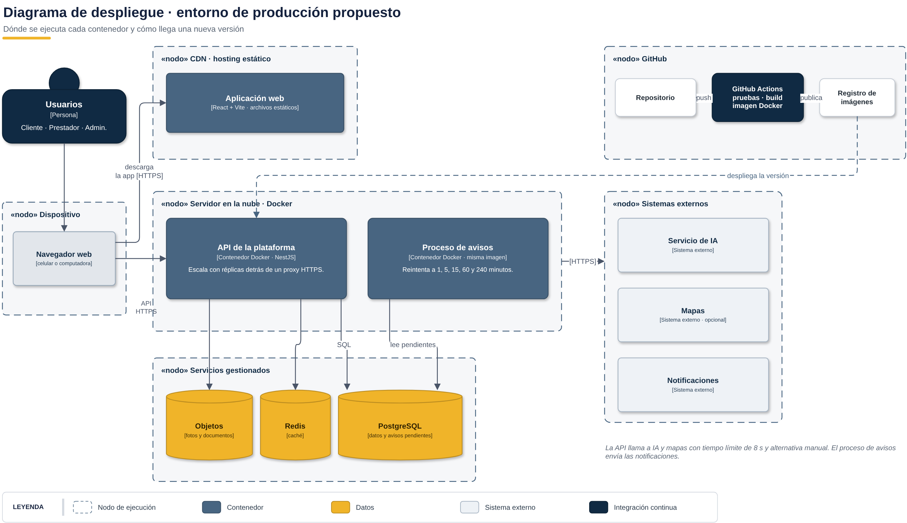

# Diagrama de despliegue

> **Proyecto:** Plataforma web para la búsqueda y contratación de servicios de construcción civil en Ayacucho.  
> **Modelo:** C4 · vista complementaria de despliegue.  
> **Estado:** entorno de producción propuesto; el proveedor de nube se elegirá al implementar.

## 1. Objetivo

Mostrar en qué nodos se ejecutan los contenedores del nivel 2 y cómo llega una nueva versión a producción.

## 2. Diagrama

[Editar en Draw.io](../../img/fuentes-svg/despliegue.drawio) · [Versión SVG](../../img/fuentes-svg/despliegue.svg)

## 3. Nodos

| Nodo | Qué se ejecuta | Motivo |
|---|---|---|
| Dispositivo del usuario | Navegador web en celular, tableta o computadora. | La aplicación es responsive (RC01). |
| CDN · hosting estático | Archivos de la aplicación web generados por Vite. | Entrega rápida y económica de archivos que no cambian. |
| Servidor en la nube · Docker | API de la plataforma y proceso de avisos, desde la misma imagen. | Un solo despliegue del monolito modular (ADR-001). La API puede tener varias réplicas detrás de un proxy HTTPS. |
| Servicios gestionados | PostgreSQL, Redis y almacenamiento de objetos. | Respaldos y mantenimiento a cargo del proveedor. |
| GitHub | Repositorio, GitHub Actions y registro de imágenes. | Cada cambio ejecuta las pruebas y construye la imagen antes de desplegarse. |

## 4. Comunicación

| Origen | Destino | Protocolo | Observación |
|---|---|---|---|
| Navegador | CDN | HTTPS | Descarga la aplicación web. |
| Navegador | API | HTTPS con JSON | API REST (RC06). |
| API | PostgreSQL · Redis · objetos | SQL · Redis · HTTPS | Red privada del proveedor. |
| API | IA y mapas | HTTPS | Tiempo límite de 8 s y alternativa manual (ADR-007). |
| Proceso de avisos | Notificaciones | HTTPS | Reintentos a 1, 5, 15, 60 y 240 minutos (ADR-009). |

Las credenciales de la base de datos y de los proveedores se configuran como variables de entorno del servidor; nunca se guardan en el repositorio ni llegan al navegador (RC09).

---

[Índice del proyecto](../../README.md) · [Nivel 4](04-nivel4-codigo.md)
