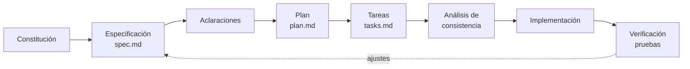

# SDD (Spec-Driven Development) y Spec Kit

**SDD** significa **especificar antes de implementar**: la especificación es el artefacto principal y de ella salen el plan, las tareas y el código. No es un estilo arquitectónico ni un marco de gestión: es la forma de construir cada funcionalidad.

## 1. Flujo aplicado



| Paso | Comando | Resultado |
|---|---|---|
| Constitución | `$speckit-constitution` | `.specify/memory/constitution.md` con los principios del proyecto |
| Especificación | `$speckit-specify` | `specs/00X-…/spec.md`: historias, escenarios y requisitos |
| Aclaraciones | `$speckit-clarify` | Dudas resueltas dentro de `spec.md` |
| Plan | `$speckit-plan` | `plan.md`, `research.md`, `data-model.md`, `contracts/` y `quickstart.md` |
| Tareas | `$speckit-tasks` | `tasks.md` ordenado por historia |
| Análisis | `$speckit-analyze` | Revisión de consistencia entre especificación, plan y tareas |
| Implementación | `$speckit-implement` | Código y pruebas en `tecnologia/` |

## 2. Estructura de carpetas

```text
.specify/memory/constitution.md     principios del proyecto
specs/
  001-usuarios-y-acceso/            spec, plan, research, data-model, contracts, quickstart, tasks
  002-prestadores-y-catalogo/
  003-solicitudes-y-cotizaciones/
  004-contratacion/
  005-seguimiento-y-cierre/
  006-notificaciones/
docs/                               análisis, arquitectura, diseño, C4 y gestión
tecnologia/                         backend y frontend generados desde las especificaciones
```

## 3. Constitución

La constitución convierte las decisiones de arquitectura en reglas que toda funcionalidad debe cumplir.

| Principio | Origen |
|---|---|
| I. Monolito modular con diez módulos que se comunican por su API pública | ADR-001 |
| II. Clean Architecture: dominio sin frameworks, puertos y adaptadores | ADR-002 |
| III. Integridad de contrataciones (no negociable): una activa por solicitud | DA04, ADR-005 |
| IV. Seguridad por rol y por participación; Ley N.º 29733 | DA03, ADR-006, RC14 |
| V. Avisos sin bloqueo con patrón Outbox | ADR-009 |
| VI. Servicios externos reemplazables con tiempo límite y alternativa | ADR-007, ADR-008 |
| VII. API REST con formato único de errores | ADR-003 |
| VIII. El cliente paga directamente al prestador | RC10 |
| IX. Pruebas obligatorias por escenario, incluidas permisos y concurrencia | AC09, EQ-04, EQ-09 |
| X. Stack definido en ADR-013 | ADR-013 |
| XI. Trazabilidad HU → RF → EQ → ADR en cada especificación | RC05 |
| XII. Simplicidad: nada de microservicios ni colas sin un ADR nuevo | ADR-001, ADR-009 |

## 4. Cómo se conecta con el resto

- Cada especificación cita sus HU, RF, EQ y ADR.
- La verificación usa las pruebas PRnn de [04-pruebas.md](04-pruebas.md).
- Una funcionalidad se considera terminada cuando cumple la [Definition of Done](01-scrum.md#4-definition-of-done-dod).

## 5. Puntos de SDD y dónde están en el repositorio

| N.º | Punto | Archivo |
|---|---|---|
| 1 | Constitución del proyecto | `.specify/memory/constitution.md` |
| 2 | Contexto y problema | [Contexto y problemática](../01-analisis-de-sistema/00-contexto-y-problematica.md) |
| 3 | Actores | [Actores](../01-analisis-de-sistema/01-actores.md) |
| 4 | Historias de usuario | [Historias de usuario](../01-analisis-de-sistema/02-historias-de-usuario.md) |
| 5 | Requisitos funcionales | [Requisitos funcionales](../01-analisis-de-sistema/03-requisitos-funcionales.md) |
| 6 | Atributos de calidad | [Atributos de calidad](../01-analisis-de-sistema/04-atributos-de-calidad.md) |
| 7 | Restricciones | [Restricciones](../01-analisis-de-sistema/05-restricciones.md) |
| 8 | Drivers | [Drivers arquitectónicos](../01-analisis-de-sistema/06-drivers-arquitectonicos.md) |
| 9 | Decisiones (ADR) | [Decisiones arquitectónicas](../01-analisis-de-sistema/07-decisiones-arquitectonicas.md) |
| 10 | Escenarios de calidad | [Escenarios](../01-analisis-de-sistema/08-escenarios-atributos-calidad.md) |
| 11 | Modelo de datos | [Modelo de datos](../03-diseno-de-software/modelo-de-datos.md) |
| 12 | Diseño de API | [API REST](../02-arquitectura-software/api-rest.md) |
| 13 | Estilo y componentes | [Estilo](../02-arquitectura-software/estilo-arquitectonico.md), [Componentes](../02-arquitectura-software/componentes-arquitectonicos.md) |
| 14 | Seguridad y privacidad | [Seguridad y privacidad](../02-arquitectura-software/seguridad-y-privacidad.md) |
| 15 | Diseño interno | [Diseño interno de módulos](../03-diseno-de-software/diseno-interno/diseno-interno-de-modulos.md) |
| 16 | Modelo C4 | [Modelo C4](../04-modelo-c4/01-nivel1-contexto.md) |
| 17 | Despliegue | [Despliegue](../04-modelo-c4/05-despliegue.md) |
| 18 | Pruebas | [Pruebas](04-pruebas.md) |
| 19 | Backlog y sprints | [Backlog y sprints](02-backlog-y-sprints.md) |
| 20 | Trazabilidad | [Trazabilidad](../trazabilidad.md) |

## 6. Especificación de ejemplo

### US-001 Aceptar una cotización (HU12 · RF20, RF21 · EQ-09)

**Como** cliente **quiero** aceptar una cotización definitiva y vigente **para** dejar registrada la contratación.

| Criterio | Dado / Cuando / Entonces |
|---|---|
| CA1 | Dada una cotización definitiva con disponibilidad confirmada, cuando el cliente la acepta, entonces se crea la contratación en estado CONFIRMADA. |
| CA2 | Dada una cotización sin disponibilidad confirmada, cuando el cliente la acepta, entonces queda EN_CONFIRMACION con un plazo de 24 horas para el prestador. |
| CA3 | Dada una solicitud con una contratación activa, cuando se intenta aceptar otra cotización, entonces se responde 409 `CONTRATACION_ACTIVA_EXISTENTE`. |
| CA4 | Dados 10 intentos simultáneos sobre la misma solicitud, entonces solo una contratación queda activa. |
| CA5 | Dada una petición repetida con la misma clave de idempotencia, entonces se devuelve el mismo resultado sin crear otro registro. |
| CA6 | Dado un usuario que no es el cliente de la solicitud, entonces la aceptación se rechaza con 403. |

Fuera de alcance: el pago del trabajo, que el cliente realiza directamente al prestador. Verificación: PR09, PR10 y PR11. Estado: **planificado** (funcionalidad 004).

---

[Índice del proyecto](../../README.md)
