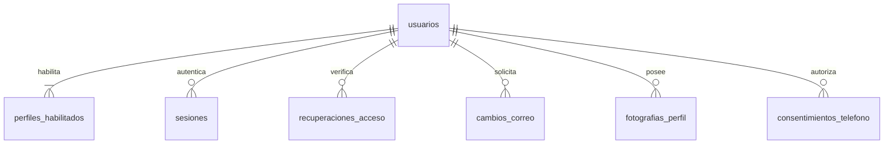

# Modelo de datos — 001 Usuarios y acceso

**Estado**: diseño para migraciones futuras; no se han creado tablas ni migraciones.
**Fuentes**: [spec](spec.md), [investigación](research.md) y
[modelo global](../../docs/03-diseno-de-software/modelo-de-datos.md).
PostgreSQL 18 es la autoridad. TypeORM/QueryRunner solo existen en Infraestructura.
Ninguna tabla de este modelo de seguridad se almacena o replica como caché en Redis.

## Propiedad y relaciones

Usuarios y acceso posee esas siete tablas. Notificaciones posee
`avisos_pendientes`; Infraestructura compartida posee `claves_idempotencia`.
El acceso entre módulos se hace por sus API internas, no por repositorios ajenos.
No crear `prestadores`, servicios o entidades de RF06 por habilitar el perfil.

## Tipos y convenciones comunes

Identificadores UUID; fechas `timestamptz` UTC; versiones enteras positivas.
Los campos de contraseña son texto PHC, nunca `varchar(72)` ni binarios truncados.
Los tokens son aleatorios de 32 bytes; solo sus digests SHA-256 se conservan
como credenciales verificables, con índices únicos por digest y propósito separado.
No registrar contraseñas, cookies, tokens ni enlaces completos en logs.

La aplicación utiliza el mismo cálculo canónico de correo que PostgreSQL:
`lower(correo)`. Comparar también las entradas de login/recuperación usando esa
misma función en DB; no mezclar reglas Unicode de JS con otra colación SQL.
No eliminar puntos ni sufijos `+`. La migración fija y prueba la colación
determinista empleada. Cambiar esa regla requiere revisar duplicados existentes.

Límites de transporte para texto no secreto: nombre hasta 200 puntos de código,
correo hasta 320, teléfono hasta 32 y distrito hasta 100; validar ausencia de vacío
en nombre/correo. Son límites técnicos del contrato, no nuevos campos obligatorios
ni restricciones a nombres de empresa. No imponer formatos nacionales al teléfono
ni restringir el distrito de cuenta a un distrito profesional de RF06.

## 1. usuarios

| Campo | Tipo / nulabilidad | Regla |
|---|---|---|
| id | uuid, PK | Identificador interno inmutable; no aceptarlo como campo editable. |
| correo | text, no nulo | Formato válido; presentación privada. |
| correo_canonico | text generado, no nulo | `lower(correo)`, índice único; actualizaciones simultáneas se protegen en DB. |
| nombre_mostrar | text, no nulo | Persona o empresa; no exigir nombres/apellidos separados. |
| contrasena_hash | text, no nulo | PHC Argon2id con parámetros y sal; nunca texto plano. |
| version_credencial | bigint, no nulo, inicial 1 | Incrementa al cambiar contraseña; evita carreras con login/reautenticación. |
| telefono | text, nulo | Opcional y privado por defecto. |
| distrito | text, nulo | Dato opcional de cuenta, no zona profesional. |
| fotografia_id | uuid, nulo | Referencia a fotografía propia, validada y utilizable. |
| politica_privacidad_version | text, no nulo | Versión presentada y aceptada al registrarse. |
| privacidad_aceptada_en | timestamptz, no nulo | Consentimiento explícito; no aceptar falso/ausente. |
| fallos_consecutivos | integer, no nulo, inicial 0 | Actualización bajo bloqueo de cuenta. |
| bloqueada_hasta | timestamptz, nulo | Quinto fallo fija ahora+900 segundos. |
| version | bigint, no nulo, inicial 1 | Versión pública del agregado para mutaciones del perfil/credenciales. |
| creada_en / actualizada_en | timestamptz | Reloj servidor. |

Índices: único de `correo_canonico`; PK para titularidad y locks.
Éxito de login reinicia fallos consecutivos; intentos durante bloqueo no prolongan
la espera. Al cumplirse el plazo se reinicia la secuencia para el nuevo intento.
No introducir estados de moderación administrativa en 001.

### Entrada de contraseña y política

Contraseña y confirmación solo existen como entradas transitorias. Contar puntos
de código, aceptar 15–128 inclusive y convertir la secuencia completa a UTF-8.
No trim, normalización ni truncado; no imponer mezcla de caracteres. Verificar
catálogo local de comunes/comprometidas en registro, recuperación y cambios.
El login compara la secuencia completa contra Argon2id, no modifica la política
de una credencial al autenticarla. No guardar confirmación ni hash rápido de la
contraseña humana; HMAC de petición idempotente usa una clave independiente.

## 2. perfiles_habilitados

| Campo | Tipo | Regla |
|---|---|---|
| usuario_id | uuid FK usuarios | Misma identidad. |
| perfil | text, CHECK cliente/prestador | PK compuesta usuario_id+perfil. No existe administrador en el alta pública. |
| habilitado_en | timestamptz | Servidor. |
| confirmado_por_titular_en | timestamptz | Confirmación de registro o de adición posterior. |

Cada cuenta tiene uno o dos perfiles; alta y perfiles se guardan en la misma
transacción. Adición exige sesión y confirmación verdadera; repetirla no crea
filas adicionales. No retirar perfiles en 001. Incrementar versión al añadir.
No asignar verificación ni insertar perfil profesional.

## 3. sesiones

| Campo | Tipo | Regla |
|---|---|---|
| id / usuario_id | uuid PK / FK | Cuenta propietaria. |
| acceso_digest | bytea único | Digest del Bearer vigente, no el secreto. |
| acceso_vence_en | timestamptz | Emisión de acceso+900 s. |
| renovacion_digest | bytea único | Digest de renovación vigente, rotada al renovarse. |
| renovacion_vence_en | timestamptz | Inicio+7 días; nunca deslizante. |
| autenticada_con_contrasena_en | timestamptz | Solo inicio o reautenticación con contraseña correcta de esta sesión. |
| creada_en / renovada_en | timestamptz | La segunda NO reemplaza el momento de autenticación. |
| revocada_en | timestamptz nulo | Cierre actual o recuperación. |
| version | bigint | Control interno de rotación y carreras. |

Índices por usuario y estado para revocación; únicos de digests.
Una sesión es utilizable solo si no revocada y su credencial correspondiente no
venció. Acceso expira al alcanzar el límite, no un instante después.
Renovar requiere digest vigente, CSRF y origen; bloquea cuenta→sesión, rota
los dos secretos sin mover inicio, vencimiento absoluto ni autenticación con contraseña.
El Bearer anterior deja de ser el vigente. No reintentar renovación automáticamente
con otro token si el servidor ya la confirmó; coordinar solicitudes del cliente.

El token CSRF se deriva por HMAC de la renovación presentada y una clave servidor;
no se almacena una copia utilizable de la renovación para reconstruirlo.
Cerrar revoca la sesión y elimina cookie; reset revoca todas las filas de la cuenta.
Comprobar DB en cada operación, sin caché de permisos ni revocaciones.

## 4. recuperaciones_acceso

| Campo | Tipo | Regla |
|---|---|---|
| id / usuario_id | uuid PK / FK | Cuenta destino, nunca una cuenta elegida en el body de consumo. |
| token_digest | bytea único | Propósito exclusivamente recuperación. |
| emitida_en / vence_en | timestamptz | vence_en=emitida_en+1800 s. |
| consumida_en / invalidada_en | timestamptz nulo | Un solo consumo exitoso. |
| version | bigint, inicial 1 | Se incluye en el enlace y consumo; representa la versión del desafío. |

Estados derivados: pendiente; vencida si ahora>=vence_en; consumida; invalidada.
No imponer que solicitar otro enlace invalide inmediatamente el anterior.
Consumir uno invalida todas las recuperaciones pendientes y todas las sesiones.
Una clave de idempotencia nueva no permite reutilizar el enlace consumido.

Antes de recalcular Argon2, consultar una coincidencia idempotente confirmada del
ámbito, clave y HMAC del cuerpo completo, incluido el token. Si coincide, devolver
el resultado anterior sin revalidar consumo, vencimiento o catálogo actual ni
ejecutar otra vez. Una misma clave con datos distintos produce 409.
Solo cuando no existe replay confirmado se comprueban política y desafío.

Orden transaccional para una ejecución nueva: leer id de cuenta por digest sin confiar en datos del cliente;
bloquear cuenta; bloquear desafío; obtener ahora del reloj servidor; verificar uso,
propósito, vigencia y versión; guardar PHC nuevo e incrementar version_credencial
y version de usuario; consumir e invalidar pendientes; revocar sesiones;
registrar aviso por API de Notificaciones; guardar resultado idempotente; commit.
Falla en cualquier escritura: rollback íntegro, incluido aviso e idempotencia.

Argon2 y consulta al catálogo se hacen antes de mantener locks costosos; tras
adquirirlos se revalidan todos los estados relevantes. Nunca autorizar por un estado
consultado antes del bloqueo.

## 5. cambios_correo

| Campo | Tipo | Regla |
|---|---|---|
| id / usuario_id | uuid PK / FK | Titular y cambio. |
| sesion_solicitante_id | uuid FK sesiones | Registro de la sesión que acreditó recencia. |
| nuevo_correo / nuevo_correo_canonico | text | Privados; no alteran aún usuarios.correo. |
| token_digest | bytea único | Token de verificación distinto del de recuperación. |
| solicitada_en / vence_en | timestamptz | Caducidad técnica de 30 minutos para este desafío. |
| autenticacion_acreditada_en | timestamptz | Marca con contraseña que autorizó la solicitud; no enviada por cliente. |
| confirmada_en / invalidada_en | timestamptz nulo | No completar dos veces. |
| version | bigint, inicial 1 | Control del desafío. |

Solicitud: sesión activa, versión de perfil esperada y antigüedad de autenticación
entre 0 y 300 segundos inclusive; si no hay marca o supera límite, exigir
reautenticación con contraseña actual. Registrar solicitud+correo pendiente en
una transacción, sin cambiar el correo actual ni reservar el destino.

Confirmación: sesión válida del mismo titular, desafío vigente y del propósito
correcto, versión actual de perfil y versión del desafío; verificar unicidad otra
vez bajo transacción e índice. Cambiar correo e incrementar versión. Conservar
id interno, contraseña, perfiles y datos. La verificación del nuevo correo es
obligatoria; no volver a exigir 300 segundos al confirmar.
Dos confirmaciones por el mismo destino: como máximo una cuenta adquiere el correo.
La que pierde conserva el anterior y recibe 409.

## 6. fotografias_perfil

| Campo | Tipo | Regla |
|---|---|---|
| id / usuario_id | uuid PK / FK | Propietario; no aceptar referencia ajena. |
| objeto_clave | text único | Generada por backend, sin nombre de archivo arbitrario. |
| mime / bytes / checksum | text / bigint / bytea | JPG, PNG o WEBP; máximo 10 MB; comprobar contenido. |
| estado | text | temporal, activa o pendiente_eliminacion. |
| creada_en / vinculada_en | timestamptz nulo según estado | Limpieza coordinada de temporales sin referencia. |

Objeto en S3, referencia en DB. Entrada/salida JSON con base64 y MIME, sin URL libre;
límite decodificado de 10000000 bytes. En registro, la foto opcional se almacena
antes del commit y su referencia se vincula con la cuenta nueva en la transacción;
si falla almacenamiento no se confirma el registro y si falla DB se limpia el objeto
sin referencia. En edición, subir por backend y luego vincular mediante PATCH
del perfil con versión. Si falla DB tras almacenar un objeto, queda como temporal
para limpieza; no se atribuye guardado del perfil. No borrar el objeto previo
antes del commit de la referencia nueva. Las lecturas comprueban titularidad.
No desarrollar perfiles públicos RF10 ni documentos RF07.

## 7. consentimientos_telefono

| Campo | Tipo | Regla |
|---|---|---|
| id / usuario_id | uuid PK / FK | Titular. |
| telefono_hmac | bytea | Consentimiento vinculado al valor autorizado; no a cualquier teléfono futuro. |
| autorizada_en / revocada_en | timestamptz nulo | Autorización explícita o retiro. |
| version | bigint | Control de cambios junto a versión de perfil. |

Registrar teléfono no crea consentimiento. Cambiar el valor deja sin efecto la
autorización para el valor anterior; compartir el nuevo requiere confirmación
explícita. El perfil devuelve solo el estado efectivo del consentimiento;
la proyección pública excluye siempre correo/documentos/dirección y omite teléfono
si no está autorizado. Esta proyección interna no entrega RF10.

## 8. avisos_pendientes — propiedad de Notificaciones

Campos: id UUID; tipo (recuperación, verificar_correo, contraseña_recuperada);
destinatario privado; payload cifrado AEAD y key_id; referencia de desafío;
creado_en, vence_en si contiene enlace; próximo_intento_en; intentos; estado;
lease_hasta; enviado_en; error sanitizado; clave lógica única para no duplicar
aviso al repetir la misma operación.

La API interna de Notificaciones registra filas con la unidad de trabajo en curso,
sin exponer EntityManager en los puertos de Usuarios. Worker del mismo backend
toma lotes con locks y lease, confirma después del envío y aplica backoff limitado.
No mantener una transacción DB abierta durante SMTP. Si el worker cae después
de entregar, puede reenviar el mismo correo; no crea otro desafío.
Borrar ciphertext sensible al confirmar entrega o vencer. El hash del desafío
solo nunca permitiría reconstruir el enlace: por eso el payload se cifra,
con clave fuera de DB y del repositorio. No hacer de Redis una cola.

## 9. claves_idempotencia — infraestructura compartida

Campos: ámbito (usuario para mutaciones autenticadas, digest de desafío para
recuperación, correo canónico para registro); método+ruta lógica redactada;
clave aleatoria del cliente; HMAC de cuerpo completo canónico con clave servidor;
estado; HTTP y resultado sin secretos; creado_en; hmac_key_id.
Índice único ámbito+operación+clave. Sin caducidad automática del resultado en 001:
no acotar unilateralmente el replay confirmado por el usuario. Una política futura
de conservación debe preservar esa garantía o contar con revisión explícita.
No guardar contraseñas, tokens ni cookies en el body serializado. Respuesta de
login/renovación no se persiste en esta tabla.

Decisión de usuario del 2026-11-16: misma clave y mismos datos devuelve resultado
previo, sin nuevas mutaciones; misma clave con otros datos produce 409; una clave
diferente con enlace usado produce rechazo. El replay exige comprobar el ámbito
y coincidencia del token/cuerpo, no basta adivinar una clave. La revocación de
sesiones ya confirmada no se deshace por replay. Registrar resultado junto al commit.
En mutaciones autenticadas comprobar primero sesión y permisos vigentes; después
buscar el replay. En recuperación pública exigir coincidencia del token y cuerpo
completo, antes de evaluar nuevamente el desafío. Conservar la clave de HMAC
identificada para comprobar resultados existentes, sin persistir secretos en claro.
Una operación en curso se espera de forma acotada o devuelve conflicto controlado;
no ejecutarla dos veces.

## Transacciones y carreras obligatorias

| Operación | Unidad atómica / control |
|---|---|
| Registro | Cuenta+perfiles+privacidad+resultado; índice de correo decide carreras. |
| Login | Validación Argon2 fuera de lock; cuenta bloqueada y versión_credencial revalidada antes de crear sesión; reinicio de fallos bajo lock. |
| Fallo de login | Incremento serializado; quinto fija bloqueo; no depender de un contador local. |
| Renovación | Cuenta→sesión; comprobar revocación y digest vigente; rotación atómica. |
| Reautenticación | Revalidar versión_credencial y sesión bajo lock antes de actualizar su marca con contraseña. |
| Recuperación completada | Cuenta→desafío→sesiones/pendientes; hash+revocación+aviso+idempotencia en el mismo commit. |
| Perfil/consentimiento/perfil habilitado | Comparación de version esperada; toda modificación efectiva incrementa versión del agregado. |
| Solicitar correo | Cuenta→sesión, recencia a la solicitud+desafío+outbox; no usar la fecha de renovación. |
| Confirmar correo | Cuenta→desafío, versión, unicidad de destino+consumo+resultado. |
| Contraseña desde cuenta | Verificar actual y política; revalidar versión bajo lock; guardar hash y versiones; no revocar globalmente por inferencia. |

Fijar orden cuenta→sesión/desafío en todos los caminos para evitar locks invertidos.
Los locks para el ámbito de idempotencia se toman de forma consistente antes de
la mutación y nunca cruzan dos cuentas en orden distinto.
Reloj productivo del servidor/DB leído al decidir después del lock (no una marca
vieja del inicio de transacción); `Reloj` inyectable para tests.
No permitir que un login validado con la contraseña previa al reset cree sesión
después de él. Cada fallo de DB responde sin mutaciones parciales.

## Migraciones futuras y datos de prueba

Crear migraciones TypeORM explícitas, sin synchronize en producción; ensayar
subida en una DB vacía y validación de índices/constraints. Las pruebas de garantías
usan PostgreSQL real. Datos ficticios; secretos efímeros, sin credenciales de ejemplo
válidas en producción. Las tablas amplían el modelo global propuesto, sin crear
módulos de negocio fuera de 001.
