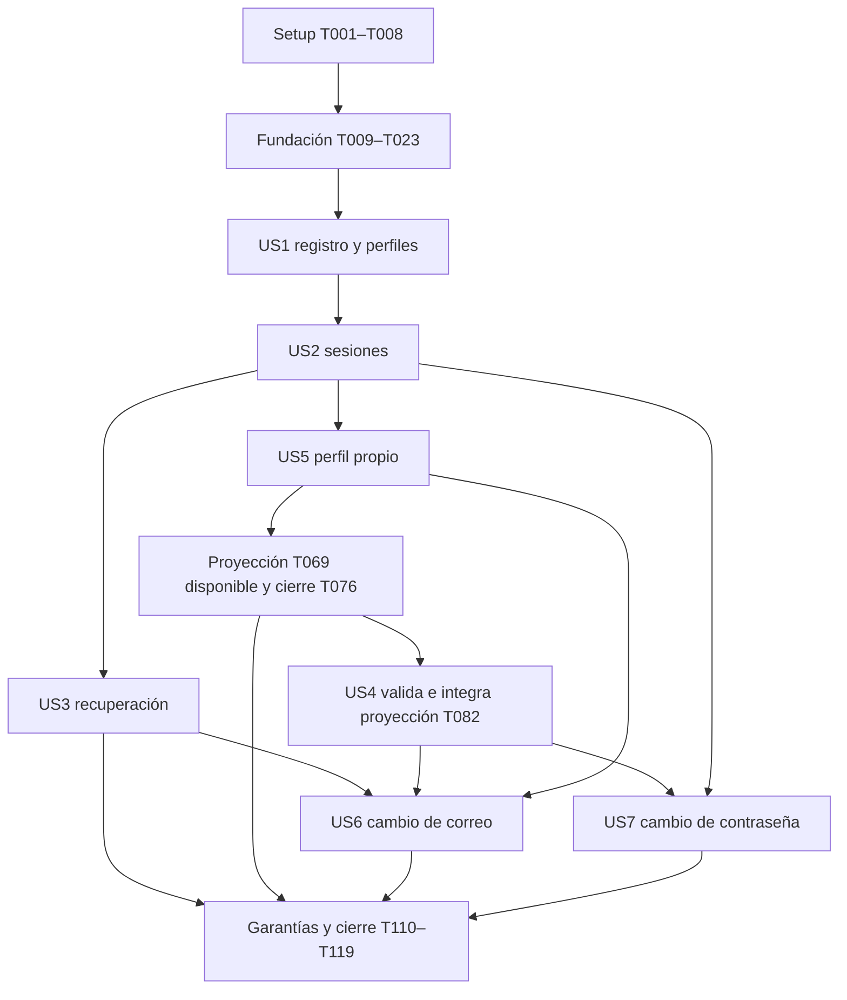

# Tasks: 001 — Usuarios y acceso

**Fecha** 2026-11-17. Preparación, fundación y US1–US7 verificadas. El progreso
del cierre, TLS y los resultados por plataforma se registran en [implementation-status.md](implementation-status.md).
**Entrada**: [spec.md](spec.md), [plan.md](plan.md), [research.md](research.md),
[data-model.md](data-model.md), [contratos](contracts/README.md),
[OpenAPI](contracts/openapi.json), [matriz de pruebas](test-matrix.md),
[quickstart.md](quickstart.md) y constitución 1.0.1.

**Alcance**: RF01–RF05; HU01 y HU02, desglosadas en US1–US7 de la spec.
Las siete historias son P1 y «Debe (MVP)». Los artefactos fundacionales existen;
US1 (T024–T036), US2 (T037–T048), US3 (T049–T062), US5 (T063–T076) y US4 (T077–T085) están verificadas;
US6 (T086–T099) y US7 (T100–T109) están verificadas. Las marcas T110–T119 reflejan
la aceptación de cada tarea. El seguimiento del 503 histórico, los abortos nativos
de Windows y el corpus productivo se conserva en el informe de implementación.
No cambiar las decisiones Q1–Q4 ni la regla de replay confirmada en research R12.
No implementar RF06/RF07/RF10/RF35 funcionales, administración, Contrataciones,
otros módulos vacíos ni alterar `tecnologia/ejemplo-clean-architecture/`.

## Formato y convenciones de rutas

Cada tarea usa `- [ ] Tnnn [P?] [USn?] descripción con ruta`.
Los IDs son únicos y consecutivos en el orden recomendado de ejecución.
`[P]` permite concurrencia dentro de la tanda indicada, una vez terminados sus
prerrequisitos; no elimina dependencias. Las rutas son relativas a la raíz y
se escriben completas en cada tarea. Dominio/Aplicación no importan Nest, TypeORM,
SMTP, S3 ni detalles de otro módulo. La composición conecta los adaptadores.

**Pruebas obligatorias**: la petición, la matriz y el principio IX requieren
pruebas para los 53 CA. Crear primero las pruebas de cada historia y comprobar
que fallan por el comportamiento pendiente; después implementar y dejarlas verdes.
U/I/C/V/E conservan el significado y las rutas de `test-matrix.md`.
Cada nombre de prueba incluye el CA exacto y su variante. Un test parametrizado
debe emitir resultados separados por CA. Los controles X-01–X-08 son adicionales,
no escenarios nuevos ni sustitutos de los 53. Las unitarias usan puertos/reloj;
las garantías de índices, locks, transacciones y revocación usan PostgreSQL real.

## Fase 1: Setup — entorno y herramientas compartidas

**Objetivo**: crear las dos aplicaciones previstas y el entorno reproducible de
validación. T001–T002 preceden T003–T008; estos últimos forman una tanda paralela
con archivos separados. No arrancar pruebas funcionales antes de la fase 2.

- [X] T001 Inicializar backend ESM NestJS 12/TypeScript 6 estricto, Node.js 24 LTS >=24.15 y resolución NodeNext en `tecnologia/backend/package.json`, `tecnologia/backend/package-lock.json` y `tecnologia/backend/tsconfig.json`; comprobar peers y módulos nativos, fijar parches estables y scripts de lint/typecheck/build/test de quickstart, sin sustituir las líneas del plan para resolver incompatibilidades. Entregar la receta de imagen Linux multietapa en `tecnologia/backend/Dockerfile` y su contexto en `tecnologia/backend/.dockerignore`, con base Node compatible fijada por digest, npm ci, compilación, dependencias nativas Argon2 compatibles entre etapas y ejecución como usuario sin privilegios; excluir secretos, corpus y evidencia del contexto. Definir ahora la receta; verificar su construcción/arranque en T023, después de la composición T022, y repetir en T116 con todas las historias.
- [X] T002 Inicializar React 19/Vite 8/TypeScript 6 con resolución Bundler en `tecnologia/frontend/package.json`, `tecnologia/frontend/package-lock.json`, `tecnologia/frontend/tsconfig.json`, `tecnologia/frontend/vite.config.ts` y `tecnologia/frontend/index.html`; fijar parches reproducibles y scripts de quickstart.
- [X] T003 [P] Configurar ESLint y reglas de dependencias en `tecnologia/backend/eslint.config.mjs`, `tecnologia/frontend/eslint.config.mjs` y `tecnologia/dependency-cruiser.cjs`; distinguir capas, API públicas y composición, sin crear esqueletos de los otros módulos.
- [X] T004 [P] Definir PostgreSQL 18, Redis, Mailpit y Garage locales con volúmenes privados y comprobaciones de salud en `tecnologia/compose.yaml` y `tecnologia/infra/garage.toml`; fijar imágenes reproducibles, dejar Redis sin datos privados y usar los nombres de servicio postgres/redis/correo/objetos de quickstart.
- [X] T005 [P] Preparar mismo origen HTTPS `https://localhost:8443` y proxy `/api/v1` hacia 3000 y web hacia 5173 en `tecnologia/infra/Caddyfile` y `tecnologia/scripts/preparar-tls.ps1`; certificados/claves locales en `tecnologia/.local/`, cookie Secure intacta y redacción de segmentos de token en logs del proxy. Alinear el techo del proxy con los límites de contratos y preservar 413 CUERPO_DEMASIADO_GRANDE en JSON con Cache-Control no-store, sin páginas HTML ni impedir el límite de 14 MB de foto; la aplicación aplica el límite ordinario de 64 KiB.
- [X] T006 [P] Configurar Jest 30/SWC/Supertest, validación OpenAPI 3.1 y harness PostgreSQL aislado en `tecnologia/backend/jest.config.mjs`, `tecnologia/backend/.swcrc`, `tecnologia/backend/test/soporte/postgres.ts` y `tecnologia/backend/test/soporte/contrato.ts`; unitarias sin DB, integración sin SQLite y utilidades para barreras y fallos deterministas.
- [X] T007 [P] Configurar Vitest/Testing Library y Playwright en `tecnologia/frontend/vitest.config.ts`, `tecnologia/frontend/playwright.config.ts` y `tecnologia/frontend/test/soporte/validacion.ts`; backend real, Mailpit, contextos aislados, 360/768/1366 px y Chromium/Firefox/WebKit, con reportes sanitizados y versiones de navegador. Entregar ejecución TLS reproducible en `tecnologia/frontend/Dockerfile.e2e`, `tecnologia/frontend/scripts/confianza-e2e.sh`, `tecnologia/frontend/scripts/ejecutar-e2e-linux.mjs` y `tecnologia/frontend/scripts/probar-navegadores.mjs`, con configuración en `tecnologia/frontend/TLS-PRUEBAS.md`. Verificados 9/9 proyectos Linux y 9/9 Windows nativo con CA confiable y rechazo de certificado no confiable; ejecución nativa en tecnologia/frontend/scripts/probar-navegadores-windows.mjs, con CA aceptada y verificada en CurrentUser/Root.
- [X] T008 [P] Declarar configuración sin secretos y exclusiones de artefactos en `tecnologia/backend/.env.example`, `tecnologia/frontend/.env.example` y `.gitignore`; separar validación/producción, origen/base de enlaces confiables, SMTP/S3, claves AEAD/HMAC con identificador y corpus externo; excluir `.local`, credenciales, corpus voluminoso y reportes sensibles.

**Punto de control**: instalación reproducible, compiladores y harness disponibles;
los comandos de aplicación todavía dependen de los adaptadores siguientes.

## Fase 2: Fundacional — prerrequisitos bloqueantes

**Objetivo**: persistencia, seguridad común y adaptadores requeridos por varias
historias. Completar T009–T023 antes de iniciar US1. El mínimo de identidad y
titularidad se aplica desde aquí; US4 extiende/verifica su matriz tras existir
los endpoints de perfil de US5. No aplazar protección de endpoints a US4.

- [X] T009 Definir errores puros, identificadores y puertos Reloj, GeneradorSecretos, UnidadDeTrabajo, HashContrasena, CatalogoContrasenasRechazadas, repositorios propios, AlmacenamientoFotografias y ProgramarCorreoSeguridad en `tecnologia/backend/src/modulos/usuarios-acceso/dominio/errores.ts` y `tecnologia/backend/src/modulos/usuarios-acceso/aplicacion/puertos/puertos.ts`; conservar literalmente «Identificadores UUID; fechas `timestamptz` UTC; versiones enteras positivas.» en sus validaciones/representación, sin tipos del ORM en el núcleo.
- [X] T010 Implementar DataSource, ejecutor de migraciones y unidad de trabajo QueryRunner en `tecnologia/backend/src/compartido/infraestructura/postgres/data-source.ts` y `tecnologia/backend/src/compartido/infraestructura/postgres/unidad-de-trabajo.ts`; transacciones locales compartidas, SQL parametrizado, synchronize desactivado y orden consistente de locks de idempotencia y cuenta→sesión/desafío; el reloj se lee al decidir después del lock, no al inicio de transacción.
- [X] T011 Crear migración y entidades TypeORM de usuarios/perfiles en `tecnologia/backend/src/modulos/usuarios-acceso/infraestructura/migraciones/001-cuentas.ts` y `tecnologia/backend/src/modulos/usuarios-acceso/infraestructura/persistencia/cuenta.entity.ts`: id «uuid, PK» e «Identificador interno inmutable; no aceptarlo como campo editable.»; correo «text, no nulo», «Formato válido; presentación privada.»; correo_canonico «text generado, no nulo», «`lower(correo)`, índice único; actualizaciones simultáneas se protegen en DB.»; nombre_mostrar «text, no nulo», «Persona o empresa; no exigir nombres/apellidos separados.»; contrasena_hash «text, no nulo», «PHC Argon2id con parámetros y sal; nunca texto plano.»; version_credencial «bigint, no nulo, inicial 1», «Incrementa al cambiar contraseña; evita carreras con login/reautenticación.»; telefono «text, nulo», «Opcional y privado por defecto.»; distrito «text, nulo», «Dato opcional de cuenta, no zona profesional.»; fotografia_id «uuid, nulo», «Referencia a fotografía propia, validada y utilizable.»; politica_privacidad_version «text, no nulo» y «Versión presentada y aceptada al registrarse.»; privacidad_aceptada_en «timestamptz, no nulo», «Consentimiento explícito; no aceptar falso/ausente.»; fallos_consecutivos «integer, no nulo, inicial 0», «Actualización bajo bloqueo de cuenta.»; bloqueada_hasta «timestamptz, nulo», «Quinto fallo fija ahora+900 segundos.»; version «bigint, no nulo, inicial 1», «Versión pública del agregado para mutaciones del perfil/credenciales.»; creada_en/actualizada_en «timestamptz», «Reloj servidor.». Para perfiles: usuario_id «uuid FK usuarios», «Misma identidad.»; perfil «text, CHECK cliente/prestador», «PK compuesta usuario_id+perfil. No existe administrador en el alta pública.», habilitado_en «timestamptz», «Servidor.» y confirmado_por_titular_en «timestamptz», «Confirmación de registro o de adición posterior.»; exigir uno o dos perfiles en alta atómica y fijar/probar colación determinista, sin quitar puntos ni sufijos `+` al correo.
- [X] T012 Crear migración, entidad y lector de sesión autoritativa en `tecnologia/backend/src/modulos/usuarios-acceso/infraestructura/migraciones/002-sesiones.ts`, `tecnologia/backend/src/modulos/usuarios-acceso/infraestructura/persistencia/sesion.entity.ts` y `tecnologia/backend/src/modulos/usuarios-acceso/infraestructura/persistencia/lector-sesion.ts`: id/usuario_id «uuid PK / FK», «Cuenta propietaria.»; acceso_digest «bytea único», «Digest del Bearer vigente, no el secreto.»; acceso_vence_en «timestamptz», «Emisión de acceso+900 s.»; renovacion_digest «bytea único», «Digest de renovación vigente, rotada al renovarse.»; renovacion_vence_en «timestamptz», «Inicio+7 días; nunca deslizante.»; autenticada_con_contrasena_en «timestamptz», «Solo inicio o reautenticación con contraseña correcta de esta sesión.»; creada_en/renovada_en «timestamptz», «La segunda NO reemplaza el momento de autenticación.»; revocada_en «timestamptz nulo», «Cierre actual o recuperación.»; version «bigint», «Control interno de rotación y carreras.»; indexar usuario/estado y consultar DB/perfiles vigentes por operación, rechazando vencimiento y revocación sin caché ni fallback permisivo.
- [X] T013 Implementar política pura de identidad/perfil/titularidad y guard de sesión en `tecnologia/backend/src/modulos/usuarios-acceso/dominio/politica-acceso.ts` y `tecnologia/backend/src/modulos/usuarios-acceso/presentacion/guard-sesion.ts`; cuenta objetivo desde sesión, roles cliente/prestador/ambos sin elevación y sin acceso implícito por referencia administrativa; 401/403/404 según contrato, incluidos recursos ajenos no visibles. Depende de T009–T012.
- [X] T014 Implementar reloj/crypto y Argon2id en `tecnologia/backend/src/modulos/usuarios-acceso/infraestructura/seguridad/crypto.ts` y `tecnologia/backend/src/modulos/usuarios-acceso/infraestructura/seguridad/argon2id.ts`; secretos aleatorios de 32 bytes y digest SHA-256 con propósito separado, PHC con sal 16 bytes/salida 32 bytes, base 64 MiB/3 pasadas/paralelismo 4 y concurrencia acotada; aplicar «Contar puntos de código, aceptar 15–128 inclusive y convertir la secuencia completa a UTF-8.» y «No trim, normalización ni truncado; no imponer mezcla de caracteres.»; Unicode inválido y entradas actuales >128 se rechazan antes de Argon2, sin almacenar confirmación ni hash rápido de contraseña humana.
- [X] T015 Implementar catálogo local versionado y preparación en `tecnologia/backend/src/modulos/usuarios-acceso/infraestructura/seguridad/catalogo-contrasenas.ts` y `tecnologia/backend/scripts/preparar-catalogo.ts`; manifiesto/fecha/checksum, comunes y snapshot completo de comprometidas, consulta exacta sin enviar datos a terceros, fixture solo en validación y readiness fallida si falta/corrompe el corpus; login no consulta catálogo. Depende de T009 y T014.
- [X] T016 Implementar migración y protocolo idempotente compartido en `tecnologia/backend/src/compartido/infraestructura/postgres/migraciones/003-idempotencia.ts` y `tecnologia/backend/src/compartido/infraestructura/idempotencia.ts`; conservar «Índice único ámbito+operación+clave.» y «Sin caducidad automática del resultado en 001: no acotar unilateralmente el replay confirmado por el usuario.»; campos ámbito (cuenta autenticada, digest de desafío para recuperación y correo canónico para registro), método+ruta lógica redactada, clave, HMAC de cuerpo completo canónico, estado, HTTP/resultado sin secretos, creado_en y hmac_key_id; claves cliente >=128 bits, clave HMAC independiente conservable por identificador, resultado en el mismo commit, espera acotada/conflicto para operación en curso y 409 si cambia cuerpo. En autenticadas verificar sesión/permisos antes de replay; en recuperación exacta consultar replay antes de desafío/catálogo/Argon2, sin persistir body, contraseñas, cookies o tokens.
- [X] T017 Crear API mínima, repositorio transaccional y migración del Outbox de Notificaciones en `tecnologia/backend/src/modulos/notificaciones/api-publica.ts`, `tecnologia/backend/src/modulos/notificaciones/aplicacion/puertos/correo-seguridad.ts` y `tecnologia/backend/src/modulos/notificaciones/infraestructura/migraciones/004-avisos.ts`; campos del modelo: «id UUID», «tipo (recuperación, verificar_correo, contraseña_recuperada)», «destinatario privado», «payload cifrado AEAD y key_id», referencia de desafío, creado_en, «vence_en si contiene enlace», próximo_intento_en, intentos, estado, lease_hasta, enviado_en, «error sanitizado» y «clave lógica única para no duplicar aviso al repetir la misma operación.»; mismo QueryRunner mediante adaptador en composición, sin acceso de Usuarios a repositorios/tablas ajenos ni implementar catálogo RF35. Depende de T010 y T014.
- [X] T018 Implementar worker dentro del mismo backend, cifrado AEAD y adaptador SMTP reemplazable en `tecnologia/backend/src/modulos/notificaciones/infraestructura/worker-correo.ts` y `tecnologia/backend/src/modulos/notificaciones/infraestructura/smtp.ts`; locks/lease para lotes, envío después del commit sin transacción abierta durante SMTP, timeout 8 s, backoff/reintentos acotados y suspensión temporal ante fallas repetidas; no enviar enlaces vencidos, borrar ciphertext al entregar/vencer, admitir posible reenvío físico tras caída sin crear otro desafío, y conservar cambio confirmado si falla aviso. Depende de T017.
- [X] T019 Crear migración/entidad de fotos, puerto S3 y limpieza en `tecnologia/backend/src/modulos/usuarios-acceso/infraestructura/migraciones/005-fotografias.ts`, `tecnologia/backend/src/modulos/usuarios-acceso/infraestructura/almacenamiento/fotografias-s3.ts` y `tecnologia/backend/src/modulos/usuarios-acceso/infraestructura/almacenamiento/limpiar-temporales.ts`: id/usuario_id «uuid PK / FK», «Propietario; no aceptar referencia ajena.»; objeto_clave «text único», «Generada por backend, sin nombre de archivo arbitrario.»; mime/bytes/checksum «text / bigint / bytea», «JPG, PNG o WEBP; máximo 10 MB; comprobar contenido.»; estado «text», «temporal, activa o pendiente_eliminacion.»; creada_en/vinculada_en «timestamptz nulo según estado», «Limpieza coordinada de temporales sin referencia.»; límite decodificado 10000000 bytes, transporte JSON/base64, no URL/PDF/binario en DB, Garage local/S3 configurable, timeout y compensación ante fallas; vincular la foto opcional de alta al crear cuenta y no borrar foto anterior antes del commit. Resolver en la migración la FK nullable de usuario.fotografia_id y la propiedad de fotos de altas aún no confirmadas sin huérfanos definitivos.
- [X] T020 Configurar REST `/api/v1`, validación estricta, filtro de errores y middleware de origen/redacción en `tecnologia/backend/src/compartido/infraestructura/http/configurar-api.ts` y `tecnologia/backend/src/compartido/infraestructura/http/logs-seguros.ts`; JSON español/camelCase, UTC, additionalProperties=false, códigos/cabeceras OpenAPI, Cache-Control no-store, Referrer-Policy no-referrer, Origin exacto sin CORS comodín, rechazo de formularios simples, 65536 bytes ordinarios en las 17 operaciones (también cuerpos inesperados), 14000000 solo registro con foto/carga y foto decodificada <=10000000 bytes; Origin obligatorio ausente→400 CABECERA_REQUERIDA en las 13 mutaciones, malformado→400 DATOS_INVALIDOS, ajeno→403 ORIGEN_NO_ADMITIDO; exceso de transporte→413 CUERPO_DEMASIADO_GRANDE, exceso de imagen decodificada→413 ARCHIVO_DEMASIADO_GRANDE; cuerpo inesperado, JSON/MIME o parámetro de ruta malformados→400 DATOS_INVALIDOS, credenciales ausentes/inválidas→401 y CSRF ausente/incorrecto→403, según la tabla de rechazos de contratos; validar por puntos de código, redactar token de ruta/cabeceras/body y no incluir SQL, stack ni datos privados en error/APM.
- [X] T021 Definir contratos/modelos puros, puertos web y adaptador HTTP en `tecnologia/frontend/src/features/usuarios-acceso/modelos/contratos.ts`, `tecnologia/frontend/src/features/usuarios-acceso/aplicacion/puertos.ts` y `tecnologia/frontend/src/features/usuarios-acceso/infraestructura/api-usuarios.ts`; respetar OpenAPI, versiones y claves idempotentes reutilizadas solo con misma operación/datos, acceso exclusivamente en memoria y tratamiento explícito de 401/403/409/422/503; ningún modelo/caso de uso importa React ni adaptadores. Depende de T020 para convenciones, no requiere endpoints ya implementados.
- [X] T022 Conectar configuración, adaptadores y API públicas en `tecnologia/backend/src/composicion/app.module.ts`, `tecnologia/backend/src/composicion/main.ts` y `tecnologia/backend/src/compartido/infraestructura/http/salud.controller.ts`; implementar GET `/api/v1/salud` con 200/503 y enum disponible/noDisponible sin secretos; readiness depende de DB/catálogo requerido, sin dependencia funcional de Redis; un único despliegue y worker. Depende de T009–T021.
- [X] T023 Entregar `dev:prepare -- --validation`, `db:migrate`, `storage:init`, `security:catalog:prepare -- --fixture`, `test:seed`, `start:validation` y `test:container` en `tecnologia/backend/scripts/preparar-validacion.ts`, `tecnologia/backend/scripts/inicializar-storage.ts`, `tecnologia/backend/scripts/verificar-contenedor.ts`, `tecnologia/backend/test/soporte/fixtures.ts` y `tecnologia/backend/package.json`; generar solo claves efímeras/TLS ignorados, comprobar DB de validación antes de seed, crear cuentas/sesiones ficticias cliente/prestador/ambos/administrativa de referencia mediante composición de test y verificar migraciones/índices, adaptadores y salud en `tecnologia/backend/test/integration/fundacion.spec.ts`. Sin endpoints productivos para seed/reloj ni credenciales reales; ensayar migración en DB vacía. Tras preparar DB/catálogo, `test:container` construye el Dockerfile T001 y arranca la imagen Linux con el entrypoint compilado T022, red aislada de Compose y configuración/corpus montados en modo de validación, sin incorporarlos a la imagen ni permitir fixture en producción; comprobar usuario sin privilegios, Argon2 nativo cargable y GET /api/v1/salud 200 con dependencias listas/503 sin DB o corpus, sin puertos públicos, y retirar solo sus contenedores efímeros al finalizar. Registrar digest, entorno y resultado sanitizado. Depende de T001, T004 y T022.

**Punto de control**: fundación lista y fallos cerrados. Las sesiones de fixture
permiten probar adición de perfiles antes de implementar login; no constituyen
un flujo de acceso público. Las tablas compartidas se crean aquí por ser usadas
por varias historias; sus reglas de negocio se implementan en sus historias.

## Fase 3: US1 — Crear una cuenta y habilitar sus perfiles (P1)

**Origen**: HU01/RF01; FR-001–003, FR-021–022, FR-028–029.
**Objetivo**: registro y adición confirmada sin duplicar identidad ni elevar permisos.
**Prueba independiente**: registrar cliente/prestador/ambos con/sin opcionales,
probar política/duplicados y añadir faltante usando sesión real sembrada por T023.
Los once CA-REG deben pasar sin RF06 ni otros módulos. El acceso público se
integra al completar US2; los fixtures de sesión solo existen en validación.

### Pruebas primero

- [X] T024 [P] [US1] Escribir U de CA-REG-01, CA-REG-02, CA-REG-04, CA-REG-05, CA-REG-06, CA-REG-09, CA-REG-10 y CA-REG-11 en `tecnologia/backend/test/unit/usuarios-acceso/registro.spec.ts`; incluir opcionales, consentimiento, confirmación true/false/ausente, 14/15/128/129 puntos de código suplementarios, espacios, >72 bytes, rechazo de comunes/comprometidas y puertos sin DB.
- [X] T025 [P] [US1] Escribir I de CA-REG-01, CA-REG-03, CA-REG-04, CA-REG-06, CA-REG-07 y CA-REG-11 en `tecnologia/backend/test/integration/usuarios-acceso/registro.spec.ts`; diez altas simultáneas case-insensitive, habilitación concurrente/repetida, una cuenta/perfil, privacidad persistida, foto propia opcional y rollback/limpieza ante fallo de objeto o DB, catálogo ausente no omitido.
- [X] T026 [P] [US1] Escribir C de POST `/cuentas` y POST `/perfil/perfiles` para CA-REG-01, CA-REG-02, CA-REG-03, CA-REG-05, CA-REG-07, CA-REG-08, CA-REG-09 y CA-REG-11 en `tecnologia/backend/test/contract/usuarios-acceso/registro.spec.ts`; versión/Idempotency-Key, obligatoriedad, Unicode, sin administrador/secretos ni credenciales/cookie emitidas por registro y resultados/códigos OpenAPI.
- [X] T027 [P] [US1] Escribir V de CA-REG-02, CA-REG-05, CA-REG-09 y CA-REG-10 en `tecnologia/frontend/test/unit/usuarios-acceso/registro.test.tsx`; mensajes por campo, privacidad explícita, pegado/espacios y límites por puntos de código sin maxlength UTF-16 incorrecto.
- [X] T028 [P] [US1] Escribir E de CA-REG-01, CA-REG-04, CA-REG-06, CA-REG-08 y CA-REG-10 en `tecnologia/frontend/test/e2e/usuarios-acceso/registro.spec.ts`; backend real, foto opcional, ambos perfiles, adición con fixture de sesión en memoria por composición de validación, identidad/datos preservados y matriz responsive/navegadores de T007.

### Implementación US1

- [X] T029 [US1] Implementar Cuenta, perfiles y política de nueva contraseña en `tecnologia/backend/src/modulos/usuarios-acceso/dominio/cuenta.ts`, `tecnologia/backend/src/modulos/usuarios-acceso/dominio/perfiles-habilitados.ts` y `tecnologia/backend/src/modulos/usuarios-acceso/dominio/politica-contrasena.ts`; respetar «Cada cuenta tiene uno o dos perfiles», «Adición exige sesión y confirmación verdadera», «No retirar perfiles en 001.» e incremento de versión efectivo, sin verificación RF07 ni administración.
- [X] T030 [US1] Definir DTO/validadores de registro y habilitación en `tecnologia/backend/src/modulos/usuarios-acceso/presentacion/registro.dto.ts`; aplicar literalmente «nombre hasta 200 puntos de código, correo hasta 320, teléfono hasta 32 y distrito hasta 100; validar ausencia de vacío en nombre/correo.»; campos obligatorios del contrato, opcionales nullable, perfiles cliente/prestador únicos 1–2, privacidad true/versión vigente y confirmación exacta; no formato nacional de teléfono ni zona RF06, validar foto JSON y Unicode completo.
- [X] T031 [US1] Implementar repositorio de cuentas/perfiles en `tecnologia/backend/src/modulos/usuarios-acceso/infraestructura/persistencia/repositorio-cuentas.ts`; búsquedas canónicas con `lower(correo)` en DB, índice como autoridad para carreras, mutación versionada, inserción atómica de perfiles y mapeo de conflicto a 409 sin SQL. Depende de T029–T030 y T011.
- [X] T032 [US1] Implementar registro en `tecnologia/backend/src/modulos/usuarios-acceso/aplicacion/registrar-cuenta.ts`; política+catálogo+Argon2 completos, cuenta/perfiles/privacidad/resultado idempotente en un commit y foto opcional almacenada antes con vinculación/compensación coordinadas; fallos no crean cuenta ni confirman éxito, no autenticar al registrar. Depende de T014–T019 y T031.
- [X] T033 [US1] Implementar adición de perfil faltante en `tecnologia/backend/src/modulos/usuarios-acceso/aplicacion/habilitar-perfil.ts`; sesión/titularidad, confirmación explícita, versión esperada, PK compuesta e idempotencia, sin otra cuenta/credencial, sin pérdida de datos ni duplicado al repetir; devolver Perfil según OpenAPI, con telefonoCompartible=false mientras no exista consentimiento efectivo, sin depender del futuro GET de US5. Depende de T013, T016 y T031.
- [X] T034 [US1] Exponer POST `/cuentas` y POST `/perfil/perfiles` en `tecnologia/backend/src/modulos/usuarios-acceso/presentacion/registro.controller.ts` y registrarlos en `tecnologia/backend/src/composicion/app.module.ts`; autorización servidor en la adición, rechazo de propiedades extra y respuestas/cabeceras exactas del contrato. Depende de T032–T033.
- [X] T035 [US1] Implementar casos de uso web de registro/habilitación y formularios en `tecnologia/frontend/src/features/usuarios-acceso/aplicacion/registro.ts`, `tecnologia/frontend/src/features/usuarios-acceso/presentacion/Registro.tsx` y `tecnologia/frontend/src/features/usuarios-acceso/presentacion/HabilitarPerfil.tsx`; tres selecciones, política/confirmación, consentimiento, opcionales/foto y mensajes sin perder el valor completo de contraseña.
- [X] T036 [US1] Integrar rutas y composición web de registro/adición en `tecnologia/frontend/src/composicion/App.tsx` y `tecnologia/frontend/src/composicion/usuarios-acceso.ts`; conectar T035 al HTTP real, proteger entrada a habilitación según estado de sesión y ejecutar T024–T028 hasta verde, guardando resultados en `tecnologia/.local/evidencia/001/us1/`; sin presentar una sesión fixture como login entregado.

## Fase 4: US2 — Iniciar, mantener y cerrar la sesión (P1)

**Origen**: HU01/RF02; FR-004–007, FR-012, FR-014.
**Objetivo**: acceso por correo/contraseña, bloqueo, renovación rotada y cierre inmediato.
**Prueba independiente**: cuentas sembradas, credenciales/tiempo controlados y
operación propia de habilitación ya disponible; nueve CA-SES, sin depender de US5.
T037–T041 se escriben en paralelo después de US1. Reautenticación es de US6.

### Pruebas primero

- [X] T037 [P] [US2] Escribir U de CA-SES-02, CA-SES-04, CA-SES-05 y CA-SES-08 en `tecnologia/backend/test/unit/usuarios-acceso/sesiones.spec.ts`; reloj 899.999/900/900.001 s, reglas de perfiles, credenciales completas y ausencia de sesión ante rechazo.
- [X] T038 [P] [US2] Escribir I de CA-SES-01, CA-SES-02, CA-SES-03, CA-SES-04, CA-SES-05, CA-SES-06, CA-SES-07, CA-SES-08 y CA-SES-09 en `tecnologia/backend/test/integration/usuarios-acceso/sesiones.spec.ts`; fallos concurrentes serializados, quinto bloqueo, no prolongar espera, reinicio de secuencia/éxito, límite absoluto 7 d, rotación concurrente, revocación inmediata, DB caída/rollback y correo canónico.
- [X] T039 [P] [US2] Escribir C de POST `/sesiones`, DELETE `/sesiones/actual`, POST `/sesiones/renovacion` y GET `/sesiones/csrf` para CA-SES-01, CA-SES-02, CA-SES-03, CA-SES-04, CA-SES-05, CA-SES-06, CA-SES-07, CA-SES-08 y CA-SES-09 en `tecnologia/backend/test/contract/usuarios-acceso/sesiones.spec.ts`; cookie, CSRF, bootstrap sin mutación, origen, expiración, 401/429/503 y X-06/X-08.
- [X] T040 [P] [US2] Escribir pruebas web adicionales de acceso en memoria, bootstrap/renovación única en vuelo y cierre en `tecnologia/frontend/test/unit/usuarios-acceso/sesiones.test.tsx`; sin almacenamiento web de tokens, ni retry ciego tras renovación consumida ni recencia reiniciada por actividad/refresh.
- [X] T041 [P] [US2] Escribir E de CA-SES-01, CA-SES-06, CA-SES-07 y CA-SES-09 en `tecnologia/frontend/test/e2e/usuarios-acceso/sesiones.spec.ts`; acceso, recarga/bootstrap, renovación, cierre y reutilización de credenciales anteriores, cookie Secure/HttpOnly y T007; integrar ahora el login real en la adición de US1.

### Implementación US2

- [X] T042 [US2] Implementar estado y reglas puras de Sesión/ControlIntentos en `tecnologia/backend/src/modulos/usuarios-acceso/dominio/sesion.ts` y `tecnologia/backend/src/modulos/usuarios-acceso/dominio/control-intentos.ts`; quinto fallo +900 s, intentos bloqueados no extienden espera, al límite reiniciar secuencia, acceso vence al alcanzar 900 s y renovación absoluta 7 d, sin renovar autenticación con contraseña por actividad.
- [X] T043 [US2] Implementar repositorio transaccional de sesiones/fallos en `tecnologia/backend/src/modulos/usuarios-acceso/infraestructura/persistencia/repositorio-sesiones.ts`; locks cuenta→sesión, actualización serial de fallos y revalidación de version_credencial antes de crear/acreditar sesión, rotación atómica de ambos digests, cierre/revocación y consulta por operación. Depende de T042 y T012.
- [X] T044 [US2] Implementar login en `tecnologia/backend/src/modulos/usuarios-acceso/aplicacion/iniciar-sesion.ts`; correo canónico y Argon2 fuera de locks, revalidar version_credencial/estado tras lock, reiniciar fallos solo al éxito, marcar contraseña en esa sesión y no emitir tokens ante bloqueo/error. Depende de T043.
- [X] T045 [US2] Implementar renovación, bootstrap y cierre en `tecnologia/backend/src/modulos/usuarios-acceso/aplicacion/renovar-sesion.ts`, `tecnologia/backend/src/modulos/usuarios-acceso/aplicacion/obtener-csrf.ts` y `tecnologia/backend/src/modulos/usuarios-acceso/aplicacion/cerrar-sesion.ts`; CSRF por HMAC de renovación presentada, origen exacto, rotar sin deslizar 7 d ni recencia, bootstrap sin mutar y cierre DB antes de eliminar cookie. Depende de T043.
- [X] T046 [US2] Exponer las cuatro operaciones de T039 en `tecnologia/backend/src/modulos/usuarios-acceso/presentacion/sesiones.controller.ts` y conectarlas en `tecnologia/backend/src/composicion/app.module.ts`; cookie `__Secure-renovacion`, HttpOnly/Secure/SameSite=Lax/Path=/api/v1/sesiones sin Domain, tokens solo en login/refresh y sin tabla genérica de resultados secretos. Depende de T044–T045.
- [X] T047 [US2] Implementar sesión web y coordinación entre peticiones/pestañas en `tecnologia/frontend/src/features/usuarios-acceso/aplicacion/sesion.ts` y `tecnologia/frontend/src/features/usuarios-acceso/infraestructura/coordinador-renovacion.ts`; acceso solo en memoria, cookie HttpOnly, bootstrap al recargar, refresh único en vuelo, limpieza tras cierre/401 sin restaurar credenciales revocadas ni persistirlas en BroadcastChannel/almacenamiento.
- [X] T048 [US2] Implementar acceso/cierre y conectarlos al registro/habilitación en `tecnologia/frontend/src/features/usuarios-acceso/presentacion/Acceso.tsx`, `tecnologia/frontend/src/features/usuarios-acceso/presentacion/EstadoSesion.tsx` y `tecnologia/frontend/src/composicion/App.tsx`; bloqueo comprensible y recuperación enlazada como ruta pendiente hasta US3, nunca éxito falso; ejecutar T037–T041 y regresión US1, evidencias en `tecnologia/.local/evidencia/001/us2/`.

## Fase 5: US3 — Recuperar el acceso a la cuenta (P1)

**Origen**: HU01/RF03; FR-008–011, FR-022, FR-026–027, FR-030.
**Objetivo**: enlace exclusivo de un uso/1800 s, reset atómico con revocación global
y aviso, y replay exacto sin efectos adicionales.
**Prueba independiente**: cuentas/sesiones ficticias y Mailpit; diez CA-REC con
relojes, carreras, enlaces previos y aviso. Requiere US2 para probar revocación
y login nuevo/anterior; el dominio no depende de UI de perfil.

### Pruebas primero

- [X] T049 [P] [US3] Escribir U de CA-REC-03, CA-REC-07 y CA-REC-10 en `tecnologia/backend/test/unit/usuarios-acceso/recuperacion.spec.ts`; 1799.999/1800/1800.001 s, propósito/cuenta, token inválido, política y confirmación, reloj leído después del lock en coordinación de aplicación.
- [X] T050 [P] [US3] Escribir I de CA-REC-01, CA-REC-02, CA-REC-03, CA-REC-04, CA-REC-05, CA-REC-06, CA-REC-07, CA-REC-08 y CA-REC-09 en `tecnologia/backend/test/integration/usuarios-acceso/recuperacion.spec.ts`; reset/reset, reset/login y reset/refresh con barreras, varios enlaces/sesiones, rollback entre hash/revocación/aviso/resultado, mismo replay aun vencido y con catálogo cambiado, clave nueva rechazada y correo Mailpit/reintento sin deshacer cambio.
- [X] T051 [P] [US3] Escribir C de POST `/recuperaciones` y POST `/recuperaciones/{token}` para CA-REC-01, CA-REC-02, CA-REC-03, CA-REC-04, CA-REC-05, CA-REC-06, CA-REC-07, CA-REC-08, CA-REC-09 y CA-REC-10 en `tecnologia/backend/test/contract/usuarios-acceso/recuperacion.spec.ts`; mismo 202/texto para existencia, 409 con misma clave/otro cuerpo, 422 con nueva clave/enlace usado, versión/propósito, no cookie/autologin y redacción de tokens.
- [X] T052 [P] [US3] Escribir V de CA-REC-10 en `tecnologia/frontend/test/unit/usuarios-acceso/recuperacion.test.tsx`; política, confirmación diferente, no éxito ante rechazo y manejo en memoria del fragmento limpiado, sin consumo al abrir pantalla.
- [X] T053 [P] [US3] Escribir E de CA-REC-01, CA-REC-02, CA-REC-06, CA-REC-08 y CA-REC-09 en `tecnologia/frontend/test/e2e/usuarios-acceso/recuperacion.spec.ts`; leer enlace/aviso en Mailpit, URL limpia, nueva contraseña/previa, varias sesiones revocadas y retorno a login, sin analítica/terceros ni captura de secretos; T007.

### Implementación verificada

- [X] T054 [US3] Crear dominio, migración y entidad de recuperación en `tecnologia/backend/src/modulos/usuarios-acceso/dominio/recuperacion.ts`, `tecnologia/backend/src/modulos/usuarios-acceso/infraestructura/migraciones/006-recuperaciones.ts` y `tecnologia/backend/src/modulos/usuarios-acceso/infraestructura/persistencia/recuperacion.entity.ts`: id/usuario_id «uuid PK / FK», «Cuenta destino, nunca una cuenta elegida en el body de consumo.»; token_digest «bytea único», «Propósito exclusivamente recuperación.»; emitida_en/vence_en «timestamptz», «vence_en=emitida_en+1800 s.»; consumida_en/invalidada_en «timestamptz nulo», «Un solo consumo exitoso.»; version «bigint, inicial 1», «Se incluye en el enlace y consumo; representa la versión del desafío.»; estados pendiente/vencida/consumida/invalidada, vencida si ahora>=vence_en, sin invalidar enlaces anteriores solo por solicitar otro.
- [X] T055 [US3] Implementar repositorio y consumo bloqueado de desafíos en `tecnologia/backend/src/modulos/usuarios-acceso/infraestructura/persistencia/repositorio-recuperaciones.ts`; localizar cuenta por digest, locks cuenta→desafío, revalidar uso/propósito/versión/tiempo tras lock, invalidar pendientes y revocar sesiones de esa cuenta en la misma UoW. Depende de T054.
- [X] T056 [US3] Implementar solicitud en `tecnologia/backend/src/modulos/usuarios-acceso/aplicacion/solicitar-recuperacion.ts`; para existente guardar desafío+correo por API de Notificaciones, sin cambiar contraseña/sesiones; existentes/inexistentes reciben exactamente «Si el correo corresponde a una cuenta, recibirás instrucciones para recuperar el acceso», sin destino/ID/estado de cuenta y sin diferencias públicas por entrega SMTP. Depende de T055 y T017–T018.
- [X] T057 [US3] Implementar consumo de recuperación en `tecnologia/backend/src/modulos/usuarios-acceso/aplicacion/consumir-recuperacion.ts`; replay exacto antes de consumo/vencimiento/catálogo/Argon2, nueva ejecución calcula política/hash fuera de locks y revalida todo tras adquirirlos, hash+version_credencial+version+consumo+invalidación de pendientes+revocación global+aviso+resultado idempotente en un commit, sin emitir sesión. Depende de T055, T016 y T043.
- [X] T058 [US3] Implementar plantillas/enlaces de recuperación y aviso en `tecnologia/backend/src/modulos/notificaciones/infraestructura/plantillas-seguridad.ts`; base configurada confiable, fragmento `/recuperar#token=...&version=1`, destinatario registrado, aviso sin contraseña, payload cifrado, claves lógicas únicas y expiración de entrega. Depende de T056–T057.
- [X] T059 [US3] Exponer las dos operaciones de recuperación en `tecnologia/backend/src/modulos/usuarios-acceso/presentacion/recuperacion.controller.ts` y registrarlas en `tecnologia/backend/src/composicion/app.module.ts`; validar versión/Idempotency-Key/cuerpo completo, conservar códigos y mensaje del contrato, GET nunca consume ni cambia credenciales. Depende de T056–T058.
- [X] T060 [US3] Implementar casos de uso web de solicitud/consumo en `tecnologia/frontend/src/features/usuarios-acceso/aplicacion/recuperacion.ts`; clave estable para replay del mismo envío, errores sin éxito falso, token solo en memoria y retorno obligatorio a acceso al completar.
- [X] T061 [US3] Implementar solicitud y establecimiento en `tecnologia/frontend/src/features/usuarios-acceso/presentacion/RecuperarAcceso.tsx` y `tecnologia/frontend/src/features/usuarios-acceso/presentacion/EstablecerContrasena.tsx`; leer fragmento y reemplazar historial antes de recursos adicionales, no consumir por GET, no analítica/terceros, mensajes genéricos/exigencia de enlace nuevo y pegado/espacios/política íntegra. Depende de T060.
- [X] T062 [US3] Conectar rutas reales y limpiar sesión web revocada en `tecnologia/frontend/src/composicion/App.tsx` y `tecnologia/frontend/src/composicion/usuarios-acceso.ts`; ejecutar T049–T053 y regresión sesiones/registro, comprobar ausencia de secretos en logs/URL/reportes y guardar evidencia en `tecnologia/.local/evidencia/001/us3/`.

## Fase 6: US5 — Consultar y actualizar el perfil propio (P1)

**Origen**: HU02/RF05; FR-015–018, FR-021, FR-031.
**Objetivo**: lectura/edición autorizadas, versión, foto y consentimiento por valor.
**Prueba independiente**: sesión de cuenta ficticia, editar y releer cada campo;
seis CA-PER, conflictos y fotos sin catálogo público RF10. Se adelanta US5 a US4
porque la matriz completa de US4 prueba estos endpoints reales. T013 ya protege
todos los accesos: esta ordenación no permite entregar endpoints sin permisos.
La proyección compartible se implementa en T069 para completar US5 sin esperar
a US4; T082 conserva únicamente su integración y validación transversal posterior.

### Pruebas primero

- [X] T063 [P] [US5] Escribir U de CA-PER-03, CA-PER-04 y CA-PER-06 en `tecnologia/backend/test/unit/usuarios-acceso/perfil.spec.ts`; campos inválidos/prohibidos, proyección privada/compartible y consentimiento explícito vinculado al teléfono actual, retirada y cambio sin herencia de autorización.
- [X] T064 [P] [US5] Escribir I de CA-PER-01, CA-PER-02, CA-PER-03, CA-PER-04, CA-PER-05 y CA-PER-06 en `tecnologia/backend/test/integration/usuarios-acceso/perfil.spec.ts`; persistencia, dos ediciones/misma versión con un 409, rollback, conservación de campos no tocados y secretos, objeto/DB descoordinados, cleanup y teléfono privado por defecto.
- [X] T065 [P] [US5] Escribir C de GET/PATCH `/perfil`, POST `/perfil/fotografias` y GET `/perfil/fotografias/{fotografiaId}` para CA-PER-01, CA-PER-02, CA-PER-03, CA-PER-04, CA-PER-05 y CA-PER-06 en `tecnologia/backend/test/contract/usuarios-acceso/perfil.spec.ts`; sesión/titularidad, versión/Idempotency-Key, foto propia 404 ajena, JSON/base64/MIME/tamaño, additionalProperties=false y no correo/contraseña/UUID editables.
- [X] T066 [P] [US5] Escribir V de CA-PER-02 y CA-PER-03 en `tecnologia/frontend/test/unit/usuarios-acceso/perfil.test.tsx`; nombre persona/empresa, campos opcionales, foto, errores por campo y conflicto que no sobrescribe automáticamente el cambio guardado.
- [X] T067 [P] [US5] Escribir E de CA-PER-01, CA-PER-02, CA-PER-05 y CA-PER-06 en `tecnologia/frontend/test/e2e/usuarios-acceso/perfil.spec.ts`; consulta/edición/recarga, foto en objeto, dos editores y consentimiento true/false/cambio de número; T007.

### Implementación verificada

- [X] T068 [US5] Crear entidad/puerto y migración de consentimiento en `tecnologia/backend/src/modulos/usuarios-acceso/dominio/consentimiento-telefono.ts`, `tecnologia/backend/src/modulos/usuarios-acceso/infraestructura/migraciones/007-consentimientos.ts` y `tecnologia/backend/src/modulos/usuarios-acceso/infraestructura/persistencia/consentimiento.entity.ts`: id/usuario_id «uuid PK / FK», «Titular.»; telefono_hmac «bytea», «Consentimiento vinculado al valor autorizado; no a cualquier teléfono futuro.»; autorizada_en/revocada_en «timestamptz nulo», «Autorización explícita o retiro.»; version «bigint», «Control de cambios junto a versión de perfil.»; «Registrar teléfono no crea consentimiento.» y «Cambiar el valor deja sin efecto la autorización para el valor anterior; compartir el nuevo requiere confirmación explícita.»; fecha/decisión del servidor y ninguna autorización implícita.
- [X] T069 [US5] Implementar consulta y DTO privado de perfil en `tecnologia/backend/src/modulos/usuarios-acceso/aplicacion/consultar-perfil.ts` y `tecnologia/backend/src/modulos/usuarios-acceso/aplicacion/perfil-resultado.ts`; cuenta desde sesión, solo campos Perfil de OpenAPI, opcionales nullable, perfiles, versión y estado efectivo de consentimiento, sin hashes/tokens/datos ajenos. Implementar también la proyección compartible interna en `tecnologia/backend/src/modulos/usuarios-acceso/aplicacion/proyectar-perfil-compartible.ts`: excluir siempre correo/documentos/dirección exacta/credenciales y omitir teléfono salvo consentimiento efectivo de ese mismo valor. Debe estar disponible para CA-PER-04/CA-PER-06 de T063–T065 y el cierre T076; no crear endpoint, búsqueda ni perfil público RF10. US4 la reutiliza e integra en T082, sin ser prerrequisito de US5. Depende de T068 y T013.
- [X] T070 [US5] Implementar actualización en `tecnologia/backend/src/modulos/usuarios-acceso/aplicacion/actualizar-perfil.ts` y `tecnologia/backend/src/modulos/usuarios-acceso/infraestructura/persistencia/repositorio-consentimientos.ts`; allowlist nombre/teléfono/distrito/foto/decisión de compartir, límites literales de T030, compare-and-set de versión e incremento efectivo, foto propia utilizable, consentimiento del valor vigente/enviado e idempotencia en el commit; error conserva todo estado previo. Depende de T068–T069.
- [X] T071 [US5] Implementar subir/leer fotografía propia en `tecnologia/backend/src/modulos/usuarios-acceso/aplicacion/fotografias.ts`; subir crea referencia temporal y resultado idempotente, PATCH vincula con versión, leer autoriza propietario antes del objeto y devuelve JSON/base64, validación de contenido/límite y limpieza sin eliminar foto vigente antes de commit. Depende de T019 y T070.
- [X] T072 [US5] Exponer GET/PATCH `/perfil` y las dos rutas de fotografía en `tecnologia/backend/src/modulos/usuarios-acceso/presentacion/perfil.controller.ts` y `tecnologia/backend/src/modulos/usuarios-acceso/presentacion/fotografias.controller.ts`; guard por operación, rechazar propiedades extra y no aceptar UUID de otra cuenta ni cambios de credenciales. Depende de T069–T071.
- [X] T073 [US5] Implementar lectura/edición web y carga coordinada de foto en `tecnologia/frontend/src/features/usuarios-acceso/aplicacion/perfil.ts`; mantener versión consultada, no reintentar 409 con sobrescritura ciega, distinguir carga temporal de guardado efectivo, confirmación de compartir separada de registrar teléfono y conservar datos no editados.
- [X] T074 [US5] Implementar pantalla/formulario de cuenta en `tecnologia/frontend/src/features/usuarios-acceso/presentacion/Perfil.tsx` y `tecnologia/frontend/src/features/usuarios-acceso/presentacion/EditarPerfil.tsx`; nombre persona/empresa, opcionales, foto local obtenida por API con revocación de object URL, controles de consentimiento, errores y conflicto, correo/contraseña remitidos a sus flujos específicos. Depende de T073.
- [X] T075 [US5] Integrar cuenta, foto y habilitación en `tecnologia/backend/src/composicion/app.module.ts`, `tecnologia/frontend/src/composicion/App.tsx` y `tecnologia/frontend/src/composicion/usuarios-acceso.ts`; exigir sesión real, mostrar ambos perfiles sin duplicar identidad y no presentar cambios de credenciales pendientes como operativos. Depende de T072 y T074.
- [X] T076 [US5] Ejecutar T063–T067 y regresión de registro/sesiones con datos aislados, verificando consultas y fotos protegidas, en `tecnologia/.local/evidencia/001/us5/`; comprobar explícitamente persistencia de cada campo, 409 sin sobrescritura, cleanup y proyección compartible T069 sin datos privados antes de cerrar la historia. La regresión conjunta con recuperación se ejecuta en T110 después de cerrar US3 y US5, sin bloquear su desarrollo independiente. Depende de T069 y T075.

## Fase 7: US4 — Acceder únicamente a lo autorizado (P1)

**Estado**: T077–T085 implementadas y verificadas; siete CA-AUT en sus niveles.
Resultados completos, comandos e inclusión efectiva en implementation-status.md.

**Origen**: HU01/RF04; FR-012–014, FR-017–018, FR-029, FR-031.
**Objetivo**: completar y verificar la matriz de identidad, perfiles y titularidad,
incluida la proyección compartible interna; ninguna ruta pública RF10.
**Prueba independiente**: dos titulares, visitante, cliente/prestador/ambos y
referencia administrativa preexistente; siete CA-AUT sobre recursos de 001.
Requiere US5 para positivos/negativos de editar perfil/foto; el guard básico
proviene de la fase 2 y la referencia administrativa no exige consola ni alta.

### Pruebas primero

- [X] T077 [P] [US4] Escribir U de CA-AUT-03, CA-AUT-04, CA-AUT-05 y CA-AUT-06 en `tecnologia/backend/test/unit/usuarios-acceso/permisos.spec.ts`; rol sin titularidad, dos titulares, ambos perfiles sin bypass, intento de elevación y proyección compartible sin correo/documento/dirección/credenciales ni teléfono no autorizado.
- [X] T078 [P] [US4] Escribir I de CA-AUT-01, CA-AUT-02, CA-AUT-03, CA-AUT-05 y CA-AUT-07 en `tecnologia/backend/test/integration/usuarios-acceso/permisos.spec.ts`; visitante/vencido/revocado, titulares positivos, ID/foto ajenos, rol insuficiente y UUID inmutable, comparando estado antes/después sin construir recursos de otros módulos.
- [X] T079 [P] [US4] Escribir C de CA-AUT-01, CA-AUT-02, CA-AUT-03, CA-AUT-04, CA-AUT-05, CA-AUT-06 y CA-AUT-07 en `tecnologia/backend/test/contract/usuarios-acceso/permisos.spec.ts`; todas las rutas protegidas existentes, campos administrativos/UUID/cuentaId extra, 401/403/404 sin filtraciones y proyección interna serializada en harness de contrato sin crear endpoint RF10; incorporar a la misma matriz las rutas US6/US7 al existir en T097/T107.
- [X] T080 [P] [US4] Escribir E de CA-AUT-02 en `tecnologia/frontend/test/e2e/usuarios-acceso/permisos.spec.ts`; cliente/prestador/ambos leen y editan sus campos, con backend real y T007; verificar rechazo servidor de peticiones manipuladas aunque se oculte el control visual.

### Implementación futura

- [X] T081 [US4] Completar API pública interna y evaluación de autorización en `tecnologia/backend/src/modulos/usuarios-acceso/api-publica.ts` y `tecnologia/backend/src/modulos/usuarios-acceso/aplicacion/evaluar-acceso.ts`; identidad/sesión, perfiles vigentes y titularidad mediante puertos propios, sin exponer repositorios ni tipos ORM y sin permiso implícito administrativo sobre cuenta ajena. Depende de T077–T080 y T013.
- [X] T082 [US4] Integrar la proyección compartible ya implementada en T069 mediante `tecnologia/backend/src/modulos/usuarios-acceso/api-publica.ts` y verificarla transversalmente con CA-AUT-06 en `tecnologia/backend/test/unit/usuarios-acceso/permisos.spec.ts` y `tecnologia/backend/test/contract/usuarios-acceso/permisos.spec.ts` de T077/T079; reutilizar `tecnologia/backend/src/modulos/usuarios-acceso/aplicacion/proyectar-perfil-compartible.ts` sin una segunda implementación, comprobar datos excluidos y consentimiento del mismo teléfono. No crear rutas, búsqueda ni perfil público RF10. Depende de T069 y T081.
- [X] T083 [US4] Aplicar evaluación uniforme y allowlist a registro, habilitación, perfil/fotos y sesiones en `tecnologia/backend/src/modulos/usuarios-acceso/presentacion/guard-sesion.ts` y `tecnologia/backend/src/compartido/infraestructura/http/configurar-api.ts`; comprobar DB por operación y ausencia de permisos extra/inmutables, conservar distinción 401/403/404 y estado protegido ante rechazo. Depende de T081–T082 y endpoints existentes; rutas posteriores reutilizan la política desde su creación.
- [X] T084 [US4] Integrar estado de permisos y mensajes en `tecnologia/frontend/src/features/usuarios-acceso/presentacion/EstadoAcceso.tsx` y `tecnologia/frontend/src/composicion/App.tsx`; solo mostrar acciones pertinentes sin convertir ocultación de UI en autorización y sin exponer datos de otras cuentas en errores.
- [X] T085 [US4] Ejecutar T077–T080 y matriz PR04 positiva/negativa en `tecnologia/.local/evidencia/001/us4/`; visitante, cliente, prestador, ambos y referencia administrativa sobre las rutas disponibles, datos antes/después y ausencia de acceso por rol sin titularidad; reservar repetición extendida a US6/US7 en T110.

## Fase 8: US6 — Cambiar el correo de acceso (P1)

**Estado**: T086–T099 terminadas y verificadas en sus niveles aplicables.
T099 se acepta por conexión de rutas, T086–T090, permisos ampliados y regresiones
de acceso/recuperación, con evidencia F3 y D099 identificada por versión.
Sobre D099-e333f5a7f71d150f se actualizaron I permisos 10/10, C permisos 19/19
y un E de correo Linux/chromium-768 1/1. Las pruebas anteriores vigentes y el
alcance exacto se justifican en [aceptacion-t099.md](aceptacion-t099.md).
No es una regresión completa D099 ni una repetición de las matrices de navegador.

El incidente HTTP 503 histórico sigue abierto, con causa indeterminada, evidencias,
limitaciones y medidas de seguimiento conservadas en [diagnostico-t099.md](diagnostico-t099.md).
No condiciona la aceptación original de T099. Los abortos nativos Windows se
mantienen separados. T110 y corpus productivo pendientes; US7 no iniciada.

**Origen**: HU02/RF05; apoyo HU01/RF02/RF04; FR-001, FR-023–024, FR-032.
**Objetivo**: recencia de la misma sesión al solicitar y verificación del nuevo
destino antes de cambiar identidad de acceso, con concurrencia/versiones.
**Prueba independiente**: controlar tiempo de sesión y Mailpit, solicitar y
confirmar/no confirmar, probar login/recuperación por nuevo/anterior; seis CA-COR.
Requiere sesiones, perfil versionado, correo y controles de acceso previos.

### Pruebas primero

- [X] T086 [P] [US6] Escribir U de CA-COR-02 y CA-COR-03 en `tecnologia/backend/test/unit/usuarios-acceso/correo.spec.ts`; 299.999/300/300.001 s, marca ausente/futura, misma sesión, actividad/renovación no renuevan marca y reautenticación válida sí.
- [X] T087 [P] [US6] Escribir I de CA-COR-01, CA-COR-02, CA-COR-03, CA-COR-04, CA-COR-05 y CA-COR-06 en `tecnologia/backend/test/integration/usuarios-acceso/correo.spec.ts`; dos cuentas confirman mismo destino con un 409, correo anterior intacto hasta commit/verificación, fallo de entrega/token vencido, no reservar destino, conservación de UUID/perfiles/datos, reautenticación concurrente con reset y no exigir otra vez 300 s al confirmar.
- [X] T088 [P] [US6] Escribir C de POST `/sesiones/reautenticacion`, POST `/perfil/cambios-correo` y POST `/perfil/cambios-correo/{token}/confirmacion` para CA-COR-01, CA-COR-02, CA-COR-03, CA-COR-04, CA-COR-05 y CA-COR-06 en `tecnologia/backend/test/contract/usuarios-acceso/correo.spec.ts`; marca cliente ignorada/rechazada, sesión/titularidad/propósito, versión de perfil/desafío, idempotencia, errores y ningún Set-Cookie en estos endpoints.
- [X] T089 [P] [US6] Escribir pruebas V adicionales de recencia, pedir contraseña, cambio pendiente y confirmación en `tecnologia/frontend/test/unit/usuarios-acceso/correo.test.tsx`; servidor decide, actividad no rehabilita ventana y error de verificación mantiene correo anterior.
- [X] T090 [P] [US6] Escribir E de CA-COR-01, CA-COR-05 y CA-COR-06 en `tecnologia/frontend/test/e2e/usuarios-acceso/correo.spec.ts`; reautenticación si procede, enlace Mailpit al destino nuevo, confirmación tras pasar 300 s pero antes de vencer desafío, misma identidad, nuevo login sí/anterior no y recuperación al destino vigente; T007.

### Implementación y verificación; cierre pendiente

- [X] T091 [US6] Crear dominio/migración/entidad de cambios de correo en `tecnologia/backend/src/modulos/usuarios-acceso/dominio/cambio-correo.ts`, `tecnologia/backend/src/modulos/usuarios-acceso/infraestructura/migraciones/008-cambios-correo.ts` y `tecnologia/backend/src/modulos/usuarios-acceso/infraestructura/persistencia/cambio-correo.entity.ts`: id/usuario_id «uuid PK / FK», «Titular y cambio.»; sesion_solicitante_id «uuid FK sesiones», «Registro de la sesión que acreditó recencia.»; nuevo_correo/nuevo_correo_canonico «text», «Privados; no alteran aún usuarios.correo.»; token_digest «bytea único», «Token de verificación distinto del de recuperación.»; solicitada_en/vence_en «timestamptz», «Caducidad técnica de 30 minutos para este desafío.»; autenticacion_acreditada_en «timestamptz», «Marca con contraseña que autorizó la solicitud; no enviada por cliente.»; confirmada_en/invalidada_en «timestamptz nulo», «No completar dos veces.»; version «bigint, inicial 1», «Control del desafío.»; correo válido <=320 y canónico con la misma función DB.
- [X] T092 [US6] Implementar repositorio de cambios en `tecnologia/backend/src/modulos/usuarios-acceso/infraestructura/persistencia/repositorio-cambios-correo.ts`; FK/propiedad, locks cuenta→sesión al solicitar y cuenta→desafío al confirmar, versiones esperadas y unicidad del destino en commit, sin reservar correo al solicitar. Depende de T091.
- [X] T093 [US6] Implementar reautenticación en `tecnologia/backend/src/modulos/usuarios-acceso/aplicacion/reautenticar-sesion.ts`; verificar actual completa fuera de lock y revalidar version_credencial/sesión tras lock antes de actualizar únicamente la marca de esa sesión; fallo no acredita autenticación ni crea/renueva sesión. Depende de T043 y T014; extender barrera reset/reautenticación de T087.
- [X] T094 [US6] Implementar solicitud de correo en `tecnologia/backend/src/modulos/usuarios-acceso/aplicacion/solicitar-cambio-correo.ts`; exigir sesión/versión y literalmente «antigüedad de autenticación entre 0 y 300 segundos inclusive», marca servidor de esa misma sesión; ausente/futura/>300 exige contraseña, actividad/refresh no cuentan; desafío+correo cifrado al nuevo destino+resultado en una transacción y conservar correo vigente. Depende de T092–T093.
- [X] T095 [US6] Implementar confirmación en `tecnologia/backend/src/modulos/usuarios-acceso/aplicacion/confirmar-cambio-correo.ts`; sesión válida mismo titular, token de propósito correcto vigente/no usado y versiones actuales de perfil/desafío, unicidad revalidada por índice, correo+versión+consumo+resultado en commit, mismo UUID/credenciales/perfiles/datos y sin exigir de nuevo 300 s ni revocar sesiones globalmente. Depende de T092 y T094.
- [X] T096 [US6] Añadir plantilla de verificación en `tecnologia/backend/src/modulos/notificaciones/infraestructura/plantillas-seguridad.ts`; enlace web con token/versión en fragmento, base confiable, nuevo destinatario, vencimiento, cifrado/limpieza y mismo desafío al reintentar; no consumir mediante GET. Depende de T094–T095.
- [X] T097 [US6] Exponer reautenticación y solicitud/confirmación en `tecnologia/backend/src/modulos/usuarios-acceso/presentacion/reautenticacion.controller.ts`, `tecnologia/backend/src/modulos/usuarios-acceso/presentacion/correo.controller.ts` y `tecnologia/backend/src/composicion/app.module.ts`; guard/origen, idempotencia donde OpenAPI exige, 403 REAUTENTICACION_REQUERIDA y versión/desafío según contrato; ampliar matriz de `tecnologia/backend/test/contract/usuarios-acceso/permisos.spec.ts` con estas rutas. Depende de T093–T096.
- [X] T098 [US6] Implementar caso de uso y formularios web en `tecnologia/frontend/src/features/usuarios-acceso/aplicacion/correo.ts`, `tecnologia/frontend/src/features/usuarios-acceso/presentacion/CambiarCorreo.tsx`, `tecnologia/frontend/src/features/usuarios-acceso/presentacion/Reautenticar.tsx` y `tecnologia/frontend/src/features/usuarios-acceso/presentacion/ConfirmarCorreo.tsx`; pendiente conserva anterior, respuesta servidor decide recencia, confirmar con sesión válida y versiones actualizadas, fragmento solo en memoria/historial limpio, sin renovación de cookie ni secretos en URL posterior.
- [X] T099 [US6] Conectar rutas de cambio/confirmación en `tecnologia/frontend/src/composicion/App.tsx` y `tecnologia/frontend/src/composicion/usuarios-acceso.ts`; ejecutar T086–T090, permisos ampliados y regresiones de acceso/recuperación, guardar resultados reales en `tecnologia/.local/evidencia/001/us6/` y comprobar destino anterior/nuevo sin revocación global inferida.

## Fase 9: US7 — Cambiar la contraseña desde la cuenta (P1)

T100–T109 verificadas sobre US7-407db07e4ac3dbb3. Los resultados y sus versiones
se documentan en [implementation-status.md](implementation-status.md).

**Origen**: HU02/RF05; apoyo HU01/RF02–RF04; FR-022, FR-025.
**Objetivo**: flujo específico que comprueba la actual y aplica política completa.
**Prueba independiente**: cuenta y sesión ficticias, actual correcta/incorrecta,
nueva válida/inválida, login nuevo/anterior y PATCH prohibido; cuatro CA-CLA.
No requiere cambiar correo; comparte sesiones/perfil/política/autorización.

### Pruebas primero

- [X] T100 [P] [US7] Escribir U de CA-CLA-02 y CA-CLA-03 en `tecnologia/backend/test/unit/usuarios-acceso/contrasena.spec.ts`; actual incorrecta no cambia hash/versiones ni marca, nueva fuera de rango/común/comprometida/confirmación distinta se rechaza, sin trim/truncado.
- [X] T101 [P] [US7] Escribir I de CA-CLA-01 y CA-CLA-02 en `tecnologia/backend/test/integration/usuarios-acceso/contrasena.spec.ts`; hash completo Argon2, revalidación de version_credencial tras comprobación fuera del lock, nueva autentica/anterior no, fallo/versión obsoleta/rollback y replay sin mutar dos veces.
- [X] T102 [P] [US7] Escribir C de POST `/perfil/cambios-contrasena` y rechazo de contraseña en PATCH `/perfil` para CA-CLA-01, CA-CLA-02, CA-CLA-03 y CA-CLA-04 en `tecnologia/backend/test/contract/usuarios-acceso/contrasena.spec.ts`; versión/Idempotency-Key, permisos, errores, política/confirmación, no Set-Cookie y ninguna revocación global añadida.
- [X] T103 [P] [US7] Escribir V de CA-CLA-03 y CA-CLA-04 en `tecnologia/frontend/test/unit/usuarios-acceso/contrasena.test.tsx`; política íntegra, confirmación, errores y acceso al flujo específico/recuperación, sin edición de contraseña desde perfil ordinario.
- [X] T104 [P] [US7] Escribir E de CA-CLA-01 y CA-CLA-04 en `tecnologia/frontend/test/e2e/usuarios-acceso/contrasena.spec.ts`; actual+nueva+confirmación, login con nueva/anterior, PATCH no cambia credencial y sesiones existentes sin revocación global inferida; T007.

### Implementación verificada

- [X] T105 [US7] Implementar caso de uso de cambio ordinario en `tecnologia/backend/src/modulos/usuarios-acceso/aplicacion/cambiar-contrasena.ts`; sesión/titularidad, versión esperada, actual exacta completa, nueva política/catálogo/confirmación de T014–T015/T029 y hash fuera de locks, revalidar version_credencial/estado tras lock, actualizar PHC/version_credencial/version+resultado idempotente en un commit; no revocación global por inferencia ni aceptación de cambio por PATCH.
- [X] T106 [US7] Definir DTO y traducción de fallos en `tecnologia/backend/src/modulos/usuarios-acceso/presentacion/contrasena.dto.ts`; nueva/confirmación 15–128 puntos de código exactos, actual <=128 antes de Argon2, Unicode inválido rechazado, versión positiva y propiedades extras prohibidas, sin devolver valores secretos; usar el mismo validador puro de política. Depende de T105.
- [X] T107 [US7] Exponer POST `/perfil/cambios-contrasena` en `tecnologia/backend/src/modulos/usuarios-acceso/presentacion/contrasena.controller.ts` y `tecnologia/backend/src/composicion/app.module.ts`; guard, origen, Idempotency-Key, 409/422 y resultado OpenAPI sin tokens ni cookie; ampliar `tecnologia/backend/test/contract/usuarios-acceso/permisos.spec.ts` con la nueva operación. Depende de T105–T106.
- [X] T108 [US7] Implementar caso de uso/formulario y rutas web en `tecnologia/frontend/src/features/usuarios-acceso/aplicacion/contrasena.ts`, `tecnologia/frontend/src/features/usuarios-acceso/presentacion/CambiarContrasena.tsx` y `tecnologia/frontend/src/composicion/App.tsx`; comprobar actual en flujo específico, permitir espacios/pegado, mostrar errores sin éxito falso, enlazar recuperación si se olvidó y no conservar contraseñas tras completar.
- [X] T109 [US7] Ejecutar T100–T104, permisos ampliados y regresión de credenciales/perfil en `tecnologia/.local/evidencia/001/us7/`; comprobar nueva/previa, rechazos sin mutar y ausencia de revocación global inferida, guardando evidencia sanitizada por CA.

## Fase 10: Pulido y garantías transversales

**Objetivo**: cierre verificable de los 53 CA y controles adicionales. T110–T114
pueden prepararse en paralelo tras las siete historias, pero deben terminar antes
de la aceptación T119; T115 precede T116, y evidencia/documentación sigue a pruebas.
Las correcciones funcionales detectadas vuelven a su historia y suite existente.
T110 concentra la regresión conjunta de recuperación y edición de perfil, con
dependencias explícitas de los cierres T062 (US3) y T076 (US5). Ninguno de esos
dos cierres exige terminar la otra historia; US3 y US5 pueden desarrollarse en paralelo.

- [X] T110 [P] Completar pruebas X-01–X-05/PR04/PR13/PR14 en `tecnologia/backend/test/integration/usuarios-acceso/garantias-transversales.spec.ts` y `tecnologia/backend/test/contract/usuarios-acceso/permisos.spec.ts`; Unicode inválido/128 puntos/>72 bytes/sales independientes, rollback en cada escritura de reset, barreras reset/reset/login/refresh/reautenticación, replay exacto aun vencido/catálogo distinto, token/cuerpo distintos, DB caída sin bypass, Redis caída sin impacto, worker tras entregar/reintentos/vencimiento/limpieza y todas las rutas finales con controles positivos/negativos. La tabla de pruebas siguiente conserva los CA en sus suites originales; estas pruebas añaden variantes, no sustituyen cobertura. Añadir la regresión conjunta de recuperación y edición de perfil en `tecnologia/backend/test/integration/usuarios-acceso/recuperacion-perfil.spec.ts` y `tecnologia/frontend/test/e2e/usuarios-acceso/recuperacion-perfil.spec.ts`: perfil editado conserva sus datos tras reset, sesiones previas no permiten leer/editar y nuevo login permite continuar como titular; enlazar variantes a CA-REC-08, CA-PER-02 y CA-AUT-01, sin crear CA nuevos. Depende de T062 (US3), T076 (US5), T085, T099 y T109.
- [X] T111 [P] Completar X-06/X-07 en `tecnologia/backend/test/contract/usuarios-acceso/seguridad-navegador-fotos.spec.ts` y `tecnologia/frontend/test/e2e/usuarios-acceso/seguridad-navegador.spec.ts`; CSRF ausente/incorrecto, origen ajeno, bootstrap y GET sin mutación, cookies exactas, tokens ausentes de almacenamiento/historial/referer/logs, foto disfrazada/PDF/base64 inválido/>10000000 bytes/ajena y fallos objeto↔DB/limpieza, incluidos alta con foto y reemplazo seguro.
- [X] T112 [P] Implementar PR12 ejecutable con dependency-cruiser en `tecnologia/backend/test/architecture/dependencias.spec.ts`; dominio sin framework/ORM/HTTP/otros módulos, aplicación sin infraestructura, puertos de Usuarios sin QueryRunner y sin repositorios privados de Notificaciones, frontend modelos/aplicación sin React/HTTP, composición como punto de conexión. Añadir casos de comprobación que demuestren que el detector rechaza una importación prohibida.
- [X] T113 [P] Implementar inventario de contrato X-08 en `tecnologia/backend/test/contract/usuarios-acceso/openapi.spec.ts`; cargar `specs/001-usuarios-y-acceso/contracts/openapi.json`, exigir las 17 operaciones sin rutas administrativas adicionales y verificar esquemas/códigos/cabeceras/constantes, additionalProperties=false, puntos de código, versión/Idempotency-Key donde proceden; solo login/refresh/cierre modifican cookie. Incluir GET salud/CSRF y reautenticación además de las suites de historia. Parametrizar las 17 operaciones para 413 CUERPO_DEMASIADO_GRANDE según límite aplicable y 400 por cuerpo inesperado/JSON o parámetros malformados; en las 13 mutaciones comprobar Origin ausente→400 CABECERA_REQUERIDA, malformado→400 DATOS_INVALIDOS y ajeno→403 ORIGEN_NO_ADMITIDO. Distinguir 413 de transporte y ARCHIVO_DEMASIADO_GRANDE por imagen decodificada; UUID inválido→400, recurso ajeno/no visible→404, credenciales→401, CSRF→403, versiones/replay→409, política/desafío→422, 429 solo donde se declara y dependencia requerida caída→503. Usar controles válidos y cambiar una sola condición, con credenciales/CSRF válidos cuando proceda para aislar la causa; no mutar estado protegido y validar enum de código por HTTP según la tabla de rechazos de contratos.
- [X] T114 [P] Preparar caracterización k6 y comprobación PR02 en `tecnologia/backend/test/performance/usuarios-acceso.k6.js`, `tecnologia/backend/scripts/observar-salud.ts` y `tecnologia/backend/package.json`; medir costo/memoria/concurrencia acotada de Argon2 y sesiones con datos ficticios, ejecutar salud cada minuto en demo y guardar entorno/duración, sin prometer SLA de registro, volumen inventado ni disponibilidad mensual por un test local.
- [X] T115 Implementar `test:coverage:001` en `tecnologia/backend/scripts/verificar-cobertura-001.ts` y `tecnologia/backend/package.json`; extraer 53 IDs únicos de spec/matriz, contrastar nombres CA de resultados ejecutados U/I/C/V/E y fallar por fila sin prueba, prueba omitida/fallida o reporte faltante; validar también los niveles exigidos por fila, sin contar comentarios/archivos presentes como evidencia. Consumir reportes de las dos apps y registrar commit/entorno/corpus/navegadores.
- [ ] T116 Configurar CI y ejecución de demostración en `.github/workflows/usuarios-acceso.yml`; instalar con lockfiles, lint/typecheck/build, U/I/C/arquitectura backend y V frontend con PostgreSQL real/fixture de corpus solo en validación; ejecutar E2E real bajo HTTPS en matriz T007 y T115 después de reunir reportes, subir JUnit/HTML/metadatos sanitizados; k6/usabilidad/salud en demo con artefactos verificables, sin credenciales de producción. Reejecutar `test:container` de T023 sobre la imagen final de `tecnologia/backend/Dockerfile` con las siete historias: arranque Linux del entrypoint compilado y worker del mismo backend, Argon2 nativo cargable, salud/errores de preparación y un recorrido de correo capturado en Mailpit, sin secretos/corpus en capas de imagen ni envío real; conservar digest/resultado como artefacto CI. Depende de T001, T023 y T110–T115.
- [ ] T117 Ejecutar guía completa y recorridos responsive/usabilidad en `specs/001-usuarios-y-acceso/quickstart.md`, registrando comandos reales, commit, entorno, corpus, navegadores y resultados de los 53 CA/controles en `tecnologia/.local/evidencia/001/validacion.md`; ensayar reinicio/migración/recuperación de respaldos PostgreSQL y referencias de objetos en entorno aislado, documentar límites y no marcar como aprobada evidencia ausente. Depende de T116 verde.
- [ ] T118 Actualizar documentación según implementación y evidencia real en `README.md`, `tecnologia/README.md`, `docs/trazabilidad.md`, `docs/02-arquitectura-software/api-rest.md`, `docs/03-diseno-de-software/modelo-de-datos.md`, `docs/05-gestion/04-pruebas.md` y `specs/001-usuarios-y-acceso/quickstart.md`; enlazar componentes/suites/resultados CA→FR→HU/RF→AC/EQ→DA→ADR→módulo→001, sin renumerar fuentes ni atribuir PR09–PR11/PR15 a esta entrega. Depende de T117; estos cambios documentales son futuros, no parte de la generación de tasks.md.
- [ ] T119 Realizar análisis final de consistencia/constitución, revisión en sesión nueva del asistente y revisión manual contra spec, conservando resultado en `tecnologia/.local/evidencia/001/revision.md` y estado veraz de `specs/001-usuarios-y-acceso/tasks.md`; exigir 53/53 y controles aplicables verdes, CI/documentación completas y PR revisado/fusionado en main antes de declarar la funcionalidad terminada, sin fusionar/publicar automáticamente por completar este checklist. Depende de T110–T118.

## Trazabilidad de pruebas: 53 escenarios, uno a uno

Esta tabla asigna cada fila de `test-matrix.md` a las tareas que crean pruebas.
La suite de cada fila identifica estos archivos futuros según su nivel:

- U: `tecnologia/backend/test/unit/usuarios-acceso/<suite>.spec.ts`.
- I: `tecnologia/backend/test/integration/usuarios-acceso/<suite>.spec.ts`.
- C: `tecnologia/backend/test/contract/usuarios-acceso/<suite>.spec.ts`.
- V: `tecnologia/frontend/test/unit/usuarios-acceso/<suite>.test.tsx`.
- E: `tecnologia/frontend/test/e2e/usuarios-acceso/<suite>.spec.ts`.

Cada celda nivel/tarea implica implementar las variantes de esa fila de la matriz,
no solo escribir su ID. Todas las filas siguen **planificadas**. La excepción de
ruta para C de proyección interna se ejecuta dentro de `permisos.spec.ts`, sin
crear un endpoint público. La cobertura se acredita al ejecutar T115, no ahora.

| Escenario | Historia | Suite | Niveles → tarea de prueba |
|---|---|---|---|
| CA-REG-01 | US1 | registro | U T024; I T025; C T026; E T028 |
| CA-REG-02 | US1 | registro | U T024; C T026; V T027 |
| CA-REG-03 | US1 | registro | I T025; C T026 |
| CA-REG-04 | US1 | registro | U T024; I T025; E T028 |
| CA-REG-05 | US1 | registro | U T024; C T026; V T027 |
| CA-REG-06 | US1 | registro | U T024; I T025; E T028 |
| CA-REG-07 | US1 | registro | I T025; C T026 |
| CA-REG-08 | US1 | registro | C T026; E T028 |
| CA-REG-09 | US1 | registro | U T024; C T026; V T027 |
| CA-REG-10 | US1 | registro | U T024; V T027; E T028 |
| CA-REG-11 | US1 | registro | U T024; I T025; C T026 |
| CA-SES-01 | US2 | sesiones | I T038; C T039; E T041 |
| CA-SES-02 | US2 | sesiones | U T037; I T038; C T039 |
| CA-SES-03 | US2 | sesiones | I T038; C T039 |
| CA-SES-04 | US2 | sesiones | U T037; I T038; C T039 |
| CA-SES-05 | US2 | sesiones | U T037; I T038; C T039 |
| CA-SES-06 | US2 | sesiones | I T038; C T039; E T041 |
| CA-SES-07 | US2 | sesiones | I T038; C T039; E T041 |
| CA-SES-08 | US2 | sesiones | U T037; I T038; C T039 |
| CA-SES-09 | US2 | sesiones | I T038; C T039; E T041 |
| CA-REC-01 | US3 | recuperacion | I T050; C T051; E T053 |
| CA-REC-02 | US3 | recuperacion | I T050; C T051; E T053 |
| CA-REC-03 | US3 | recuperacion | U T049; I T050; C T051 |
| CA-REC-04 | US3 | recuperacion | I T050; C T051 |
| CA-REC-05 | US3 | recuperacion | I T050; C T051 |
| CA-REC-06 | US3 | recuperacion | I T050; C T051; E T053 |
| CA-REC-07 | US3 | recuperacion | U T049; I T050; C T051 |
| CA-REC-08 | US3 | recuperacion | I T050; C T051; E T053 |
| CA-REC-09 | US3 | recuperacion | I T050; C T051; E T053 |
| CA-REC-10 | US3 | recuperacion | U T049; C T051; V T052 |
| CA-AUT-01 | US4 | permisos | I T078; C T079 |
| CA-AUT-02 | US4 | permisos | I T078; C T079; E T080 |
| CA-AUT-03 | US4 | permisos | U T077; I T078; C T079 |
| CA-AUT-04 | US4 | permisos | U T077; C T079 |
| CA-AUT-05 | US4 | permisos | U T077; I T078; C T079 |
| CA-AUT-06 | US4 | permisos | U T077; C T079 |
| CA-AUT-07 | US4 | permisos | I T078; C T079 |
| CA-PER-01 | US5 | perfil | I T064; C T065; E T067 |
| CA-PER-02 | US5 | perfil | I T064; C T065; V T066; E T067 |
| CA-PER-03 | US5 | perfil | U T063; I T064; C T065; V T066 |
| CA-PER-04 | US5 | perfil | U T063; I T064; C T065 |
| CA-PER-05 | US5 | perfil | I T064; C T065; E T067 |
| CA-PER-06 | US5 | perfil | U T063; I T064; C T065; E T067 |
| CA-COR-01 | US6 | correo | I T087; C T088; E T090 |
| CA-COR-02 | US6 | correo | U T086; I T087; C T088 |
| CA-COR-03 | US6 | correo | U T086; I T087; C T088 |
| CA-COR-04 | US6 | correo | I T087; C T088 |
| CA-COR-05 | US6 | correo | I T087; C T088; E T090 |
| CA-COR-06 | US6 | correo | I T087; C T088; E T090 |
| CA-CLA-01 | US7 | contrasena | I T101; C T102; E T104 |
| CA-CLA-02 | US7 | contrasena | U T100; I T101; C T102 |
| CA-CLA-03 | US7 | contrasena | U T100; C T102; V T103 |
| CA-CLA-04 | US7 | contrasena | C T102; V T103; E T104 |

### Contratos → historia → tareas

Todas las rutas de esta tabla se sirven bajo `/api/v1`.

| Operación OpenAPI | Responsable | Prueba de contrato | Implementación |
|---|---|---|---|
| POST /cuentas | US1 | T026 | T032, T034 |
| POST /perfil/perfiles | US1 | T026 | T033, T034 |
| POST /sesiones | US2 | T039 | T044, T046 |
| DELETE /sesiones/actual | US2 | T039 | T045, T046 |
| POST /sesiones/renovacion | US2 | T039 | T045, T046 |
| GET /sesiones/csrf | US2 | T039 | T045, T046 |
| POST /recuperaciones | US3 | T051 | T056, T059 |
| POST /recuperaciones/{token} | US3 | T051 | T057, T059 |
| GET /perfil | US5 | T065 | T069, T072 |
| PATCH /perfil | US5; rechazo credencial US7 | T065, T102 | T070, T072 |
| POST /perfil/fotografias | US5 | T065 | T071, T072 |
| GET /perfil/fotografias/{fotografiaId} | US5 | T065 | T071, T072 |
| POST /sesiones/reautenticacion | US6; apoyo US2/US4 | T088 | T093, T097 |
| POST /perfil/cambios-correo | US6 | T088 | T094, T097 |
| POST /perfil/cambios-correo/{token}/confirmacion | US6 | T088 | T095, T097 |
| POST /perfil/cambios-contrasena | US7 | T102 | T105, T107 |
| GET /salud | Fundacional/PR02 | T023, T113 | T022 |

US4 verifica transversalmente autorización de esas operaciones mediante T079,
ampliada en T097/T107 y reejecutada en T110. T113 impide omitir operaciones.

### Controles y trazabilidad heredada

| Control | Tareas principales | Referencias conservadas |
|---|---|---|
| Permisos/privacidad y datos privados | T013, T063–T085, T110 | PR04, AC04/EQ-04, DA03, ADR-006, Usuarios y acceso, HU01/HU02, RF01–RF05 |
| Tiempo de sesión/bloqueo | T037–T046, T110 | PR13, CA-SES, AC04/EQ-04, DA03, ADR-006 |
| Recuperación atómica y plazo | T049–T059, T110 | PR14, CA-REC, AC04/EQ-04, DA03, ADR-006; Outbox ADR-009 |
| Recencia de autenticación | T086–T099, T110 | Q4/FR-032, CA-COR-01–03, PR04, DA03, ADR-006 |
| Responsive y usabilidad | T007, E de cada historia, T117 | FR-019, PR07, AC07/EQ-07, DA10, ADR-004 |
| Dependencias entre capas/módulos | T003, T112 | PR12, ADR-001/ADR-002, principio II |
| Salud/operación | T022–T023, T114, T117 | Soporte PR02; no acreditar EQ-02 mensual con medición local |
| Unicode/hash completo | T014–T015, T024–T028, T110 | X-01, Q1, FR-022, ADR-006 |
| Rollback, carreras y replay | T010, T016, T050–T057, T087, T110 | X-02/X-03/X-04, research R12, principios III/V; no PR09–PR11 de Contrataciones |
| Fallas de proveedores | T018–T019, T110 | X-05, ADR-009/ADR-011, principios V/VI |
| Navegador/fotos/contrato | T019–T020, T039, T065, T111, T113 | X-06/X-07/X-08, ADR-003/ADR-006/ADR-011 |
| Proyección compartible e integración posterior | T069, T076, T077–T082 | CA-PER-04/06, CA-AUT-06, FR-017/FR-031; implementación en US5 y validación transversal en US4 |
| Regresión conjunta recuperación/perfil | T062, T076 → T110 | Variantes de CA-REC-08, CA-PER-02 y CA-AUT-01; sin nuevos CA ni dependencia de desarrollo entre US3 y US5 |
| Imagen Linux del backend | T001 → T022 → T023 → T116 | Plataforma del plan, ADR-013, Docker; receta, construcción/arranque inicial y verificación final en CI |
| Rechazos de transporte y cabeceras | T020, T113 | X-08, contrato de 17 operaciones, FR-018/FR-020; 400/413 explícitos y códigos por HTTP |

## Dependencias y orden de ejecución

**Orden secuencial recomendado**: setup → fundación → US1 → US2 → US3 → US5 →
US4 → US6 → US7 → pulido. Todas son P1; el orden entre iguales sigue dependencias
y disponibilidad de endpoints de prueba, manteniendo USn originales de la spec.

| Historia/fase | Prerrequisitos reales para terminar | Separación que permite prueba independiente |
|---|---|---|
| US1 | Fundación | Registro real y sesiones de fixture para adición, sin login público ni RF06 |
| US2 | Fundación y US1 | Cuenta sembrada y habilitación propia como operación privada de control |
| US3 | US1/US2, Outbox fundacional | Mailpit y cuentas/sesiones aisladas; no perfil ni correo cambiable |
| US5 | US1/US2, fotos y guard fundacionales | Titular ficticio, edición/foto y versiones; no depende de US3 |
| US4 | US1/US2/US5; T013 y proyección T069 ya disponibles | Reutilizar proyección en T082 y verificar matriz transversal; sin construir otros módulos |
| US6 | US2/US3/US5/US4 | Perfil versionado, correo mínimo, verificación y nueva identidad de acceso/recuperación |
| US7 | US1/US2/US5/US4 | Contraseña actual/nueva y login; US6 no es prerrequisito |
| Pulido | Las siete historias | Cobertura 53/53, X-01–X-08 y evidencia global |

Dependencias concretas de las correcciones: T068→T069→T070/T075→T076→T081/T082;
T062+T076→T110 para la regresión conjunta. T069 no depende de ninguna tarea de US4.
Para el contenedor: T001 entrega Dockerfile/.dockerignore; T022 entrega el entrypoint
compilado; T023 construye y verifica el arranque inicial después de preparar DB/corpus;
T116 repite sobre la imagen de las siete historias. No construir una imagen de
aplicación funcional antes de T022 ni usar la imagen fundacional como entrega completa.

Dentro de cada historia: pruebas primero → modelos/validación → persistencia →
casos de uso → controladores/composición → UI integrada → suites verdes/evidencia.
El orden numérico es la ruta secuencial ejecutable; las dependencias explícitas
añaden barreras. Una tarea de prueba puede quedar roja hasta su implementación,
pero no se cierra una historia ni se declara aceptación con pruebas pendientes.

**Trabajo compartido**: serializar cambios en `app.module.ts`, `App.tsx`,
`usuarios-acceso.ts`, `package.json`, migraciones y `plantillas-seguridad.ts`.
Los imports de módulos nuevos se registran en composición al exponer cada endpoint.
No ejecutar en paralelo dos tareas que editen el mismo archivo aunque pertenezcan
a historias distintas. Las tareas no marcadas [P] se ejecutan secuencialmente.

## Oportunidades y ejemplos de ejecución en paralelo

Hay **45 tareas [P]**: setup 6; pruebas de historias 34; pulido 5.
Estas son oportunidades de ejecución futura, no una instrucción para delegar
ni implementar durante la generación de este documento.

| Tanda | Ejemplo concreto de tareas simultáneas | Condición |
|---|---|---|
| Setup | T003 lint/dependencias + T004 Compose + T005 TLS + T006 backend tests + T007 frontend tests + T008 env/ignores | T001–T002 terminadas; escribir solo sus archivos |
| US1 | T024 U registro + T025 I registro + T026 C registro + T027 V registro + T028 E registro | Fundación terminada; suites distintas; ejecutar E con datos aislados |
| US2 | T037 U sesiones + T038 I sesiones + T039 C sesiones + T040 V sesiones + T041 E sesiones | US1 lista; sin compartir datos de fixtures entre workers |
| US3 | T049 U recuperación + T050 I recuperación + T051 C recuperación + T052 V recuperación + T053 E recuperación | US2 y Outbox listos |
| US5 | T063 U perfil + T064 I perfil + T065 C perfil + T066 V perfil + T067 E perfil | US2 y adaptador de fotos listos |
| US4 | T077 U permisos + T078 I permisos + T079 C permisos + T080 E permisos | US5 lista; pruebas con titulares distintos |
| US6 | T086 U correo + T087 I correo + T088 C correo + T089 V correo + T090 E correo | US3/US4/US5 listas |
| US7 | T100 U contraseña + T101 I contraseña + T102 C contraseña + T103 V contraseña + T104 E contraseña | US4/US5 y sesiones listas; no depende de US6 |
| Pulido | T111 navegador/fotos + T112 arquitectura + T113 contrato + T114 k6/salud | Siete historias listas; T110 reserva permisos.spec.ts |

US3 y US5 pueden avanzar tras US2 en sus archivos propios; integrar sus cambios
de composición por turnos. US6 y US7 pueden preparar pruebas y casos de uso en
archivos distintos tras sus prerrequisitos, manteniendo composición y plantillas
serializadas. Los ejemplos no autorizan saltar la fase fundacional.

## Estrategia de implementación y entrega incremental

1. Completar setup/fundación y ensayar migraciones/seguridad/adaptadores antes
   de recorridos. Esta fase no entrega una cuenta pública usable por sí sola.
2. Validar **US1 como primer incremento técnico**: once CA de registro/perfiles,
   con sesión fixture únicamente en validación para la adición autenticada.
3. Completar **US1 + US2 como primer corte demostrable por un usuario**: registro,
   acceso, habilitación y cierre con guard fundacional real. No llamarlo entrega
   completa del MVP acordado: la spec exige las siete historias.
4. Añadir US3 y US5; después verificar US4 completa. No posponer seguridad básica
   de ningún endpoint hasta esa verificación ni sustituir backend por mocks en E.
   T069 entrega la proyección de US5; US4 la reutiliza. Los cierres US3/US5 siguen
   independientes y su regresión conjunta se ejecuta en T110.
5. Añadir US6 y US7, reejecutar permisos de rutas nuevas y conservar comportamientos
   de historias anteriores; recuperación sigue siendo el único flujo con la
   revocación global expresamente aprobada.
6. Completar T110–T119: 53/53 con resultados ejecutados verdes y controles
   transversales, rendimiento/usabilidad documentados, documentación y revisión.
   El MVP completo conserva las siete historias P1, no solo el corte inicial.

## Resumen y validación de esta planificación

| Grupo | IDs | Tareas | CA propios |
|---|---|---:|---:|
| Setup | T001–T008 | 8 | — |
| Fundacional | T009–T023 | 15 | Soporte |
| US1 | T024–T036 | 13 | 11 |
| US2 | T037–T048 | 12 | 9 |
| US3 | T049–T062 | 14 | 10 |
| US4 | T077–T085 | 9 | 7 |
| US5 | T063–T076 | 14 | 6 |
| US6 | T086–T099 | 14 | 6 |
| US7 | T100–T109 | 10 | 4 |
| Pulido | T110–T119 | 10 | Controles transversales |
| **Total** | **T001–T119** | **119** | **53** |

Las tareas conservan checkbox de estado, ID secuencial y rutas concretas;
las 86 de historias llevan su etiqueta US correspondiente. Las 53 filas de
trazabilidad conservan los niveles de la matriz y enlazan tareas de prueba.
La corrección documental de I1/I2/I3/C1 conservó T001–T119 y las 45 marcas [P],
reasignando responsabilidades y dependencias sin añadir requisitos ni escenarios.
US7 completó T100–T109. **109 tareas terminadas y 10 pendientes**.
Cuatro CA-CLA probados, con 53 CA acumulados en versiones documentadas.
Evidencia nueva en `tecnologia/.local/evidencia/001/us7/US7-407db07e4ac3dbb3/`.
El cierre transversal T110–T119 queda pendiente.

**Registro histórico de la aceptación de T099:**

La reevaluación de T099 confirma sus criterios originales y marca únicamente T099.
**T001–T099: 99 tareas terminadas, 20 pendientes. US6 aceptada; US7 no iniciada.**
Permisos actualizados sobre D099: 10 I y 19 C; recorrido de correo actual 1 E Linux.
La unión de selección D099 es 54 U/67 I/54 C; no es regresión completa del backend.
V y matrices anteriores mantienen su versión F3; su vigencia y el impacto de D099
se justifican en aceptacion-t099.md e implementation-status.md.
Incidente HTTP 503 histórico abierto, causa indeterminada; seguimiento y evidencia
conservados, separados de los abortos nativos Windows. T110 y corpus pendientes.
**Siguiente T100 (US7), no iniciada. Detención tras aceptar T099.**

**Registro histórico de los estados previos de US6 (decisiones de aquel momento):**

La continuación de US6 verifica T086–T098; **T099 queda pendiente** por el diagnóstico
causal del503 histórico de recuperación, no reproducido con observadores posteriores.
T001–T098 suman **98 tareas terminadas y 21 pendientes**. US6 no se declara cerrada.
**49/53 CA** probados:11 REG,9 SES,10 REC,7 AUT,6 PER,6 COR; cuatro CA-CLA futuros.
Versión final F3-a6f68f56d2e7d9bb: **97 U/84 I/88 C/46 V/90 E Linux/90 E Windows**.
Backend incluye los siete archivos completos de cada nivel; C conserva el aborto
nativo inicial de registro y su repetición26/26, unido a los otros seis archivos62.
V incluye seis archivos; cada matriz E incluye siete archivos/nueveproyectos,
sin omisiones ni reintentos automáticos y espera real301 s en chromium-360.
La barrera login/cambio de correo pasó de 200 indebido a401 sin emitir sesión;
fixtures usan el reloj de decisión, sin cambiar la ventana inclusiva0–300 s.
No se han eliminado casos previos;233 reportes históricos conservan sus huellas.
Resultados iniciales, parciales y finales separados, fuentes y comandos en
implementation-status.md y tecnologia/.local/evidencia/001/us6/.
La causa del503 original sigue sin demostrarse; la inestabilidad nativa Windows
0xC0000409 también se conserva sin atribución causal. TLS y contratos intactos.
**T099 pendiente; US7 no iniciada. T110 y corpus productivo aprobado pendientes.**

**Registro histórico del cierre US4 (estado de aquel momento):**

La continuación autorizada de US4 completó únicamente T077–T085, conservando US1–US3 y US5.
T001–T085 suman **85 tareas terminadas y 34 pendientes**. Acumulado **43/53 CA**:
11 REG, nueve SES, diez REC, seis PER y siete AUT; quedan diez de US6/US7.
Ejecuciones completas sin filtros: 89 U, 68 I y 77 C (seis suites por nivel),
37 V (cinco suites) y 81 casos E distintos cubiertos por entorno (seis archivos ×
nueve proyectos): matrices iniciales 80/81; repeticiones secuenciales SES Linux 9/9
y REG Windows 18/18. No son matrices monolíticas 81/81; fallos iniciales conservados.
REC está incluida y sus casos anteriores se contrastan por identidad, sin bajas.
Pasan typecheck/lint/build, arquitectura, contenedor y proxy; TLS se conserva.
Evidencia e inventario: tecnologia/.local/evidencia/001/us4/ y implementation-status.md.
La proyección interna de T069 se reutiliza en T082; no se añade administración ni RF10.
T110 conserva las nuevas variantes transversales y recuperación/perfil conjuntas pendientes.
El corpus productivo completo aprobado sigue pendiente antes del despliegue.
Se conservan todos los incidentes históricos y la limitación SameSite del inspector
WebKit Windows; la cabecera Lax continúa exigida. **Sin bloqueo actual de US4**.
Siguiente tarea **T086 (US6), no iniciada**. Detención al completar T085.

**Registro histórico del cierre anterior de US5 (estado de aquel momento):**

La continuación autorizada completó únicamente US5: T063–T076, conservando US1–US3.
T001–T076 suman 76 tareas terminadas; las 43 restantes siguen pendientes.
Se acreditan acumulativamente 36 CA: 11 REG, nueve SES, diez REC históricos y seis PER;
los otros 17 siguen pendientes. US5 incluye la proyección compartible interna T069.
Resultados recuperados: 71 U, 44 I y 52 C backend; 31 V frontend; 45 E por entorno
en Linux y Windows (9 US5 + 9 sesiones + 18 US1 + 9 fundación/TLS).
Al reanudar se corrigió la sincronización de consulta E y se verificaron otros
9/9 proyectos US5 en cada entorno, sin omitidos ni reintentos. Se conserva el intento
Linux 7/9 y los incidentes históricos. La regresión conjunta con recuperación no se
adelanta ni se acredita aquí: sigue pendiente en T110.
La lectura SameSite de WebKit Windows tiene la limitación documentada en el estado;
la cabecera SameSite=Lax se exige en todos los motores, sin modificar cookies.
Se conservan TLS, certificados y confianza previamente verificados.
El corpus completo aprobado de producción continúa pendiente del despliegue;
el fixture local no lo sustituye. Se conserva el registro de limitaciones e intentos.
Siguiente tarea T077 (US4): no iniciada. Detención al completar US5.
Consultar la evidencia y las comprobaciones en implementation-status.md.
